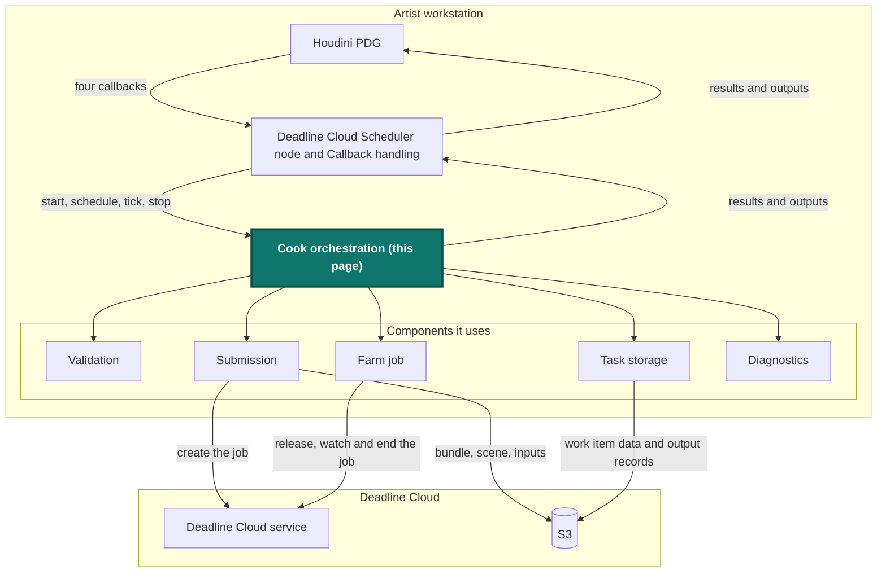
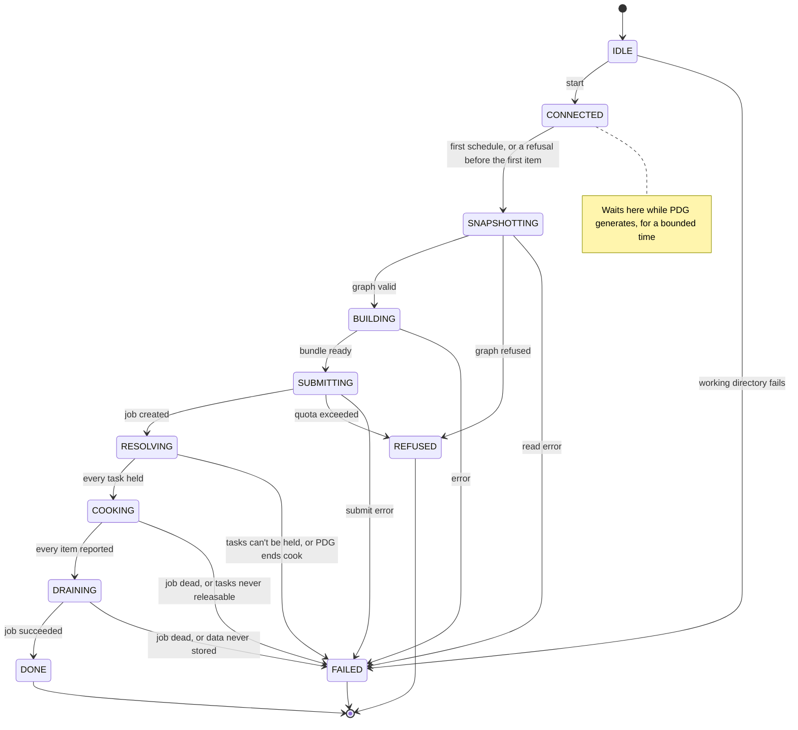
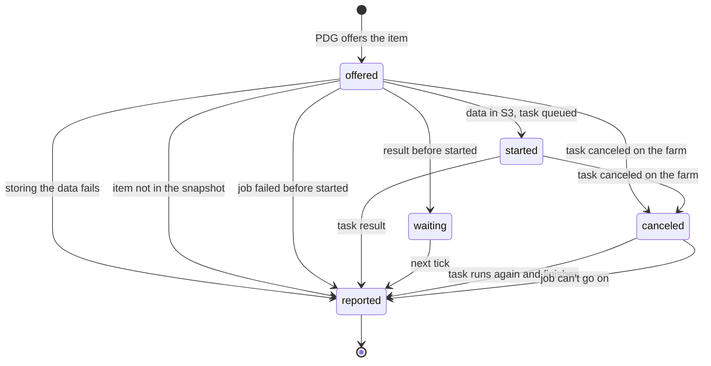
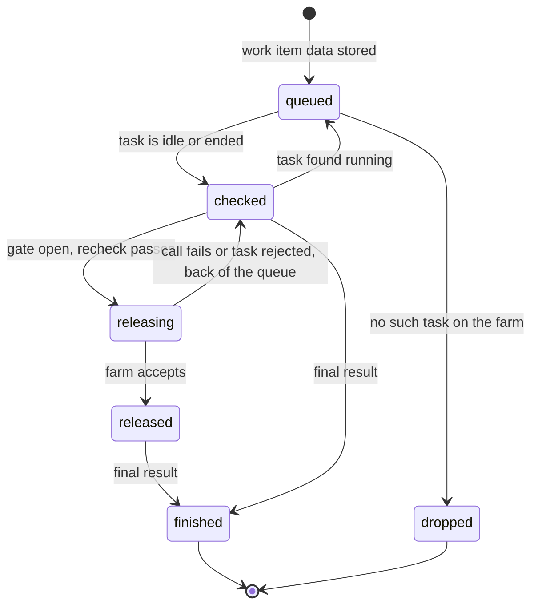
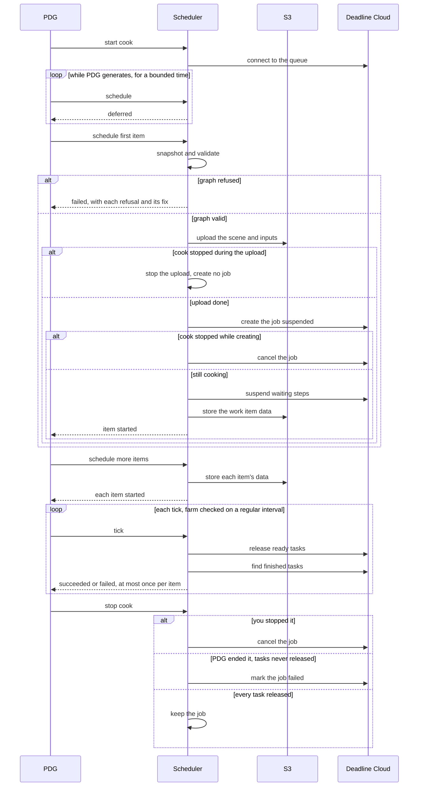

[Back to the overview](../overview.md)

# Cook orchestration

## TL;DR

- A cook is one run of a TOP network, started when you press Cook. Cook orchestration turns each cook into one Deadline Cloud job at most.
- It waits for PDG to finish generating the graph. Then it reads the graph once and validates it.
- When validation refuses the graph, the scheduler creates no job and puts nothing in S3.
- The scheduler creates the job with every task held, so no worker can pick a task up yet. It releases a task once the task's work item data is in S3 and its release gate is open.
- PDG gets one result per work item at most.
- You can stop a cook at any moment. A stop before the upload finishes means no job is created. A job that's created after the stop is canceled right away.
- Once a cook is closed, its phase stays IDLE.

## The problem

- PDG offers work items one at a time while it's still generating the graph. Deadline Cloud needs the whole job when the job is created.
- A task must wait until its work item data is stored. It must also wait until the steps it waits on have finished.
- PDG can call start, stop, schedule and tick at the same time.
- You can stop a cook at any moment, even while the job is being created.

## Where it fits

- Cook orchestration owns one cook from start to stop. It decides the cook's phase, when the job is created, when each task is released, and what PDG is told.
- It hands the work to other components:
  - Validation decides whether the graph is refused.
  - Submission builds the job and creates it.
  - Task storage reads and writes S3.
  - The Farm job talks to Deadline Cloud about the running job.
  - Diagnostics keeps the debug folder.
- It never talks to the worker. The worker only sees the task Deadline Cloud runs and the work item data in S3.

## How it works

A cook runs in two halves. First the scheduler turns the whole graph into one job. Then it feeds that job one work item at a time.

- **Wait.** When you press Cook, the scheduler connects to the farm. Then it waits for PDG to finish generating the graph.
- **Submit once.** On the first work item, the scheduler reads the graph and validates it. Then it creates one job with every task held. If the graph is refused, the cook stops here, and nothing reaches the farm.
- **Feed the job.** For each work item PDG offers, the scheduler stores the item's data in S3. It releases the item's task once every step that task waits on has succeeded.
- **Follow the farm.** On each tick, the scheduler checks the farm and tells PDG about each finished task. The cook is done when every item has a result and the job has succeeded.
- **Stop at any time.** If you stop the cook, the scheduler cancels the job. After the cook closes, it stays closed.

The cook's progress is tracked as a phase. The sections below define the terms, then explain each phase, the release gate, and a work item's life.

### Terms

| Term | What it means |
| --- | --- |
| Cook | One run of a TOP network, from the start PDG sends when you press Cook to the stop PDG sends at the end. For example, cooking a wedge of 10 simulations that feed a render. |
| Generate | PDG making a node's work items without running them. For example, pressing Generate on a node, or PDG making the render node's items at the start of a cook. |
| Work item | One unit of work on a TOP node, such as frame 12 of a ROP Geometry Output. |
| Step and task | In the job, each TOP node that runs on the farm is a step, and each of its work items is a task. Frame 12 of the ROP Geometry Output is one task of the geometry step. |
| Waits on | Step B waits on step A when B depends on A. The dependency comes from a TOP wire, or from B's scene reading a file A writes. For example, the render step waits on the simulation step. |
| Dynamic step | A step whose node makes its work items only while its upstream items cook. Its items don't exist until then. |
| Snapshot | The one read of the graph and the scene, taken at the first work item. Validation and Submission use the snapshot, not the live graph. |
| Refused | Validation or a Deadline Cloud quota says the graph can't be cooked. For example, a step whose node cooks In-Process is refused. |
| Advisory | A warning from Validation. The cook still runs. |
| Quota | A Deadline Cloud service limit, such as the most tasks one step may have. |
| Held task | A task that's suspended on the farm, so no worker picks it up. When the job is created, the tasks of steps that wait on nothing start held. The tasks of steps that wait on other steps start pending, and the scheduler then holds them too. |
| Work item data | What PDG knows about one work item, such as its attributes, its command and the files it expects. The scheduler stores it in S3, and the worker reads it there. |
| Release | Setting a held task to ready, so a worker can pick it up. |
| Tick | One onTick call. PDG calls onTick often while a cook runs. The scheduler checks the farm on a regular interval, so not every tick checks it. |
| Result | What PDG is told at the end of a work item: succeeded, with its outputs, or failed. |
| Retry | When a task fails, the farm can run it again, up to the job's retry limit. |
| Early run | A run of a task the scheduler hasn't released yet. For example, someone sets a held task to ready by hand, and the farm runs it. |
| No fleet can run the task | Deadline Cloud marks a task this way when no fleet on the queue meets the node's Host Requirements. |
| You stop the cook | You cancel the cook in Houdini. |
| PDG ends the cook | PDG sends its stop without you canceling, for example because it has nothing more to cook. |
| Cancel the job | Set the job to canceled on the farm. |
| Mark the job failed | Set the job's tasks to failed on the farm, so no task stays suspended. If Deadline Cloud refuses that, the scheduler cancels the job instead. |
| Close | The stop that ends the cook. The cook's phase becomes IDLE. |
| Debug folder | The folder per cook where Diagnostics keeps the log, the snapshot and the job bundle. |
| Job bundle | The job template and the files it needs. |

### Phases

| Phase | What it means |
| --- | --- |
| IDLE | The cook hasn't started, or it's closed. |
| CONNECTED | The farm is reachable and the working directory is set. The scheduler waits for PDG to finish generating and offer its first work item. |
| SNAPSHOTTING | The scheduler reads the graph and the scene once, and validates them. |
| BUILDING | The graph passed. The scheduler gets the job bundle ready in the debug folder. |
| SUBMITTING | The scheduler writes the job bundle, uploads the scene and inputs, and creates the job, suspended. |
| RESOLVING | The job exists. The scheduler finds which task in the job belongs to each work item. It suspends every step that waits on another step. |
| COOKING | Every task is held. The scheduler stores each work item's data, releases tasks through the release gate, and reports results to PDG. |
| DRAINING | Every work item has a result. The scheduler waits for the job to succeed. |
| DONE | The job succeeded. |
| REFUSED | The graph was refused, so no job was created. |
| FAILED | The cook can't finish. |

### The release gate

Every task of the job starts held. A task's release gate is open when both of these are true:

- Every step the task waits on has succeeded on the farm.
- Deadline Cloud has finished any update to the task's own step.

The scheduler releases a task when all three of these are true:

- PDG has offered the task's work item.
- The work item data is in S3.
- The task's release gate is open.

For example, the render task for frame 12 is released only after PDG offers that work item, its data is in S3, and the simulation step has succeeded.

### A work item's life

1. PDG offers the work item. If the cook is in COOKING, the scheduler stores the work item data in S3 and queues the item's task for release. Then it tells PDG the item started.
2. On a later tick, once the release gate is open, the scheduler releases the task, and the farm runs it.
3. When the task succeeds, the scheduler tells PDG the item succeeded, with its outputs. When the task fails with no retries left, the scheduler tells PDG the item failed.
4. When the task fails and the farm will retry it, the scheduler waits for the retry.
5. When no fleet on the queue can run the task, the scheduler tells PDG the item failed.
6. When the job can't go on, or the work item data can't be stored, the scheduler tells PDG the item failed.

Each item gets one result.

## State machine

The scheduler runs three state machines: the cook's phase, each work item, and each task in the job.

### Cook phases

Every phase also goes to IDLE when the cook closes. The diagram leaves those arrows out to stay readable.

While PDG is still generating, each schedule call returns deferred, and the cook stays in CONNECTED. Waiting doesn't change the phase.

A graph can be refused at four points. At each one, the scheduler creates no job. At the first three, it also puts nothing in S3. At the fourth, the client library has already uploaded the scene and input files before Deadline Cloud refuses the job:

- When the cook starts, the pre-cook checks refuse it before the cook opens.
- In CONNECTED, before the first work item, in either of two cases:
  - While PDG generates, a step's task count passes a quota.
  - PDG ends the cook before offering any work item, and either a step took its work items from cache or the graph has no step that runs on the farm.
- In SNAPSHOTTING, validation refuses the graph.
- In SUBMITTING, a quota stops the job from being created.

Phase table:

| From | To | When | What happens |
| --- | --- | --- | --- |
| IDLE | CONNECTED | The cook starts, and PDG's working directory is set. | Nothing is submitted yet. |
| IDLE | FAILED | The working directory can't be set. | The cook closes. |
| CONNECTED | SNAPSHOTTING | The first schedule call after PDG finishes generating. | When several calls arrive together, only the first one submits. |
| CONNECTED | SNAPSHOTTING, then REFUSED | While PDG generates, a step's task count passes a quota. | The refusal is recorded, and the scheduler asks PDG to cancel the cook. |
| CONNECTED | SNAPSHOTTING, then REFUSED | PDG ends the cook before offering any work item, and a step took its items from cache or no step runs on the farm. | The refusal is recorded. |
| SNAPSHOTTING | BUILDING | The graph and scene are read, and validation passes. | The job can be built. |
| SNAPSHOTTING | REFUSED | Validation refuses the graph. | Each refusal is shown with its fix. Advisories go to the Warning tab. |
| SNAPSHOTTING | FAILED | The graph or scene can't be read, or validation raises an error. | The error goes back to PDG. |
| BUILDING | SUBMITTING | A place for the job bundle is ready in the debug folder. | The job bundle is written, and the job is created suspended. |
| BUILDING | FAILED | An error happens before the move. | The error goes back to PDG. |
| SUBMITTING | RESOLVING | The job is created. | Its tasks are matched to work items next. |
| SUBMITTING | REFUSED | A quota stops the job from being created. | The error goes back to PDG. Nothing is on the farm. |
| SUBMITTING | FAILED | The job can't be created for any other reason. | The error goes back to PDG. There's no job to end. |
| RESOLVING | COOKING | Every task is matched, and every step that waits on another step is suspended. | Releases can start. |
| RESOLVING | FAILED | Tasks can't be matched, steps can't be suspended, or PDG ends the cook. | The job is marked failed once. |
| COOKING | DRAINING | Every expected work item has a result. | The scheduler waits for the job to finish. |
| COOKING or DRAINING | FAILED | The job failed, was canceled or was archived. Or no fleet on the queue can run it. Or the job couldn't be created, updated or uploaded. | Every item without a result is reported failed, once. |
| COOKING | FAILED | PDG ends the cook, and some work items were never offered. | The first few are named, with PDG's reason. The job is marked failed. |
| COOKING or DRAINING | FAILED | PDG ends the cook, and some work item data never reached S3. | The job is marked failed. |
| DRAINING | DONE | The job has succeeded. | The cook ends. |
| any | IDLE | The cook closes. | The job, if there is one, is canceled, marked failed, or kept. The summary is written. |

When two things happen at once, one of them loses:

| Case | What happens |
| --- | --- |
| The cook stops before the upload of the scene and inputs finishes. | The upload stops, and no job is created. |
| The cook stops after the call that creates the job has gone out. | The job that comes back is canceled right away. |
| Two calls fail the cook at the same time. | Only the first one fails the open work items, once. |
| A start arrives while a cook, a generate, or another start is open. | The scheduler ignores the new start and logs a warning. |
| A stop arrives while a start is still connecting. | The start closes the new cook itself. |

### Per work item states

| State | Meaning |
| --- | --- |
| offered | PDG offered the item. The scheduler fails the offer when it's a second offer of the same item, when the job has already failed, when the cook is closed, or when the snapshot doesn't have the item. |
| started | PDG was told the item started. If the job failed in the meantime, the same schedule call that told PDG the item started returns failed. |
| waiting | A result arrived before PDG was told the item started. The scheduler keeps the first result and reports it on the next tick that checks the farm, which comes every few seconds. |
| reported | PDG was told the item succeeded or failed. An item reaches this state once. |
| canceled | The farm canceled the task. The scheduler doesn't tell PDG about the cancel. If the task runs again, its result is reported as usual, and the item leaves canceled. If the job can't go on, the item fails like any other open item. |

- When the work item data can't be stored in S3:
  - The scheduler answers PDG's schedule call with failed.
  - The item's task stays suspended.
  - When PDG ends the cook, the cook ends FAILED.
  - When you stop the cook, the scheduler cancels the job instead.
- When the cook closes, an item that's still open stays without a result. The scheduler tells PDG nothing more about it.

### Per task release states

| State | Meaning |
| --- | --- |
| queued | The work item data is in S3, and the task waits for its release gate. |
| checked | The scheduler has read the task's status since it was queued, and found it idle or ended. It reads the status again just before the release. |
| releasing | The release gate is open. Every step the task waits on has succeeded, and Deadline Cloud has finished any update to the task's own step. |
| released | The farm accepted the release. |
| finished | The task's final result was handed to the cook. The result is succeeded, failed with no retries left, or no fleet on the queue can run it. |
| dropped | The farm has no such task, so nothing is released. |

- The release gate reads step statuses on a regular interval. When a read fails, it keeps the last statuses it read.
- When the farm rejects a release, the scheduler stops releasing for that tick. The rejected task goes to the back of the queue.
- The scheduler finds finished tasks by their end time. Once a minute, it also reads every released task that still has no result, so it doesn't miss a result.

## Invariants

These rules always hold, whatever the implementation does.

### Starting

1. One cook is open at a time at most. A start that arrives while a cook, a generate, or another start is open is ignored.
2. A generate only sets the working directory. A job is created only for a cook.
3. A stop that arrives while a start is still connecting closes the new cook.
4. A start can fail because of a setup error, or because the working directory can't be set. Then each schedule call fails, and the next tick cancels the cook.

### Submission

1. A cook creates one job at most.
2. The scheduler takes the snapshot only after PDG has finished generating.
3. The wait for generation has a time limit. When the limit is reached, the scheduler takes the snapshot anyway.
4. When the scheduler can't tell whether PDG is still generating, it stops waiting and takes the snapshot.
5. The wait leaves out dynamic steps, because a dynamic step generates only once its upstream items cook.
6. When the graph is refused, the scheduler creates no job. A quota that stops the job from being created is one kind of refusal. That refusal comes after the client library has uploaded the scene and input files to S3. Every other refusal comes before anything is stored in S3.
7. Every task of the job is held before any task can be released. The job is created suspended, and then every step that waits on another step is suspended. If either can't be done, the cook ends FAILED and the job is marked failed.
8. The scheduler matches the job's tasks to work items from the job's list of steps. It doesn't list every task in the job.

### Phases

1. Every phase change is a row in the phase table above.
2. When two phase changes race, one wins. The other one changes nothing.
3. Only closing the cook moves it to IDLE. After that, the phase stays IDLE.
4. DONE, REFUSED and FAILED are final. The only move out of them is closing the cook.
5. The cook reaches DONE only after every expected work item has a result and the job has succeeded.
6. After the cook leaves CONNECTED, a schedule call does its work only in COOKING. In any other phase, it returns failed and changes nothing.
7. A work item the snapshot doesn't have fails, and its task isn't queued.

### Callbacks

1. Each part of a tick runs on its own. When one part fails, the other parts still run.
2. The scheduler lets go of its locks before it calls the farm, S3 or PDG. A slow call then can't hold up another callback.

### Release

1. A task is released only when PDG has offered its work item, its work item data is in S3, and its release gate is open.
2. A task is released once at most.
3. Tasks whose release gate is open are released in the order they were queued.
4. A task the farm rejected, or whose release call failed, goes to the back of the queue.
5. An early run's result counts only when the run started after the work item data was stored:
   - When the scheduler first checks a queued task and finds it running or already ended, the run may have started before the data was stored. The scheduler drops that run's result and waits for a later run.
   - When the scheduler first finds the task idle, and the task then finishes before the release, the run started after the data was stored. Its result counts, and the task isn't released.
6. The scheduler checks the farm on a regular interval, not on every tick. It releases tasks in batches of a limited size.
7. When a read of the farm fails or is throttled, the scheduler keeps the last step statuses it read. It tries again on the next tick.
8. The scheduler logs each early run as a gate violation, once per task.

### Reporting

1. PDG gets one result per work item at most: succeeded or failed.
2. A result found on a tick reaches PDG only after PDG was told the item started.
3. When a task fails and the farm will retry it, the scheduler waits for the retry and tells PDG nothing yet.
4. While the job's retry limit is unknown, the scheduler waits for the job's status before it reports a failed task. When the limit is known but a failed task's retry count can't be read, the task is reported failed.
5. When the farm cancels one task, the scheduler tells PDG nothing. If the task runs again, its later result is reported as usual. The item stays canceled only when it never gets another result.
6. When the job can make no more progress, every offered work item without a result is reported failed, once.
7. When PDG rejects a success, the item is reported failed, once.
8. When no fleet on the queue can run a task, the task has failed. Its item is reported failed, once. The message says to add a fleet that matches the node's Host Requirements, or to change them.
9. A result for a task that isn't in the job is ignored and logged.

### Stopping

1. When the cook stops before the upload of the scene and inputs finishes, the upload stops. The call that creates the job never goes out, so no job exists.
2. A job created after the cook stopped is canceled at once.
3. A job is canceled or marked failed once at most.
4. When you stop the cook, the scheduler cancels the job.
5. When PDG ends the cook and some tasks can never be released, the cook ends FAILED and the job is marked failed.
6. When PDG ends the cook and every task was released, the job is kept, because it may still be finishing.
7. After the cook closes, the scheduler records nothing more and reports nothing more to PDG.

## Sequence and errors

In the table, "node error" means the scheduler node shows the error. You also see one popup per cook at most.

| Case | What the scheduler does | What PDG is told | What you see |
| --- | --- | --- | --- |
| The graph is refused when the cook starts, at the snapshot, or by a quota while PDG generates. | Creates no job and stores nothing. | onStartCook returns false, or the item fails, or the stop raises the refusal. | A node error listing each refusal and its fix. |
| A setup error: no farm, no login, no queue, or no access to the S3 bucket. Or the working directory can't be set. | Retries a refused login a few times, then gives up. Any other setup error fails at once. | Each schedule call fails, and the next tick cancels the cook. | A node error with the fix. |
| A quota stops the job from being created. | Ends the cook REFUSED. | The item fails. | A node error saying a service quota was exceeded. |
| The job can't be created for another reason. | Ends the cook FAILED, and keeps the job bundle in the debug folder. | The item fails. | A node error with the fix. |
| Tasks can't be held. | Ends the cook FAILED, and marks the job failed. | The item fails. | A node error naming each step that couldn't be suspended. |
| Work item data can't be stored in S3. | Leaves that task suspended. When PDG ends the cook, ends it FAILED and marks the job failed. When you stop the cook, cancels the job. | That item fails. | A console line. |
| A task fails with no retries left. | Logs it. For the first few failures, the log also shows the end of the worker's log. | The item fails. | An error line and the end of the worker's log. |
| Checking the farm fails or is throttled. | Keeps waiting, and tries again on the next tick. | Nothing. | Warnings in the log. |
| No fleet on the queue can run a task. | Reports the item failed, once. | The item fails. | An error line saying to add a fleet that matches the node's Host Requirements, or to change them. |
| The job can make no more progress. | Ends the cook FAILED. | Each open item fails. | An error line with the counts. |
| PDG rejects a success. | Reports the item failed. | The item fails. | An error line. |
| You stop the cook. | Cancels the job. | Nothing more. | The summary says you stopped it. |

## Where it lives

- Scheduler and Cook: `src/deadline/houdini_pdg/cook.py`
- Farm job interface (port): `src/deadline/houdini_pdg/ports.py`
- Farm job implementation: `src/deadline/houdini_pdg/farm_job.py`

PDG's onStartCook, onSchedule, onTick and onStopCook reach the scheduler calls through the scheduler node.

[Back to the overview](../overview.md)
