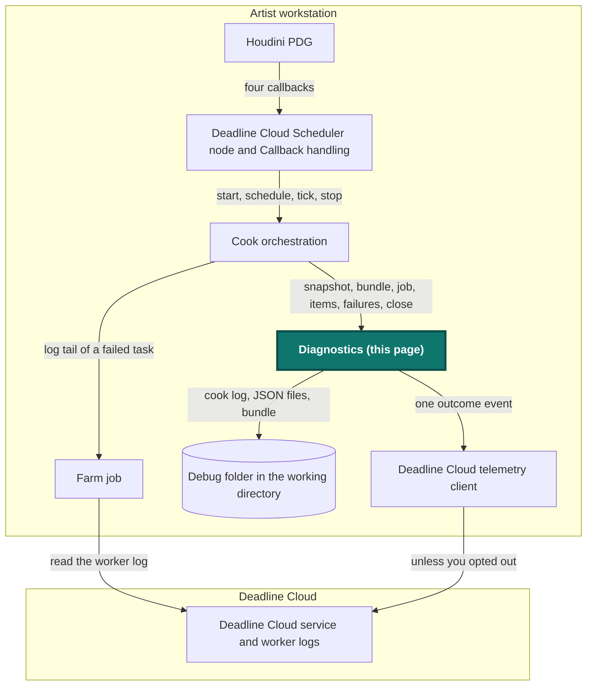
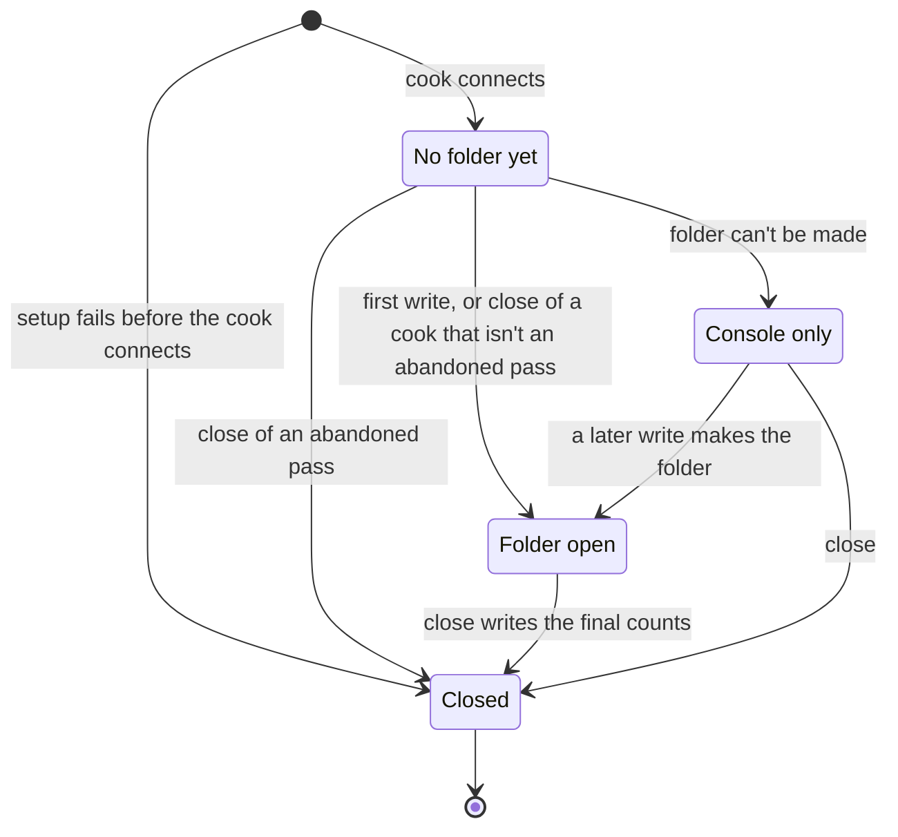
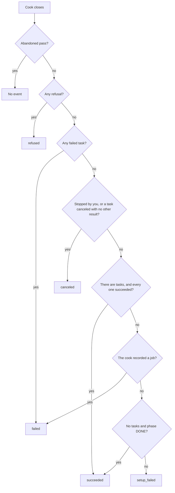
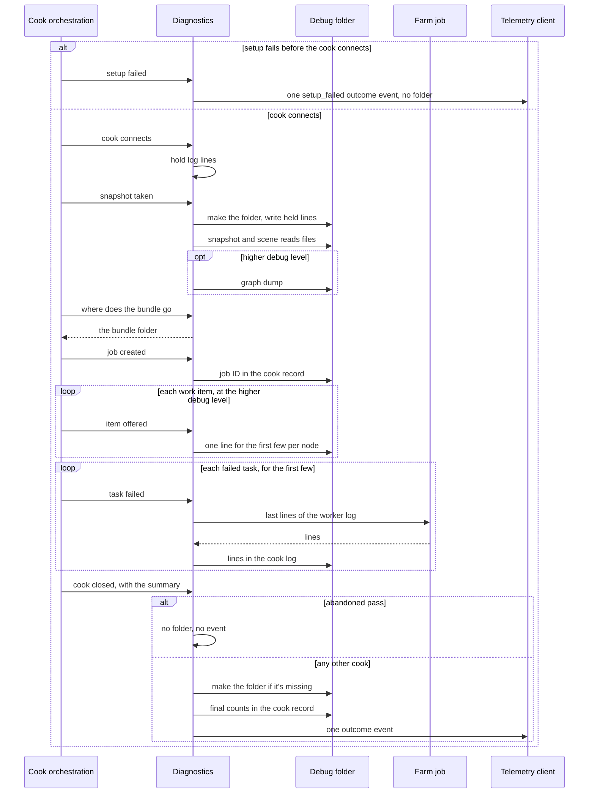

[Back to the overview](../overview.md)

# Diagnostics

## TL;DR

- Diagnostics keeps a record of each cook, so you can explain a failure after the cook has ended.
- Each cook gets its own debug folder in the working directory. The folder holds the cook log, a few JSON files, and the job bundle as submitted.
- The folder is made on the first write. A cook that wrote nothing gets its folder when it closes.
- An abandoned pass leaves no folder. That's a start PDG sends and drops before it offers any work item.
- For the first few failed tasks, the cook log gets the last lines of the worker log.
- Each cook sends one telemetry event with its outcome and counts. The event holds no paths or names. A cook whose setup fails sends one too.
- The telemetry client honors your opt-out.
- When something in diagnostics fails, the cook carries on.

## The problem

- A cook runs across your Houdini, Deadline Cloud and S3, and it can last hours. When it fails, the node error alone rarely says why.
- PDG can start a pass and drop it before it starts the real cook. Each start is a separate cook, but one press of Cook should leave one folder at most.
- The scheduler logs lines before it knows where the folder goes. Every one of those lines should still reach the cook log.
- The team needs to know how cooks end, without learning anything about your scenes or files.

## Where it fits

- Diagnostics owns these parts of one cook:
  - the debug folder, the cook log in it, and the files it writes there
  - the failure log tails
  - the outcome event
- Cook orchestration tells diagnostics what happened. Diagnostics only learns about PDG, the farm and S3 from those reports.
- The worker log comes through the Farm job, and only when diagnostics asks for it.
- The telemetry client belongs to the Deadline Cloud client library. The client decides whether an event is sent.

## How it works

Cook orchestration reports each step of the cook to diagnostics. Diagnostics writes those reports to files in one folder, and at the end it sends one telemetry event.

- **Hold the log.** When the cook connects to the farm, diagnostics starts catching the scheduler's log lines. It holds them in memory until the folder exists.
- **Make the folder.** On the first write, usually the snapshot, diagnostics makes the cook's debug folder. It writes the held lines to the cook log, and then writes every later line straight to it.
- **Record the cook.** Diagnostics writes the snapshot file, the scene reads file and the job bundle. At the higher debug level, it also writes the graph dump and the item details. It notes the job's ID once the job exists.
- **Explain failures.** For the first few failed tasks, diagnostics asks the Farm job for the end of the worker log. It puts those lines in the cook log.
- **Close.** When the cook closes, diagnostics writes the final counts, and makes the folder first if it's still missing. Then it sends one outcome event. An abandoned pass gets no folder and no event.

### Terms

| Term | What it means |
| --- | --- |
| Cook | One run of a TOP network, from PDG's start to its stop. |
| Snapshot | The one read of the graph and scene that Cook orchestration takes at the first work item. |
| Cook ID | The ID a cook gets when PDG starts it, before it connects to the farm. For example, `3f9a2c1b5e7d4a6f8b0c2d4e6f8a0b1c`. When the start checks refuse the graph, no cook is opened, so there's no cook ID. |
| Setup failure | The cook can't connect to the farm. For example, no farm or queue is set, or the scheduler can't reach the queue, the queue role or the S3 bucket. |
| Working directory | PDG's working directory for the TOP network, where PDG also keeps its own `pdgtemp` folder. For example, `/proj/shot010`. |
| Debug folder | One folder per cook, inside the `pdg_debug` folder in the working directory. Its name is the cook's start time in UTC, then the first 8 characters of the cook ID, so the names sort by start time, to the second. For example, `/proj/shot010/pdg_debug/2026-11-25-23-16-40-3f9a2c1b`. |
| Cook log | `orchestrator.log` in the debug folder. It holds every line the scheduler logs during the cook. Each line is stamped with its UTC time. |
| Cook record | `cook.json` in the debug folder. It holds the cook ID, start time, debug level, job ID, final phase, outcome, refusals and counts. Each write adds the new keys, replaces old values for the same keys, and stamps the time. |
| Leaf step | A step that no other step waits on. For example, the encode step at the end of a wedge, render and encode network. |
| Snapshot file | `snapshot.json`. The job's shape as submitted. It has the totals, the leaf steps, and the nodes that didn't become a step. It lists the steps whose PDG work item indices had gaps and were renumbered from 0. For each step, it has the task count and range, the dependencies, the data dependencies, and whether the step declares its outputs. It also has the step's first and last work item, and its work items in task order. |
| Data dependency | A dependency added because one step's scene reads a file another step writes, with no TOP wire between them. |
| Scene reads file | `scene_reads.json`. For each step, it lists the files the step's scene reads and the step each read was matched to. It also lists the data dependencies those reads added. |
| Implied dependency | A dependency that another path already covers. For example, C waits on B, B waits on A, and C also waits on A directly. C's dependency on A is implied. |
| Graph dump | `graph.json`. Everything known about the graph before submission, and why each node became a step or didn't. For each step, it lists the implied wire dependencies a reduction would drop. Data dependencies are always kept, so the list holds only wire dependencies. |
| Item details | `scheduled_items.jsonl` has one line per described work item. Each line compares the work item PDG offered with what generation said about it. A summary file written at close counts the offers. |
| Failure log tail | The last lines of a failed task's worker log, written to the cook log. |
| Outcome event | One telemetry event per cook. It holds an outcome and counts only. |
| Debug level | Standard, or Graph dump and item details. The second level adds the graph dump and the item details. The default is Standard. You set it with the node's parm or with an environment variable. |
| Abandoned pass | A start PDG sends and then drops before the real cook. It didn't fail, and it never got past connecting. It has no job, no refusal, no stop by you, and no steps, tasks or counts. For example, you press Cook, PDG starts a pass and stops it without offering a work item, and then starts the real cook. |

### Outcomes

| Outcome | When |
| --- | --- |
| refused | The graph was refused. That happens at the snapshot, while PDG generated, when PDG ended the cook before offering anything because items were cached or nothing runs on the farm, or by a quota when the job was created. The event lists the kinds of refusal. |
| failed | A task failed. Or the cook recorded a job, but not every task succeeded. |
| canceled | You stopped the cook. Or the farm canceled a task, and its work item got no other result. A canceled task that then ran again and succeeded counts as succeeded. |
| succeeded | Every task succeeded. A cook with no tasks succeeded when it reached DONE. |
| setup_failed | The cook has no job and no refusal, you didn't stop it, and it didn't reach DONE. A cook whose setup fails ends with this outcome. |

## Debug folder states and outcome flow

### Debug folder states

| State | What it means |
| --- | --- |
| No folder yet | Lines are held in memory, up to a limit. Past the limit, the oldest lines are dropped and counted. |
| Folder open | The held lines were written in order. When lines were dropped, the first line says how many. Every later line and file goes into the folder. |
| Console only | The folder couldn't be made. One warning says so. The lines stay in memory and on the console. Each later write tries to make the folder again. |
| Closed | If the folder exists, the cook record has its final counts. If the cook has an outcome event, it was handed to the telemetry client. Nothing more is written. |

- The first write is whichever comes first: the snapshot, the job bundle, or the job's ID. In a normal cook, it's the snapshot.
- When a cook that isn't an abandoned pass closes, it gets a folder even if nothing else was written. The folder holds its cook log and cook record. Some examples:
  - a cook refused while PDG generated
  - a cook PDG ended after offering nothing, which the scheduler refused because items were cached or nothing runs on the farm
  - a cook you stopped before the first work item
- An abandoned pass leaves no folder. Its lines stay on the console.
- A cook whose setup fails before it connects leaves no folder. It still sends its setup_failed outcome event.

### Outcome flow

The questions are asked top to bottom, and the first yes decides the outcome. For example, a cook with a failed task that you then stopped is failed, not canceled.

## Invariants

These rules always hold, whatever the implementation does.

### The debug folder

1. Each cook gets its own debug folder. Two cooks that start in the same second still get two folders.
2. Folder names sort in the order the cooks started, to the second. Two cooks that start in the same second sort by their cook IDs.
3. The folder is made on the first write, not when the cook starts.
4. A cook that connected and wrote nothing gets its folder when it closes. An abandoned pass is the one exception.
5. One press of Cook leaves one folder at most.
6. An abandoned pass leaves no folder, and its lines stay on the console. A cook whose setup fails before it connects leaves no folder either.
7. The job bundle is written inside the folder. When the submission fails, the folder keeps the bundle that explains it.
8. When the folder can't be made, the bundle goes to a temporary folder instead, so the job can still be submitted.

### The cook log

1. While the cook is open, the scheduler's log lines at info level and above reach the cook log.
2. When the cook closes, the scheduler's logger is set back the way it was.
3. Lines logged before the folder exists reach the cook log in the order they were logged, ahead of later lines.
4. The memory for lines held before the folder exists has a limit. When lines are dropped, the cook log's first line says how many.
5. Each line starts with its time in UTC, whatever your time zone.
6. The console shows the same lines whether the folder exists or not.

### The files

1. The cook record holds the last value written for each key. It also holds the time of the last write, in UTC.
2. When the cook record is missing, damaged or not a JSON object, it's read as empty. Writing over it always succeeds.
3. The snapshot file and the scene reads file are written for every cook that takes a snapshot, at every debug level.
4. The graph dump and the item details are written only at the Graph dump and item details level.
5. The debug level defaults to Standard. A valid level in the environment variable wins over the node's parm. An invalid level there is ignored, with a warning.
6. Item details describe only the first few work items of each node. The summary file counts every offer, including the ones not described.
7. Item details are added one line per work item. When a cook dies part way, every complete line is kept.
8. Each of the other JSON files is written whole or not at all. When one file fails to write, the others are still written.
9. The graph dump shows each step's dependencies exactly as submitted.

### Failure log tails

1. The scheduler fetches a failed task's worker log tail only for the first few failures of a cook. The cook log says once when that limit is reached.
2. When a tail can't be read, or is empty, the cook log says so.
3. The same limit bounds how many worker logs are read from the farm.

### The outcome event

1. A cook sends one outcome event at most. An abandoned pass sends none.
2. Every cook that has a cook ID and isn't an abandoned pass sends exactly one.
3. A cook whose setup fails before it connects sends setup_failed.
4. The outcome comes from the counts, in the order of the outcome flow.
5. The phase decides the outcome only for a cook with no job, no refusal, no stop by you, and no tasks.
6. The event carries the outcome, the kinds of refusal, whether a job was submitted, and the counts. Paths, scene names, job IDs and free text stay out of it.
7. Diagnostics sends the event through the telemetry client it's given. That client honors your telemetry opt-out.
8. A generate, which only makes work items, has no cook record and sends no event.

### Never failing the cook

1. When a call to diagnostics fails, the failure is logged, and the cook goes on.
2. When writing a log line fails, the code that logged the line carries on as usual.
3. When telemetry fails, the cook carries on as usual.

## Sequence and errors

| Case | What diagnostics does | What you see |
| --- | --- | --- |
| The folder can't be made, or no working directory is set. | Keeps lines on the console and puts the bundle in a temporary folder. Skips each file, and tries to make the folder again on the next write. | One warning in the console. |
| A JSON file can't be written, other than the cook record or item details. | Skips that file and writes the others. | A warning naming the file. |
| An item details line can't be written. | Skips the line and goes on. | Nothing. |
| The cook record can't be written. | Skips the write and goes on. | Nothing. |
| The cook record is damaged. | Reads it as empty and writes a new one. | Nothing. |
| A log line can't be written. | Drops the line. | Nothing. |
| Too many lines come before the folder exists. | Drops the oldest lines. | The cook log's first line says how many were dropped. |
| A worker log can't be read. | Goes on. | A warning naming the task. |
| A worker log is empty. | Goes on. | A warning that the queue role may lack access to the logs, or the log expired. |
| The telemetry client fails, or isn't available. | Sends nothing. | Nothing. |
| PDG's work item can't be read for item details. | Describes the item from what the scheduler already knows. | The line says where the description came from. |
| Setup fails before the cook connects. | Sends one setup_failed outcome event, and makes no folder. | The node error and console lines. |
| The start checks refuse the graph. | Nothing, because no cook was opened. | The node error and console lines. |

## Where it lives

- Diagnostics: `src/deadline/houdini_pdg/diagnostics.py`
- Built for each cook, with the telemetry client: `src/deadline/houdini_pdg/houdini_plugin/pdg/types/deadlinecloud/__init__.py`
- Debug level read from the node and the environment: `src/deadline/houdini_pdg/houdini/host.py`

[Back to the overview](../overview.md)
