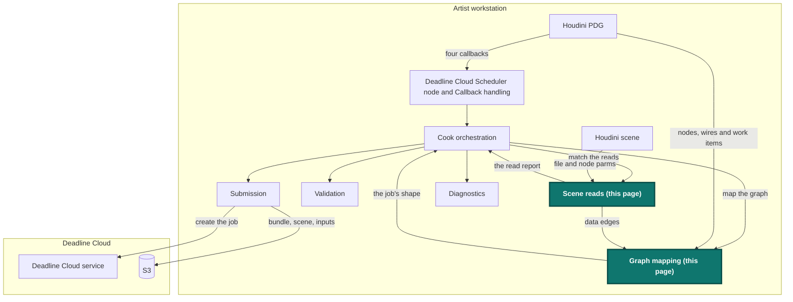
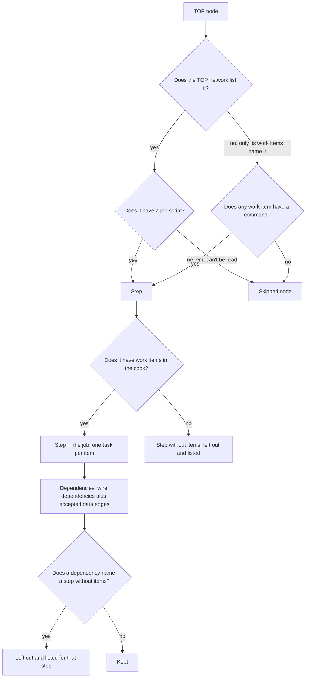
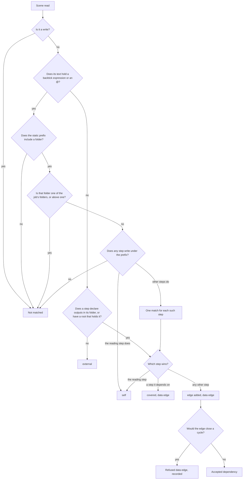
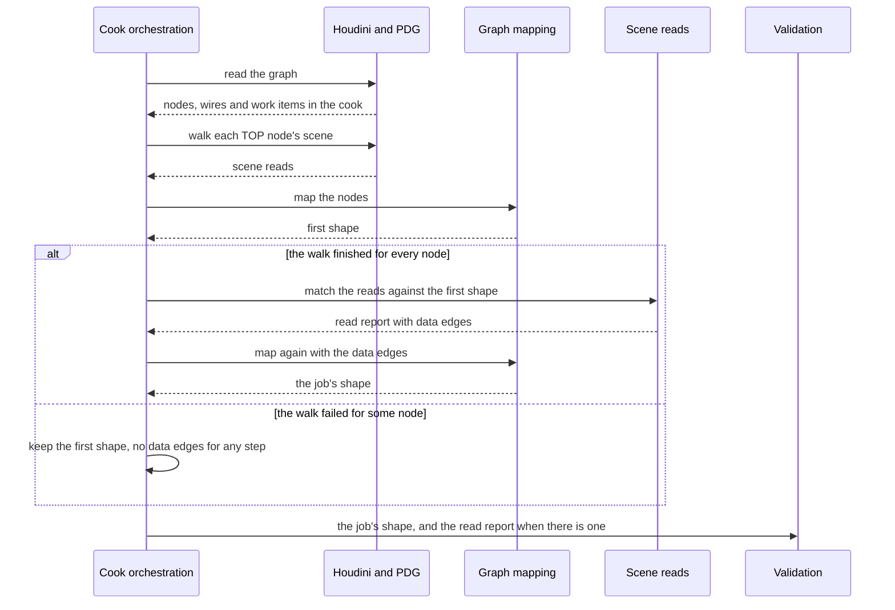

[Back to the overview](../overview.md)

# Graph mapping and scene reads

## TL;DR

- Graph mapping turns the TOP network PDG has generated into the shape of one Deadline Cloud job: its steps, their tasks, and the dependencies between steps.
- A TOP node is a step when it runs a job script on a worker. Each of its work items is one task, and tasks are numbered from 0 with no gaps.
- A step depends on the nearest steps wired above it, through any nodes that aren't steps.
- Scene reads find the files each node's scene opens and the step that writes each one. When no wire connects the two, they add a data edge, so the worker gets the files it needs.
- Mapping never refuses a graph and never raises. It records what it left out, and Validation decides whether that's a problem.

## The problem

- PDG knows the graph as nodes, work items and wires. Deadline Cloud wants steps, tasks and step dependencies, fixed before the job is created.
- Some nodes only make or regroup work items, such as a Wedge or a partitioner. They run nothing on the farm, but they sit between the steps that do.
- A step's scene can read a file another step writes, with no TOP wire between them. A worker only gets files from the steps its own step depends on, so a missing edge means a missing file.
- When the cook starts, PDG may not have generated every node yet, and the cook may cover only some of the generated work items.

## Where it fits

- Graph mapping and Scene reads run on the workstation, inside the cook's first schedule, before anything is uploaded.
- They only read. They never talk to Deadline Cloud or S3, and they never change the scene.
- Cook orchestration calls them, Validation judges what they return, Submission builds the job from it, and Diagnostics records it in the debug folder.
- The Scheduler node's Submit button and the checks at cook start use the same reads, so every check counts steps the same way.

## How it works

Mapping runs in two passes around the scene reads.

- **Read the graph.** Read every TOP node from the network, with its wires and settings, and the work items PDG has generated.
- **Read the scene.** Walk each TOP node's scene and collect the file parms it evaluates.
- **Map once.** Turn the nodes into steps and tasks, with the dependencies the wires give.
- **Match the reads.** Find the step that writes each read file, and note which steps need a new edge.
- **Map again.** Map the graph a second time with those data edges added. The result is the job's shape, which the cook validates and submits.

If the walk fails for any node, the job gets no data edges at all. The cook keeps the first map, and Validation says which checks didn't run. A walk that stops at its limit still counts, and its reads are used.

### Terms

The examples on this page use a scene saved as `/proj/shot/shot.hip`, so `$HIP` is `/proj/shot`. The Scheduler node's Working Directory parm is left at `$HIP`.

| Term | What it means |
| --- | --- |
| Step | A TOP node that runs a job script on a worker. A node the TOP network lists is a step when it has a job script. A node that only its work items name is a step when one of its work items has a command. That happens when the network doesn't list the node. |
| Skipped node | A TOP node that isn't a step, such as a Wedge or a partitioner. It maps to nothing. |
| Task | One work item of a step. Its task index is its place in the step, counting from 0, ordered by PDG's index and then by name. PDG's own index is kept beside it. |
| Cook set | The nodes this cook covers. During a cook, it's the set PDG gives when the cook starts. When Submit checks the graph, the scheduler builds the set itself, from the display node and every node wired above it. The display node is the node with the display flag. When the set can't be read, it's unknown. An empty set from PDG counts as unknown too. |
| In the cook | A work item is in the cook when PDG will schedule it in this cook. For example, when you cook a ROP node, PDG schedules that node's items and the upstream items they need. PDG doesn't schedule items that stay uncooked or dirty, or items an earlier cook already cooked, failed or canceled. Those items aren't in the cook. Whether a whole node is in the cook is set out under "Reading the graph". |
| Step without items | A step that has no work items in the cook. It's left out of the job and listed. |
| Cached item | A work item PDG took from an earlier cook's files instead of cooking it. Cached items are kept aside so Validation can refuse their step. A node the cook set names keeps its cached items, even when all of its items came from cache and so none of them is in the cook. |
| Wire dependency | A step's nearest steps above it in the TOP network, reached through any skipped nodes. |
| Scene read | One file parm that the scene walk finds for a TOP node. The walk covers every TOP node, both steps and skipped nodes. It keeps the parm's authored text, its value on the workstation, and whether it's a read or a write. |
| Read | A scene read whose parm names a file the node opens. For example, a File SOP whose Geometry File parm is `$HIP/geo/a.bgeo` reads `/proj/shot/geo/a.bgeo`. |
| Write | A scene read whose parm names a file the node creates. For example, a Geometry ROP whose Output File parm (`sopoutput`) is `$HIP/geo/out.bgeo` writes `/proj/shot/geo/out.bgeo`. A File Cache's Geometry File parm is the one exception. It stays a read even while the node writes it, because the steps that load the cache read the same parm. |
| Plain read | A read whose authored text holds no backtick expression and no `@`. Its full path is known on the workstation, such as `$HIP/geo/a.bgeo`. |
| Work-item read | A read whose authored text holds a backtick expression or an `@`. Its full path is known only for one work item, such as `$HIP/geo/@wedgenum.bgeo`. |
| Static prefix | For a work-item read, the authored text before the first backtick or `@`, with Houdini variables expanded. For example, `$HIP/geo/@wedgenum.bgeo` has the static prefix `/proj/shot/geo/`. It's empty when the text starts with the expression, or when it can't be expanded. |
| The job's folders | The folders the job uploads. They are the folder in the Scheduler node's Working Directory parm, on its PDG tab, and each folder in its Output Directories list, on its Job Attachments tab. When a task ends, every file it wrote in these folders is uploaded, so the steps below it can download it. For example, with Working Directory `$HIP` and one output directory `/renders/shot`, the job's folders are `/proj/shot` and `/renders/shot`. |
| Declared output | A file a step's work item says it will write. PDG's `__PDG_DIR__` token is replaced by the working directory, and environment variables are expanded. For example, with `SHOT` set to `sh010`, `__PDG_DIR__/geo/$SHOT.bgeo` becomes `/proj/shot/geo/sh010.bgeo`. For a work item PDG took from cache, the files PDG found are used instead of the files it expected. Only outputs with a folder count. |
| Root | The deepest folder that holds all of a step's output folders. For example, a step that writes into `/proj/shot/geo/cache/wedge0` and `/proj/shot/geo/cache/wedge1` has the root `/proj/shot/geo/cache`. A step has no root when that folder is one of the job's folders or above one, or when its outputs mix absolute and relative paths. |
| Producer | A step whose declared outputs cover a read. A producer has its output folders and, usually, a root. |
| Verdict | How a read relates to the reading step: **self** (its own output), **covered** (written by a step it already depends on), **edge added** (written by a step it didn't depend on) or **external** (no step writes it). |
| Data edge | A dependency a covered or edge-added read asks for. Covered reads count too, so a wire that carries files is kept. |
| Refused data edge | A data edge left out because it would close a cycle. |

### Kinds of path

How a path is matched depends on how it's written. The examples use the scene above.

| Kind | Example | What matching uses | Matched as |
| --- | --- | --- | --- |
| Plain absolute path | `/proj/shot/geo/a.bgeo` | the folder `/proj/shot/geo` | a plain read, by its folder |
| Path with a portable prefix | `$HIP/geo/a.bgeo` | the value on the workstation, `/proj/shot/geo/a.bgeo`, so the folder `/proj/shot/geo` | a plain read, by its folder |
| Path with another variable | `$JOB/geo/a.bgeo` | the value on the workstation, with `$JOB` expanded | a plain read, by its folder |
| Path with a work item attribute | `$HIP/geo/@wedgenum.bgeo` | the static prefix `/proj/shot/geo/` | a work-item read, by its prefix |
| Path with a backtick expression | ``$HIP/geo/cache.`$F+1`.bgeo`` | the static prefix `/proj/shot/geo/cache.`, which ends inside a file name | a work-item read, by its prefix |
| Path with a PDG token | `__PDG_DIR__/geo/a.bgeo`, in a work item's declared outputs | `/proj/shot/geo/a.bgeo`, with the token replaced by the working directory | a declared output, used to find the step that writes a read |

### Reading the graph

- Which nodes exist, how they're wired, and whether each one is a step come from the TOP network itself, because generation may not have reached every node yet.
- Work items, their commands, their declared files and their attribute names come from what PDG generated.
- A wire through a subnet with no PDG node of its own continues from the subnet's display node. When the subnet has no display node, it continues from the nodes wired into the subnet.
- When no TOP network can be read at all, each node's wiring comes from its work items' dependencies instead.
- A work item whose node the network doesn't list is still kept. Whether that node is a step is decided by its items' commands.
- Each node also carries the settings Validation checks.
- The graph is read in two situations. The cook reads it at its first schedule, and then only work items in the cook become tasks. Submit reads it after it generates the work items, and then every generated item becomes a task.

Whether a node is in the cook depends on its items and on the cook set. A node that isn't in the cook is outside the cook.

| The node | Cook set known | Cook set unknown |
| --- | --- | --- |
| Has items in the cook | in the cook | unknown |
| Generated items, but PDG left all of them out of this cook | outside the cook | outside the cook |
| Generated no items, and the cook set names it | in the cook | unknown |
| Generated no items, and the cook set doesn't name it | outside the cook | unknown |

The second row applies only when the cook reads the graph. When Submit reads it, every generated item counts as in the cook.

### Matching a read

- Writes aren't matched. Only reads are matched to the step that writes their file. If writes were matched, two File Copy nodes that write one sequence at different frame offsets would each seem to read the other's files.
- A plain read is matched by its folder. A step that declares outputs in exactly that folder wins. Otherwise the step with the deepest root that holds the folder wins. The reading step wins a tie.
- A work-item read is matched by its static prefix. Every step that declares an output whose path starts with the prefix is a producer, and each one gets its own match and data edge. If the reading step is one of them, the read is its own, with one self match and no edge.
- A root or prefix that is one of the job's folders, or above one, would cover every file the job writes, so it isn't used. For example, a step that writes `/proj/shot/geo/a.bgeo` and `/proj/shot/render/a.exr` would have the root `/proj/shot`, which is the working directory. That step has no root, so a read matches it only in `/proj/shot/geo` or `/proj/shot/render`. In the same way, the read ``$HIP/`@name`.bgeo`` has the prefix `/proj/shot/`, so it matches no step. The read `$HIP/geo/@wedgenum.bgeo` has the prefix `/proj/shot/geo/`, which is below the working directory, so it's matched.
- Reads by skipped nodes are matched the same way but kept apart, and they add no data edge.

## Decision flow

Graph mapping and scene reads have no state of their own. They answer two questions for every node and every read.

### Is a node a step, and what does it become

### How a read is matched

## Invariants

### Reading the graph

1. A node the TOP network lists is a step exactly when it has a job script. A node that only its work items name is a step when one of its work items has a command.
2. A node whose job script can't be read isn't a step.
3. For every node the TOP network lists, when the network can be read, whether the node is a step and how it's wired never depend on how far PDG has got with generating. Generating more items can only move a step from the steps without items into the job.
4. When the cook reads the graph at its first schedule, only work items in the cook become tasks. When Submit reads the graph after generating its work items, every generated item becomes a task.
5. When the cook set is known, a node with items in the cook is in the cook, even when the cook set doesn't name it. PDG reads the cook set when the cook starts, before the nodes inside an HDA exist, so the set can miss them.
6. When the cook reads the graph, a node that generated items but has none in the cook is outside the cook, whatever the cook set says. For example, when you cook node B, its upstream node A may hold only items an earlier cook cooked. A is then outside the cook.
7. When the cook set is known, a node with no items in the cook is in the cook when the cook set names it, and outside the cook when it doesn't. Rule 6 comes first, so a node it puts outside the cook stays outside.
8. When the cook set is unknown, rule 6 still puts nodes outside the cook. For every other node, whether it's in the cook is unknown, even when it has items in the cook.
9. When the cook reads the graph, a node's cached items are kept aside when the cook set names the node, or when the node still has items in the cook. When the cook set is unknown, every node's cached items are kept aside.

### Steps and tasks

1. Every node is exactly one of: a step in the job, a step without items, or a skipped node.
2. A skipped node adds no step and no task.
3. A step has one task per work item. Task indices run from 0 with no gaps, and each task keeps PDG's own index.
4. A step is listed as remapped when its PDG indices aren't already 0 to N-1.
5. Steps are listed dependencies first. Steps that are ready together are listed alphabetically, and steps without items still count when the order is worked out. Steps in or below a wire cycle are listed alphabetically at the end.
6. The job's shape doesn't depend on the order the nodes are read in.
7. Looking up a step or a task that doesn't exist returns nothing. It never raises.

### Dependencies

1. A step depends on its nearest steps upstream, through any chain of skipped nodes, and never on itself.
2. A cyclic or dangling wire never stops mapping.
3. A data edge is added only between two different steps. An edge that would close a cycle is refused and recorded, and an edge already wired counts as accepted.
4. No dependency is ever pruned, even when a longer path implies it, because a worker only gets files from its step's direct dependencies.
5. A step's dependencies are its wire dependencies plus its accepted data edges, minus any on a step without items, which are listed instead.
6. A step's data dependencies are the accepted data edges that are still among its dependencies.

### Scene walk

1. The walk starts at the TOP node and follows node references and input wires.
2. It enters children only inside the TOP node's own subtree, and never enters another TOP node.
3. It visits each scene node once and stops at a limit, so it always ends.
4. A scene read is a file parm with a value on the workstation. Parms that aren't data, such as labels and pre or post scripts, are left out. So are values that name something inside Houdini.
5. A parm that names a file the node creates is marked as a write. A File Cache's Geometry File parm is the one exception. It stays a read even while the node writes it, because the steps that load the cache read the same parm.
6. When a parm only copies another parm's text, the read takes the copied text, and `$OS` names the node that holds it.
7. A walk that fails for any node marks the reads incomplete. The job then gets no data edges, for any step.
8. A walk that stops at its limit isn't a failure. Its reads are used.

### Matching reads

1. Writes aren't matched to any step. Only reads are.
2. A plain read in one of the reading step's own output folders is self. A work-item read is self when the reading step writes under its prefix.
3. A read is covered exactly when its producer is already a dependency of the reading step.
4. Data edges come only from covered and edge-added matches.
5. Folder tests compare whole folder names, so `/a/bc` isn't inside `/a/b`. The prefix test is the one exception. It compares text, so the prefix `/proj/shot/geo/cache.` matches `/proj/shot/geo/cache.0001.bgeo`.
6. A step has no root when the deepest folder that holds all its output folders is one of the job's folders, or above one. The step still matches reads in its exact output folders. For example, a step that writes into `/proj/shot/geo` and `/proj/shot/render` has no root, because `/proj/shot` is the working directory.
7. A work-item read whose prefix folder is one of the job's folders, or above one, matches no step. For example, the prefix `/proj/shot/` matches nothing, and the prefix `/proj/shot/geo/` can match.
8. A work-item read adds no match when its prefix can't be expanded, or when no step writes under it.
9. Reads by skipped nodes add no data edge.

### Never failing

1. Mapping never refuses a graph. Every choice about whether the shape can be cooked belongs to Validation.
2. Reading the graph, walking the scene and matching reads never raise. An unreadable value is treated as unknown or empty.

## Sequence and errors

| Case | What happens | What you see |
| --- | --- | --- |
| No TOP network can be read | Wiring comes from the work items' dependencies | nothing |
| A node's job script can't be read | The node isn't a step | nothing, unless Validation finds a problem |
| A work item's node isn't in the network | The node is kept, and its items decide whether it's a step | it shows in the graph dump |
| A step has no work items in the cook | It's left out and listed, and so are dependencies on it | Validation decides whether to refuse |
| A data edge would close a cycle | The edge is refused and recorded | Validation decides whether to refuse |
| The scene walk fails for any node | The reads are marked incomplete, and the job gets no data edges for any step | a warning in the log, and Validation says which checks didn't run |
| The scene walk hits its limit | The walk stops for that node, and the reads it found are still used | a warning in the log |
| A static prefix can't be expanded | The read isn't matched by its prefix | nothing |

## Where it lives

- Graph mapping: `src/deadline/houdini_pdg/graph.py`
- Scene reads, matching: `src/deadline/houdini_pdg/scene_reads.py`
- Reading PDG and the scene: `src/deadline/houdini_pdg/houdini/readers.py`

The readers take PDG and Houdini objects as they come and never import either, so the rest stays plain Python.

[Back to the overview](../overview.md)
