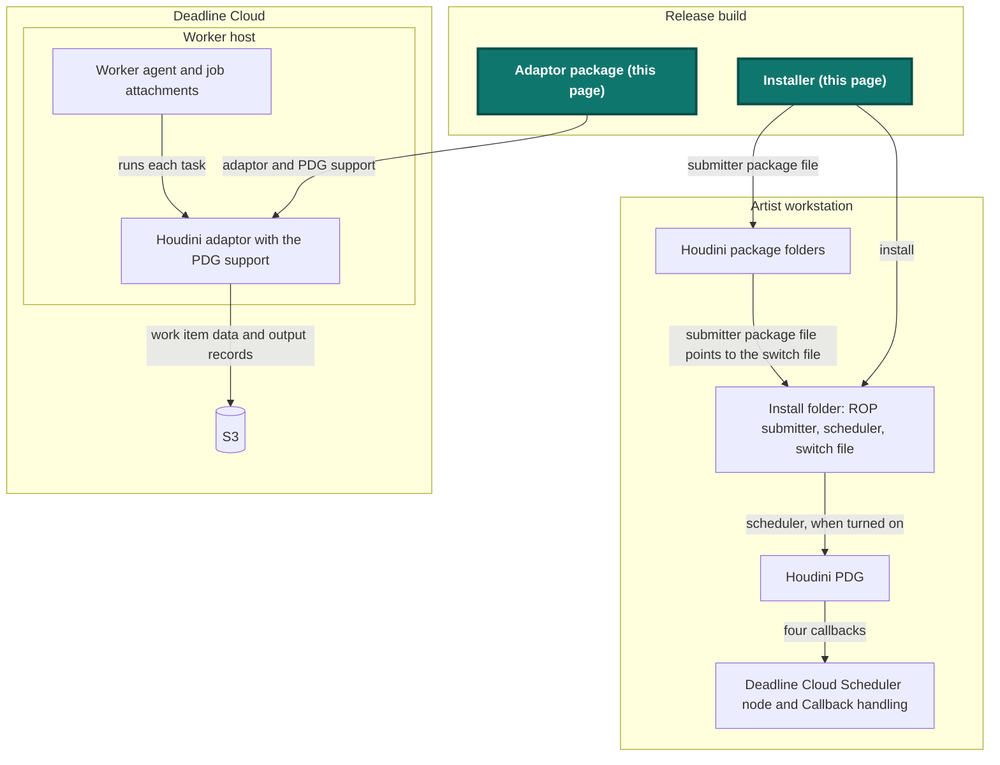
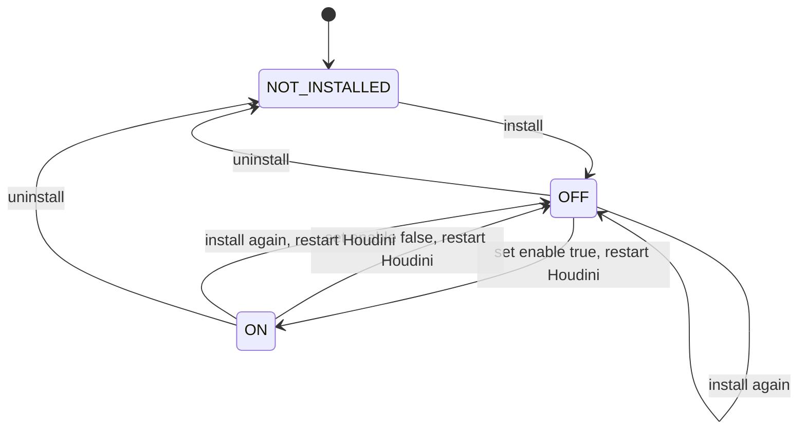
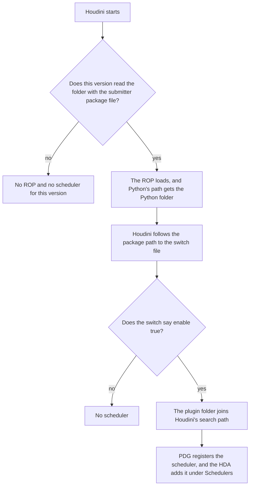
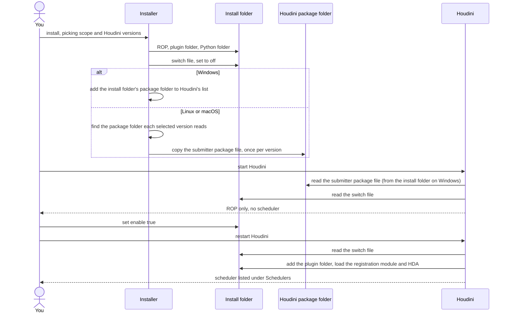

[Back to the overview](../overview.md)

# Packaging and install

## TL;DR

- The Installer ships the scheduler with the ROP submitter, in the same component, turned off.
- One switch file in the install folder turns the scheduler on. You set `"enable": true` in it and restart Houdini. Then Deadline Cloud Scheduler (Experimental) shows up under Schedulers in a TOP network's Tab menu.
- The one switch file serves every Houdini version that reads the install, for a user install and a system install alike. Installing again sets it back to off. Uninstalling removes it.
- A Houdini version sees the scheduler only when it reads the folder that holds the submitter's package file. The installer puts that file where each selected version reads it.
- The Adaptor package carries the scheduler's Python package to workers. It leaves out the submitter code.

## The problem

- The scheduler is experimental, so a studio should choose to show it. It stays out of everyone's TOP menu until someone turns it on.
- The scheduler needs the ROP submitter's code and its Python dependencies, which the installer already ships. A second install would load the ROP twice.
- Houdini reads package files only when it starts. A value set in one package file can't turn another package on or off. So the switch has to be the `enable` value in the scheduler's own package file.
- Workers need the scheduler's work item data and output record code, but they have no Houdini UI and no submitter.

## Where it fits

- The Installer owns what lands on the workstation: the install layout, the switch file, and where the submitter package file goes for each Houdini version.
- The Adaptor package owns what lands on the worker: the Houdini adaptor and the scheduler's Python package.
- Both do their work before any cook runs. They decide whether Houdini can find the scheduler, and whether the worker can run its tasks.

## How it works

The installer ships the scheduler turned off. Houdini picks it up through the submitter's package file, once you turn the switch on and restart Houdini.

- **Build.** The release build makes the installer and the adaptor package from the same source.
- **Install.** The installer puts the ROP submitter and the scheduler in the install folder. It writes the switch file, set to off. Then it makes each Houdini version you picked read the submitter package file.
- **Turn on.** You set `"enable": true` in the switch file and save it.
- **Start Houdini.** Houdini reads the submitter package file and follows it to the switch file. When the switch is on, Houdini adds the plugin folder to its search path. PDG then registers the scheduler, and the HDA adds its Tab menu entry.
- **Reinstall or uninstall.** Installing again puts the switch back to off. Uninstalling removes the install folder, and the switch file with it.

### Terms

| Term | What it means |
| --- | --- |
| Install folder | The folder the installer puts the submitter in. The Deadline Cloud submitter installer installs submitters for several applications. With it, the install folder is the Houdini folder inside that installer's folder. |
| Install scope | User or system. A user install is for you only. A system install is for everyone on the machine, and it needs admin rights. Editing a system install's files needs admin rights too. |
| Package file | A JSON file Houdini reads when it starts. It adds folders to Houdini's search path and sets environment variables. |
| Houdini package folder | A folder Houdini reads package files from. Each Houdini version has its own, such as `~/houdini20.5/packages` for Houdini 20.5 on Linux. |
| Submitter package file | The ROP submitter's package file. It puts the ROP on Houdini's search path, puts the install folder's Python folder on Python's path, and names the folder that holds the switch file. |
| Switch file | The scheduler's own package file, in the install folder. Its `enable` value turns the scheduler on or off. |
| HDA | The file that defines the scheduler node in Houdini: its icon, parameters, help and Tab menu entry. |
| Registration module | The module PDG loads when Houdini starts, to register the scheduler type. |
| Plugin folder | The folder that holds the scheduler's registration module and HDA. It's on Houdini's search path only while the switch is on. |
| Python folder | The install folder's Python folder. It holds the ROP's modules, their dependencies, and the scheduler's Python package. |
| Adaptor package | The worker's copy of the Houdini adaptor and its dependencies, built from the same source as the scheduler. |

### Where the submitter package file goes

The scheduler follows the submitter package file, so this table also says which Houdini versions can see the scheduler.

| OS | Scope | Where it goes |
| --- | --- | --- |
| Windows | user or system | It stays in the install folder. The installer adds that folder to Houdini's package folder list, for you or for the machine. So every Houdini version reads it. |
| Linux, macOS | user | A copy goes into the package folder that each selected version reads in your Houdini preferences. When `HOUDINI_USER_PREF_DIR` is set where the installer runs, the copy goes into the `packages` folder inside it instead. Any `__HVER__` in it is replaced by that version's number. |
| Linux, macOS | system | The installer finds where each selected version is installed on the machine. It puts a copy in the package folder that installed version reads. It ignores `HOUDINI_USER_PREF_DIR`. |

Here's where the copy for Houdini 20.5 goes in each case:

| Case | Package folder |
| --- | --- |
| Linux, user install | `~/houdini20.5/packages` |
| macOS, user install | `~/Library/Preferences/houdini/20.5/packages` |
| User install, with `HOUDINI_USER_PREF_DIR` set to `/studio/prefs/houdini__HVER__` | `/studio/prefs/houdini20.5/packages` |
| Linux, system install, with Houdini 20.5 installed in `/opt/hfs20.5.410` | `/opt/hfs20.5.410/packages` |
| Windows, either scope | The install folder, which every version reads |

- Each selected version gets its copy in the folder that version reads. So every selected version that's installed sees the scheduler once the switch is on.
- You can choose the package folder for each version when you install.
- An unattended install places the file the same way as an interactive one.
- In either scope, the installer looks for each selected version. When one isn't installed on the machine, it warns you and names the version.
- For a version that isn't installed, a user install still writes that version's copy. A system install skips that version and creates no package folder for it.

## Install states

| State | What it means |
| --- | --- |
| NOT_INSTALLED | No install folder and no submitter package file. Houdini lists neither the ROP nor the scheduler. |
| OFF | The ROP is installed, and Houdini last started with the switch off. The plugin folder isn't on Houdini's search path, so no TOP network lists the scheduler. |
| ON | Houdini last started with the switch on. The scheduler is listed under Schedulers in a TOP network's Tab menu. |

- An edit to the switch file changes nothing until Houdini starts again.
- The state is per install, not per Houdini version. Each version that reads the submitter package file is in the same state.

### How Houdini finds the scheduler

## Invariants

These rules always hold, whatever the implementation does.

### Install layout

1. The installer installs the scheduler with the ROP submitter, as part of the same component. There's no separate choice for it.
2. Houdini finds the scheduler's registration module and HDA only through the switch file.
3. The Python folder holds the scheduler's Python package. The plugin folder's files are kept apart, in the plugin folder.
4. The installer ships exactly one switch file, set to off, inside the install folder.
5. The submitter package file names the folder that holds the switch file. That's how Houdini finds the switch file, and the scheduler adds no environment variable of its own.

### Turning on and off

1. While the switch says off, the scheduler is missing from every TOP network's Tab menu.
2. After you set the switch on and restart Houdini, Deadline Cloud Scheduler (Experimental) is listed under Schedulers in a TOP network's Tab menu.
3. A change to the switch takes effect only when Houdini starts again.
4. One switch file serves every Houdini version that reads the install, in a user install and a system install alike.

### Houdini versions

1. The installer offers the scheduler for exactly the Houdini versions it offers the ROP for.
2. A Houdini version sees the scheduler only when it reads the folder that holds the submitter package file.
3. On Windows, every Houdini version reads that folder.
4. On Linux and macOS, the installer copies the submitter package file into the package folder each selected version reads. It does this for user and system installs. You can choose each folder.
5. A system install finds where each selected version is installed and copies the file into that version's package folder.
6. A system install writes only into package folders that already exist. It leaves every user's preference folders alone.
7. In either install scope, the installer looks for each selected version. When a version isn't installed on the machine, the installer warns you and names the version.
8. For a version that isn't installed, a user install still copies the file. A system install skips that version and copies no file for it.
9. A user install that uses `HOUDINI_USER_PREF_DIR` replaces `__HVER__` in it with each version's number. For example, `/studio/prefs/houdini__HVER__` becomes `/studio/prefs/houdini20.5` for Houdini 20.5.
10. An unattended install places the submitter package file the same way as an interactive one.

### Reinstall and uninstall

1. Installing again sets the switch back to off.
2. Uninstalling removes the install folder, and the switch file with it. It also removes every copy of the submitter package file the installer made.
3. On Windows, uninstalling also takes the install folder's package folder off Houdini's package folder list.
4. After an uninstall, Houdini lists neither the ROP nor the scheduler.

### Imports

1. In an installed Houdini, the scheduler uses the ROP code the installer ships, and nothing else.
2. Houdini loads the ROP once.

### Worker package

1. The adaptor package carries the scheduler's Python package, so the worker reads work item data and writes output records with the same code as your workstation.
2. The adaptor package leaves out the submitter code.
3. The modules the worker loads run without importing the ROP submitter.

### Development checkout

1. A development install, from a copy of the source code, writes one package file. That file puts both the ROP and the plugin folder on Houdini's search path.
2. So in a development install the scheduler is always on, and there's no switch to edit.
3. The development package file puts the source code on Python's path, so the scheduler runs from the source code.

## Sequence and errors

| Case | What happens | What you see | What to do |
| --- | --- | --- | --- |
| A Houdini version doesn't read the folder with the submitter package file | Nothing from the install loads in that version | No ROP and no scheduler in that version | Install again and pick that version's package folder |
| A user install, and a selected Houdini version isn't installed on the machine | The installer still copies the submitter package file for that version | A warning naming the version. Once that version is installed, it sees the ROP and the scheduler | Nothing, or install that Houdini version |
| A system install, and a selected Houdini version isn't installed on the machine | The installer skips that version. It creates no package folder and copies no file for it. | A warning naming the version. When that version is installed later, it has no ROP and no scheduler. | Install that Houdini version, then install again |
| The switch is on, but Houdini hasn't restarted | Nothing changes | No scheduler yet | Restart Houdini |
| The switch file is in a system install | Saving it needs admin rights | The editor refuses to save | Edit it as an admin |
| You installed again | The switch is back to off | The scheduler is gone after the next start | Set the switch on again and restart |
| You uninstalled | The install folder and the package file copies are removed | No ROP and no scheduler | Nothing |
| You uninstall a system install without admin rights | The uninstaller stops and removes nothing | A warning that a system install needs an admin to uninstall | Run the uninstaller as an admin |

## Where it lives

In the repository:

- Installer component: `install_builder/deadline-cloud-for-houdini.xml`
- Submitter package file: `packages/deadline_submitter_for_houdini.json`
- Switch file: `packages/pdg_scheduler/deadline_cloud_pdg_scheduler.json`
- Plugin folder source: `src/deadline/houdini_pdg/houdini_plugin/`
- Adaptor package: `pyproject.toml` (wheel contents) and `scripts/create_adaptor_packaging_artifact.sh`
- Development install: `scripts/install_dev_submitter.py`

In the install folder:

| Path | What it holds |
| --- | --- |
| `pdg_scheduler/pdg/types/deadlinecloud/__init__.py` | The registration module |
| `pdg_scheduler/otls/deadline_cloud_scheduler.hda/` | The scheduler HDA |
| `python/deadline/houdini_pdg/` | The scheduler's Python package, with `_version.py` and without `houdini_plugin/` |
| `deadline_package/deadline_submitter_for_houdini.json` | The submitter package file |
| `deadline_package/pdg_scheduler/deadline_cloud_pdg_scheduler.json` | The switch file |

On the worker, the adaptor package holds `deadline/houdini_adaptor/` and `deadline/houdini_pdg/` with their dependencies, and no `deadline/houdini_submitter/`.

[Back to the overview](../overview.md)
