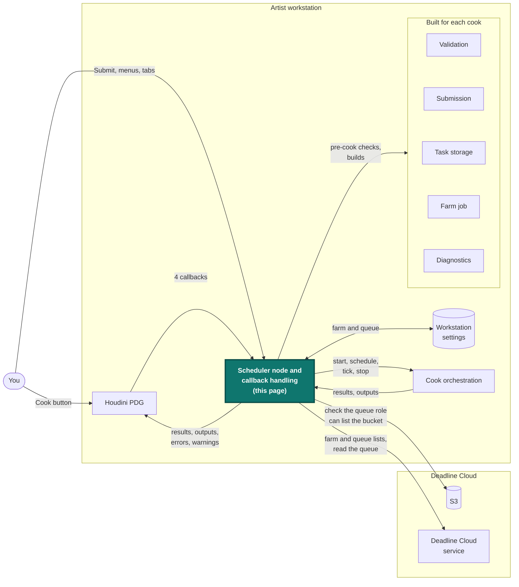
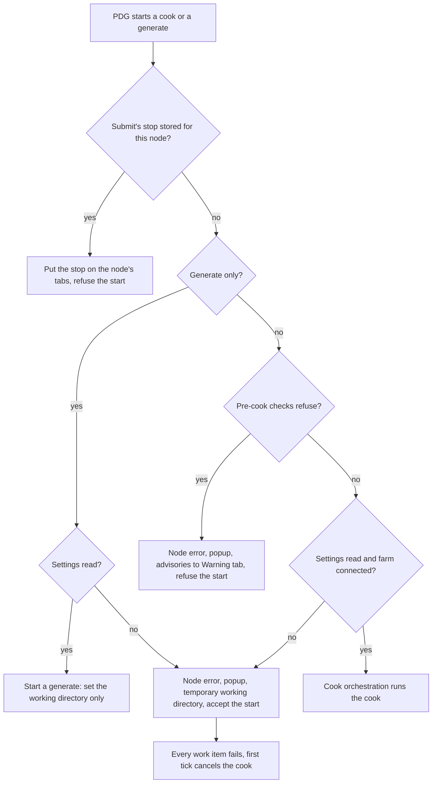
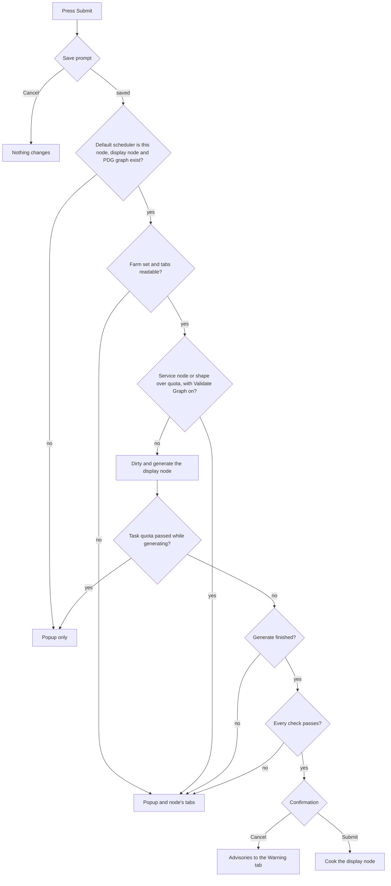
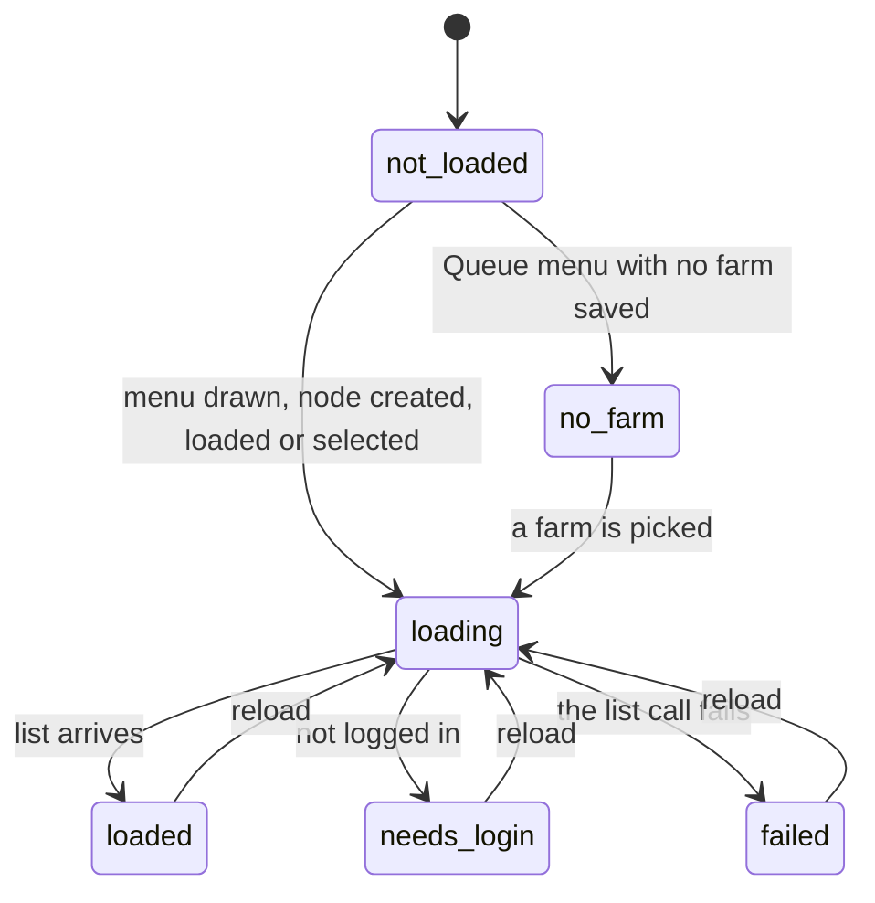
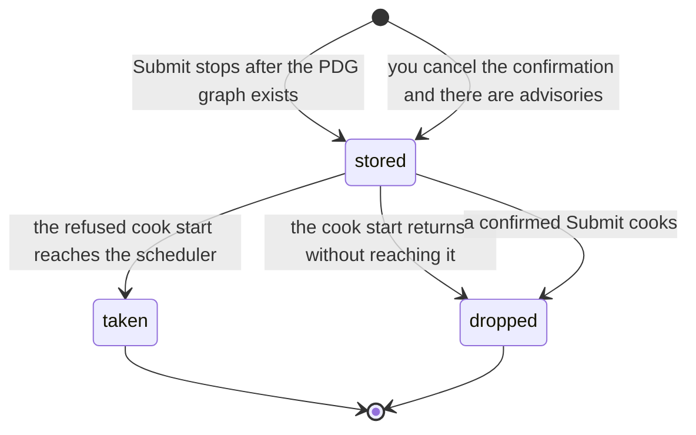
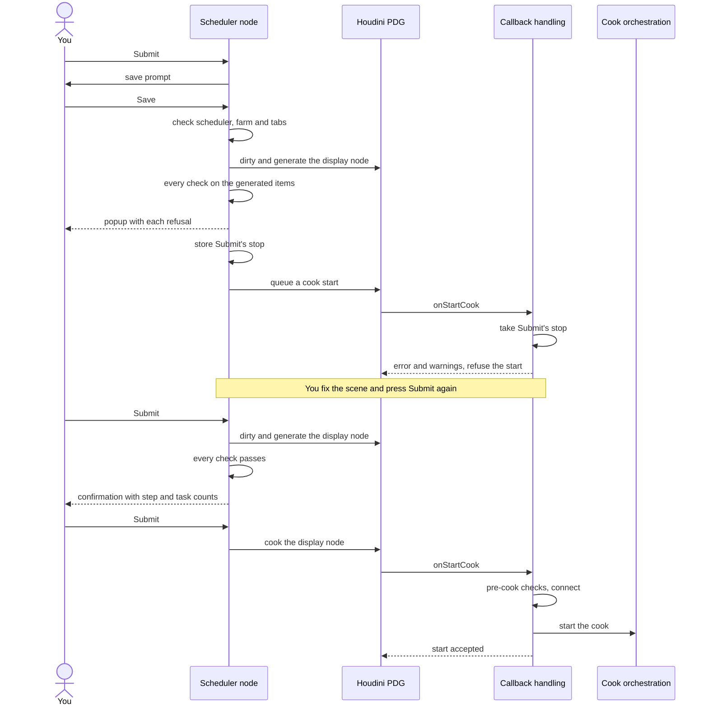

[Back to the overview](../overview.md)

# Scheduler node and callback handling

## TL;DR

- The Deadline Cloud Scheduler (Experimental) is a TOP scheduler node. Its tabs hold the job's settings, the farm and queue, the cook's PDG settings, extra job attachments and host requirements.
- Callback handling sits between PDG and the cook. It starts one cook each time PDG starts one, and passes PDG's four callbacks on. It catches every error and shows it on the node, so PDG only ever gets a clear answer.
- You can start a cook two ways: with PDG's own Cook buttons, or with the node's Submit button. Both run the same checks. When the checks refuse the graph, the cook doesn't start and no job is created.
- Submit generates the network's work items, checks them all, and asks you to confirm before it cooks.
- Every refusal or setup error goes on the node's error tab, and in at most one popup per cook. Warnings go on the node's Warning tab.
- The Farm and Queue menus show lists that load in the background, so drawing a menu is instant. The farm or queue you pick is saved as your workstation default.

How a cook runs after it starts is in [Cook orchestration](cook-orchestration.md).

## The problem

- PDG talks to a scheduler only through callbacks. When a scheduler can't start, PDG itself shows only "Failed to start scheduler". The reason shows only when the scheduler puts it on its node.
- An error that escapes a callback can leave PDG's cook in a confusing state. A dialog opened from PDG's thread can freeze Houdini.
- PDG's Cook button checks nothing before the cook starts. An artist wants to see every problem, and the job's size, before anything is uploaded.
- An artist needs to pick a farm and queue on the node, the way they do on the Deadline Cloud ROP. Houdini must stay responsive while the lists load.

## Where it fits

- The node is what you see in Houdini. Callback handling is the scheduler class PDG calls. They're on one page because the node's buttons and PDG's callbacks share the same checks and the same way of showing errors.
- Callback handling builds each cook's parts and hands them to Cook orchestration, which runs the cook.
- The farm and queue always come from your workstation settings, as for the ROP. The node only shows and changes them.

## How it works

The node holds your settings and starts the cook, and callback handling turns PDG's four callbacks into one cook that Cook orchestration runs.

- **Set up the node.** You fill in the node's tabs and pick a farm and queue. The node keeps its settings in its own parms, so they're saved with the scene.
- **Start a cook.** Either press PDG's Cook button, or press Submit. Submit checks everything first, shows the job's size, and asks you to confirm.
- **Check at the start.** When PDG starts a cook, the scheduler runs the pre-cook checks before it connects to anything. When the checks refuse the graph, the scheduler tells PDG not to start.
- **Connect.** The scheduler reads the farm and queue from your workstation settings, and reads the queue from Deadline Cloud. It checks that the queue role can use the queue's job attachments bucket. Then Cook orchestration takes over.
- **Pass the callbacks on.** Every later callback goes to the open cook. An error is caught, logged and shown on the node.

### Terms

| Term | What it means |
| --- | --- |
| Display node | The TOP node in the network whose display flag is on. Submit generates and cooks it. |
| Cook set | The TOP nodes a cook runs. For PDG's Cook button, PDG names them. For Submit, it's the display node and every node wired above it. |
| Refusal | A problem that stops the cook before anything is uploaded, such as a dynamic node. Each refusal names the node and the fix. |
| Advisory | A warning that doesn't stop the cook, such as a node whose files may be missing on the worker. |
| Setup error | A problem found while the cook connects or reads its settings, such as no farm set, a login error, or a bad parm value. |
| Pre-cook checks | Validation's checks on the network before a cook, plus a check that the scene is saved. When the work items haven't been generated yet, only the checks that need nothing but the nodes, wires and parms run. |
| Service node | A TOP node that cooks its items through a PDG service, a set of Houdini processes PDG keeps running. Generating its items starts those processes. |
| Job shape quota | A farm limit that the nodes and wires already show, such as steps per job or dependencies per step. |
| Dirty | Mark a node's work items as out of date, so PDG makes them again on the next generate. Submit keeps the files the items wrote. |
| Node error | The text on the scheduler node's error tab. The scheduler sets it through PDG, so it shows like any other cook error. |
| Warning tab | The scheduler node's Warning tab. The scheduler sets it through PDG, like a cook warning. Advisories go here. |
| Popup | An error dialog. It's queued on Houdini's main thread, so PDG's thread doesn't wait for you to close it. |
| Submit's stop | The error text and advisories of a Submit that stopped. They're kept for that scheduler node until a cook start takes them. |
| Refused cook start | A cook start that Submit queues for one reason: so the scheduler can put Submit's stop on the node's tabs. PDG shows a node error or warning only when the scheduler sets it while PDG is starting a cook. A message set from the Submit button itself is dropped. So Submit queues a cook start, and the scheduler sets the message during that start and then refuses it. |
| Workstation defaults | The farm, its Region and the queue saved in the Deadline Cloud workstation settings. The ROP and the CLI share them. |

### The node's tabs

| Tab | What it holds |
| --- | --- |
| Shared Job Settings | Job name, description, priority, failed tasks limit, task retry limit and max worker count. Then Farm and Queue menus, Settings and Update Queue Parameters, then the queue's parameter folders, then Submit. |
| PDG | Working directory, debug level (Standard, or Graph dump and item details), Validate Graph, automatic scene save, and adaptor wheels. |
| Job Attachments | Extra input files, extra input directories and extra output directories. |
| Host Requirements | Any worker, or custom requirements that apply to every step. |

- Settings, Update Queue Parameters and the queue parameter fields work the same way as on the ROP. Login and Logout are hidden.
- When a node is created, or its scene loads, the node lays out its parms as the installed node definition does. The queue parameter fields and their values are kept. Then the node runs the queue parameter update.
- The count fields are plain integer fields with no slider.

### The callbacks

| PDG callback | What callback handling does | What PDG gets back |
| --- | --- | --- |
| `onStartCook` | Takes Submit's stop if there is one. Otherwise checks a cook, builds one cook, and starts it. | False to refuse, True otherwise |
| `onSchedule` | Hands the work item to the open cook. | Succeeded or Deferred from the cook, and CookFailed for anything else |
| `onTick` | Hands the tick to the open cook. | SchedulerReady, or SchedulerCancelCook after a failed start |
| `onStopCook` | Closes the cook and drops it. | True |

### Submit

Submit does, in order:

- Asks you to save unsaved changes. Always Save turns on automatic save for this node.
- Checks that the network's Default TOP Scheduler is this node. Checks that the network has a display node and a PDG graph.
- Checks that a farm and queue are set, and reads the node's tabs. So a bad value shows before anything generates.
- Refuses a Service node in the cook set, or a job shape over a quota, before it generates.
- Dirties the display node's work items, keeping their files, and generates them. When a step passes its task quota while generating, the generate stops.
- Stops if the generate didn't finish.
- Runs every check on the generated items.
- Shows one confirmation: farm, queue, job name, priority, working directory, step and task counts, host requirements and extra attachments, with advisories under the details.
- On Submit, cooks the display node. If a cook is already running, PDG cancels it and its job first, and then the new cook starts.

### Farm and Queue menus

- Each menu shows names and stores the farm or queue ID. The first entry means none selected.
- A menu only reads a list that Houdini keeps for the session. A list that isn't loaded yet loads in a background thread. Only one thread loads each list at a time.
- Lists start loading when a menu is drawn, and when a scheduler node is created, loaded or selected. They load again after Settings or Update Queue Parameters.
- Until its list arrives, a menu shows the current value by name, then "Loading...".
- When you pick a different farm or queue from the list, it's saved the same way the Deadline Cloud client's own farm and queue pickers save it. Then the node runs its queue parameter update.
- A farm pick also clears the queue, and starts loading the new farm's queues.

## Decision flows and states

The node has two decision flows, a cook start and Submit, and two small state machines: each menu's list, and Submit's stop.

### Cook start

| Outcome | What PDG sees | What you see |
| --- | --- | --- |
| Submit's stop taken | The start is refused | Submit's error on the error tab, its advisories on the Warning tab, no second popup |
| Graph refused | The start is refused, so PDG starts nothing, not even a Service node's processes | Node error listing each refusal and its fix, one popup, advisories on the Warning tab |
| Setup error | The start is accepted, each item fails, and the first tick cancels | Node error with the fix, one popup |
| Started | The cook runs | Nothing yet |

### Submit

- "Popup and node's tabs" stores Submit's stop and queues a refused cook start.

### Menu list

Each list has these states. The farm list is one list, and each farm has its own queue list.

| State | What the menu shows |
| --- | --- |
| not_loaded, loading | The current value by name, or its ID when no name is known, then "Loading..." |
| loaded | None selected, then every farm or queue by name |
| needs_login | The current value, then "Log in with Deadline Cloud Monitor or `deadline auth login`" |
| failed | The current value, then the error |
| no_farm | The current value, then "Choose a farm first" |

- A reload comes from Settings or Update Queue Parameters. A farm pick reloads that farm's queues. A reload keeps the names already seen.
- When the saved farm's queue list arrives, every scheduler node's Queue menu is updated. When the saved queue is in the list, Queue shows it. When it isn't, Queue shows none selected.
- When the queue list needs a login or failed to load, Queue keeps showing the saved queue.

### Submit's stop

- A stop is kept only until its refused cook start returns. Whatever that cook start does, the stop is removed when it returns. So the next cook you start yourself begins with no old stop.

## Invariants

These rules always hold, whatever the implementation does.

### The node

1. The node's settings live in its own parms and are saved with the scene.
2. The farm and queue are the one exception. They're saved as your workstation defaults, not in the scene.
3. Creating a node or loading its scene lays out its parms as the installed node definition does. The queue parameter fields keep their values, and the definition's own parms keep theirs.
4. Laying out the parms makes no farm or login call. So the tabs are right even when you aren't logged in.
5. Submit stays the last item in Shared Job Settings, below the queue parameter folders.
6. Login and Logout are hidden.

### Callbacks

1. Every callback catches its own errors. PDG gets a return value from each callback, never an exception.
2. Every callback failure is logged with its traceback. It's shown on the node in words an artist can act on.
3. At most one cook is open at a time.
4. When you press Submit or cook again while a cook runs, that cook stops first and its job is canceled. So a new start always finds no cook open.
5. Each start builds a fresh cook. Nothing carries over from the last one.
6. A generate isn't checked, doesn't connect to the farm, and creates no job.
7. When a cook start fails with a setup error, PDG's start is still accepted. Then every work item fails, and the next tick cancels the cook. PDG gets a temporary working directory, which is removed when the cook stops.
8. PDG keeps the output files of an item from an earlier cook. Before PDG is told that the item started, those files are cleared, so the item's outputs are only this cook's.
9. When that clear fails, a warning is logged and the cook goes on.
10. PDG's local and remote working directories are always set to the same path.
11. Every output reported to PDG has checksum 0.
12. When Houdini has a UI, PDG's callbacks read the graph, the scene and the settings on Houdini's main thread.

### Starting a cook

1. When the checks refuse the graph, the scheduler refuses PDG's start. PDG then starts nothing, including a Service node's processes.
2. The pre-cook checks run before any farm call.
3. When Validate Graph is off, refusals are shown as advisories and the cook goes on.
4. A scene that was never saved is always refused, even with Validate Graph off. A scene with unsaved changes is refused, even with Validate Graph off, when Houdini has a UI.
5. A login error while reading the queue is retried a few times, because a login renewal may still be finishing. Any other error fails the start at once.
6. The start checks that the queue role can list the queue's job attachments bucket. When the queue role isn't allowed to list it, the start fails before anything is uploaded.
7. When that check fails for any other reason, the error is logged and the cook goes on.
8. The scheduler reads the queue and opens the queue role's session once per cook, when the cook starts. Every part of the cook uses that queue and that session.
9. A generate reads no queue and opens no session.
10. Creating the job is the one exception to rule 8. The client library reads the queue and opens its own session to upload the job's files.

### Submit

1. The save prompt comes first. Cancel there leaves everything as it was, including the node's tabs.
2. Submit checks the same graph PDG would cook. Before it generates, it dirties the display node's items, keeping their files.
3. When the cook set has a Service node, or the job shape is over a quota, Submit stops before it generates.
4. When Validate Graph is off, Submit goes on and generates in both of those cases.
5. Every refusal is shown together, in one popup, before any confirmation.
6. After a refused Submit, the only cook start is the refused cook start, which creates no job.
7. The confirmation shows the step and task counts. When the scheduler can't be found, it says the counts come when the cook starts.
8. Submit sets the node error and warnings only through a refused cook start.
9. Submit passes no state to the cook it starts. The cook runs its own checks.

### Showing errors

1. A cook's refusal or setup error is always on the node's error tab.
2. A Submit stop is on the error tab too, except in two cases, where it's shown only in the popup:
    - Submit stopped before the network had a PDG graph. A cook start then could run on another scheduler, or build the graph itself.
    - Submit stopped because a step passed its task quota during Submit's generate. The cook start after the canceled generate doesn't reach the scheduler.
3. Each cook shows at most one popup. When Houdini has no UI, it shows none.
4. A popup runs apart from PDG's thread, so PDG keeps going while it's open.
5. A refusal message has one line per refusal, each naming the node and the fix.
6. For a refusal or a setup error, a cook's node error and popup start with "Deadline Cloud Scheduler (Experimental): ". An unexpected error starts with a different first line. Submit's popup and error tab may start with "The cook can't start." instead.
7. After that first line comes Validation's refusal text: a header line, then one line per refusal.
8. Advisories go to the Warning tab once per Submit or cook. A confirmed Submit sends none, because the cook it starts sends the same ones.
9. When a warning can't be set, the failure is logged and the cook goes on.

### Farm and Queue menus

1. Drawing a menu reads only the lists Houdini already has. The network calls happen in the background.
2. At most one thread loads each list at a time. Lists load only in a Houdini session with a UI.
3. Until the list arrives, a menu's first entry is the current value. So the menu shows the right name while the list loads.
4. A pick changes the workstation defaults only when it's a farm or queue from the list, different from the saved one.
5. For any other pick, such as "Loading..." or the saved one again, the menu goes back to the saved ID.
6. A pick saves exactly what the Deadline Cloud client's own pickers save, in the same order. It also clears the default storage profile.
7. When a queue list arrives, Queue is set only on nodes whose value changes. So a scene that just opened stays marked as saved.

### Settings

1. A running cook uses the PDG tab and output folder settings it read when it started. A change made while it runs applies to the next cook.
2. The job settings, host requirements and listed input files and folders in the job are the ones read when the job is created.
3. When a parm is missing from the node, it takes its default, and that's logged once per node.
4. A bad value fails with an error that names the parm. These values are bad:
    - an empty working directory
    - a working directory or output folder with a variable that isn't set
    - a debug level that isn't one of the two levels
    - an output folder that is a whole drive or a home folder, or that holds one, such as `/home`
    - a listed input that matches no file
    - a host requirement the client library refuses
5. A valid debug level in an environment variable is used instead of the parm. An invalid one is ignored with a warning.
6. Houdini evaluates the working directory and output folder parms first, and the result is made absolute. The table below shows each kind of path.
7. An output folder that is the working directory, is inside it, or holds it is refused. The error names the folder's parms.
8. When one output folder holds another, both are refused with one error that names the parms of both.
9. Some output folders share only "/" with the working directory or with another output folder, such as `/renders/shot` and `/proj/shot/pdgwork`. Such a folder is refused when the queue's storage profile puts both in the same local location, or in none. Job attachments would then put the root of the job's files at "/". The error names each folder and its parm.
10. When the storage profile puts the two folders in different local locations, such as `/proj` and `/renders`, the folder is accepted.
11. A Windows drive or share root doesn't count as "/". So `C:/proj/pdgwork` and `C:/renders`, which share only `C:/`, are accepted.
12. Host requirements: memory and GPU memory are typed in GiB and sent in MiB. A number of -1 means not set. A requirement group with nothing set is left out of the job.

How each kind of path in the Working Directory or an output folder parm is read, with the scene saved at `/proj/shot/a.hip`:

| Typed in the parm | What the cook uses |
| --- | --- |
| A plain absolute path, `/proj/shot/pdgwork` | `/proj/shot/pdgwork` |
| A path with a portable prefix, `$HIP/pdgwork` | `/proj/shot/pdgwork` |
| A path with a variable that isn't set, `$SHOT_ROOT/pdgwork` | Refused. The error names the parm. |
| A path with a backtick expression, `` `chs("../shotdir")`/pdgwork `` | The expression's result, such as `/proj/sh010/pdgwork` |
| A relative path, `pdgwork` | Made absolute from Houdini's current folder |
| A path from your home folder, `~/pdgwork` | Your home folder, then `pdgwork` |

How an output folder compares with the working directory `/proj/shot/pdgwork`, when the storage profile has no local locations:

| Output folder | What it shares with the working directory | Result |
| --- | --- | --- |
| `/proj/renders` | `/proj` | Accepted |
| `/proj/shot/pdgwork/renders` | It's inside the working directory | Refused |
| `/proj/shot` | It holds the working directory | Refused |
| `/renders/shot` | Only "/" | Refused |

## Sequence and errors

A Submit that is refused after the generate, then fixed and confirmed:

| Case | What the node does | What PDG is told | What you see |
| --- | --- | --- | --- |
| You cancel the save prompt, or cancel the confirmation when there are no advisories | starts nothing | nothing | nothing |
| You cancel the confirmation when there are advisories | stores Submit's stop | a refused cook start | the advisories on the Warning tab |
| The network cooks on another scheduler, or has no display node or PDG graph | starts nothing | nothing | popup with the fix |
| No farm or queue set, or a tab value is bad | stores Submit's stop | a refused cook start | popup and node error naming the parm |
| A Service node, or a job shape over a quota | stores Submit's stop, generates nothing | a refused cook start | popup and node error with each refusal |
| A task quota passed while Submit generates | cancels the generate | nothing | popup only |
| The generate didn't finish | stores Submit's stop | a refused cook start | popup and node error saying to fix the node errors, or naming the steps with no items |
| The checks on the generated items refuse | stores Submit's stop | a refused cook start | popup, node error, advisories on the Warning tab |
| You press Submit or cook again while a cook runs | lets PDG stop the running cook, which cancels its job, then starts the new cook | stop with cancel, then a new start | the old job canceled, the new cook running |
| PDG's Cook button and the graph is refused | refuses the start | start returns false | node error, one popup, advisories on the Warning tab |
| Setup error at the start (no farm, login, queue, bucket, or a bad setting) | accepts the start, fails each item | each item fails, the first tick cancels | node error with the fix, one popup |
| The queue role can't list its job attachments bucket | fails the start before anything is uploaded, as a setup error | each item fails, the first tick cancels | node error naming the queue and the bucket, saying to add list permission on the bucket to the queue role |
| A later callback fails | logs it | the item fails, or the tick goes on | node error, one popup per cook |
| A farm or queue list can't load | keeps the menu usable | nothing | the login entry or the error in the menu |

## Where it lives

- The node definition (parms, help, Tab menu entry, button callbacks, create and load scripts): `src/deadline/houdini_pdg/houdini_plugin/otls/deadline_cloud_scheduler.hda/Top_1deadlinecloudscheduler/`
- Callback handling and the scheduler type's registration: `src/deadline/houdini_pdg/houdini_plugin/pdg/types/deadlinecloud/__init__.py`
- Submit, the pre-cook checks, the menus, the node layout and the settings reads: `src/deadline/houdini_pdg/houdini/host.py`
- The settings value: `src/deadline/houdini_pdg/houdini/settings.py`

[Back to the overview](../overview.md)
