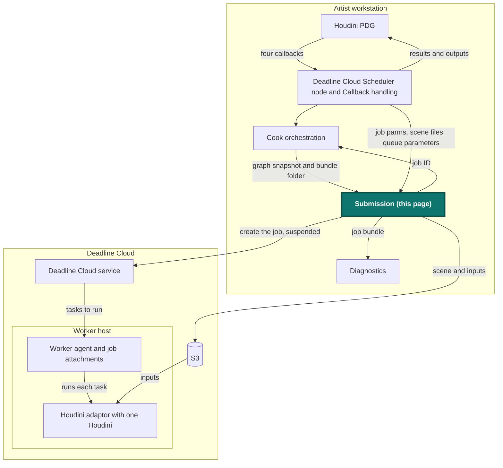
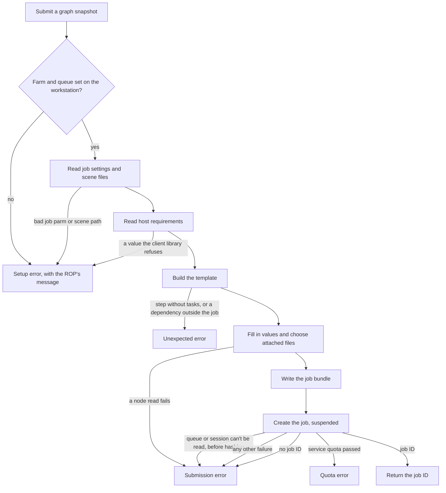
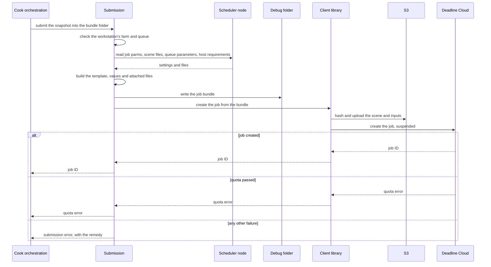

[Back to the overview](../overview.md)

# Submission

## TL;DR

- Submission turns one graph snapshot into one Deadline Cloud job, and returns the job's ID.
- Each step becomes one job step, with the same name and the same dependencies. Each work item becomes one task.
- The job is always created with its target task status set to suspended. Tasks of steps that wait on nothing start suspended. Tasks of steps that wait on other steps start pending, and the scheduler suspends them too. So no task runs before the scheduler releases it. The scheduler node has no setting for this.
- Submission attaches the scene, and the files that only the workstation has. The files steps make for each other move through the output folders instead.
- It writes the job bundle into the cook's debug folder. Then it creates the job through the same client library code as the ROP submitter.
- It never asks a question. When setup, attaching or job creation fails, it returns one error that says what to change.
- A snapshot that can't become a job shows as an unexpected scheduler error.

## The problem

- PDG has the graph, but Deadline Cloud wants a job bundle. A job bundle is a job template, its parameter values and the list of files to attach.
- The ROP submitter already builds bundles, and the scheduler node has the same job parms. The two must read those parms the same way and send the same values.
- The job must start with every task held, because a task needs work item data that exists only after the job is created.
- Submission runs on a PDG thread with no dialog, so nobody is there to answer a question.
- Attaching too few files breaks tasks on the farm. Attaching too many can mean hashing a whole drive before anything is sent.

## Where it fits

- Submission owns what the job looks like, and the one call that creates it.
- Cook orchestration decides when to submit, and what to do with the job afterwards.
- The scheduler node supplies the job parms, the scene's files and the queue parameters. Submission reads them on Houdini's main thread.
- The debug folder keeps the job bundle, so you can still read a job that Deadline Cloud rejected.

## How it works

Submission runs once per cook. It runs at the first work item, after the graph has passed validation.

- **Check the farm and read the settings.** When the workstation has no default farm or no default queue, Submission stops with the ROP submitter's message. Otherwise it reads the shared job parms the same way the ROP submitter does. Then it adds the scene's files and the cook's folders.
- **Build the template and fill in the values.** The template has one step per graph step, and one job environment that keeps Houdini open. It also has the parameters every PDG job needs. Their values come from the job settings, the cook and the node's queue parameters.
- **Choose the files to attach.** These are the scene, its assets, the files you listed on the node, and some declared inputs. A declared input is attached when it exists on this workstation and no step writes it.
- **Write the bundle.** Submission writes three files into the bundle folder, using the same writer as the ROP submitter.
- **Create the job.** One client library call hashes and uploads the attached files, then creates the job with its target task status set to suspended. Submission answers yes to any question the call asks.

### Terms

| Term | What it means |
| --- | --- |
| Graph snapshot | The steps, tasks and dependencies the cook read from PDG once, before submission. Submission never reads the graph itself. |
| Job bundle | The job template, the parameter values and the asset references, as three files in one folder. |
| ROP submitter | The Deadline Cloud ROP node's own submitter. The scheduler node shares its parm names, its parm reader and its bundle writer. |
| Client library | The Deadline Cloud Python library that hashes and uploads the attached files and creates the job. |
| Job settings | The job's name, description, priority, failed tasks limit, task retry limit, max worker count and adaptor wheels override. They're read from the node's Shared Job Settings parms, which have the same names as the ROP's. |
| Adaptor wheels override | A developer setting. When it's on, the worker installs the Houdini adaptor from a local folder of wheel files instead of the released one. |
| Job environment | A part of the job template that runs once when a worker session starts and once when it ends. `PdgSession` uses it to start Houdini once per session. |
| Host requirements | What a worker must have to run a step, such as a minimum amount of memory. They come from the node's Host Requirements parms. |
| Declared input | A file a work item tells PDG it will read. For example, a render item declares `/proj/shot/geo/a.0001.bgeo`. |
| Declared output | A file a work item tells PDG it will write. |
| Scene files | The saved `.hip` file, the assets the ROP's scene scan finds, and the files and folders listed on the node's Job Attachments tab. |
| Scene scan | The ROP submitter's pass over the scene's file references, such as a File SOP that reads `$HIP/tex/brick.png`. |
| Time variable | A Houdini variable for the current frame or time, such as `$F4`. |
| Output folders | The working directory, plus the folders listed in the node's Output Directories parm. For example, `/proj/shot` and `/renders/shot`. Whatever a task writes there is uploaded when the task ends. Validation calls these the job's folders. |
| Known paths | The folders the scheduler chose on purpose. The client library asks before it attaches a path outside them. |
| Reserved name | A parameter name the cook sets itself. These are the PDG parameters and the adaptor wheels override's parameters. |

### What goes in the job template

| Part | What it holds |
| --- | --- |
| Name | The cook name. It's the node's job name when set. Otherwise it's the `.hip` file name, and otherwise a name made from the cook's ID. |
| Description | The node's description, when set. |
| Parameters | First, the node's queue parameter definitions, without the reserved names. Then the PDG parameters below. When the adaptor wheels override is on, it adds its own parameters. |
| Job environments | `PdgSession`, which starts Houdini once per session and stops it at the end. When the adaptor wheels override is on, `OverrideAdaptor` comes first, so Houdini starts from the developer adaptor. |
| Steps | One per graph step, in snapshot order. Each step has the graph step's name, its dependencies, the node's host requirements and one command. It also has one INT task parameter, `TaskIndex`, that covers every task. |

The PDG parameters:

| Parameter | Type | Value |
| --- | --- | --- |
| `CookName` | STRING | The job's name. |
| `PdgCookId` | STRING | The cook's ID. |
| `JaBucket` | STRING | The queue's job attachments bucket. |
| `JaRootPrefix` | STRING | The queue's job attachments root prefix. |
| `HipFile` | PATH, file, IN | The saved `.hip` file. |
| `PdgDir` | PATH, folder, OUT | The working directory, which is `$PDG_DIR` on the worker. |

The worker learns where work item data lives from `JaBucket` and `JaRootPrefix`. Those two are known before any job, step or task ID exists.

`PdgSession` gives the adaptor the scene file, the Houdini version, the working directory, and the bucket and root prefix. When the node lists output folders, it gives those too.

Every step runs the same command. Each step's run data holds only the step's name and its record outputs flag. The flag tells the worker to record which files a task wrote. A step records outputs when at least one of its work items doesn't declare its outputs.

### What goes in the parameter values

| Value | Rule |
| --- | --- |
| Target task run status | Always SUSPENDED. The scheduler node has no setting for it. |
| Priority, max failed tasks count, max retries per task | Whole numbers from the node, sent as integers. |
| Max worker count | Sent only when the node sets a value above zero. Zero or less means no limit. |
| PDG parameters | One value each, from the cook. |
| Node queue parameters | The node's values, without the reserved names. Deadline Cloud adds the queue's own defaults when it creates the job. |
| Adaptor wheels | Sent only when the override is on. |

The adaptor wheels override is on when two things are true: the node turns it on, and its wheels folder exists. The ROP submitter uses the same rule, so the template and the values always agree.

### What gets attached

| List | What's in it |
| --- | --- |
| Input files | The `.hip` file, the scene's asset files, the files listed on the node, and the declared inputs described below. |
| Input folders | Folders the scene uses whole, such as an asset library stored as a folder, and the folders listed on the node. |
| Output folders | The working directory and the folders listed in the node's Output Directories parm. |

The scene's asset files come from the scene scan. Whether a reference is attached depends on how its path is written. The examples assume `$HIP` is `/proj/shot`.

| Kind of reference | Example | Attached? |
| --- | --- | --- |
| Plain path that exists | `/mnt/lib/tex/brick.png` | Yes |
| Path with a portable prefix, such as `$HIP`, that exists | `$HIP/tex/brick.png` | Yes, as `/proj/shot/tex/brick.png` |
| Path with a time variable | `$HIP/geo/a.$F4.bgeo` | Yes, every matching frame on disk, such as `/proj/shot/geo/a.0001.bgeo` and `/proj/shot/geo/a.0002.bgeo` |
| Path with a work item attribute | `$HIP/geo/@wedgenum.bgeo` | No. The step that writes it delivers it. |
| Path with a backtick expression | `` `@pdg_input` `` | No. The step that writes it delivers it. |
| Path with a variable that doesn't expand, because `SHOT` isn't set | `$SHOT/tex/brick.png` | No |
| Relative path | `tex/brick.png` | No |
| Path that doesn't exist | `/mnt/lib/tex/missing.png` | No |
| Path a work item declares as an output | `/proj/shot/geo/a.0001.bgeo`, when a ROP Geometry Output item declares it | No. The step that writes it delivers it, and a local copy would be out of date. |

A few more rules apply to the scene's assets:

- The `.hip` file is attached once.
- The scheduler's own node library and the ROP's node library are left out.
- A folder the scene uses whole is attached as a folder, not as a file.
- When the scene scan fails, no scene assets are attached, and the log has a warning.

A declared input of any step is attached when all three of these are true. The steps it waits on don't change the rule.

- It resolves to a real path on this workstation, after the working directory token and variables are filled in. For example, `__PDG_DIR__/tex/brick.png` resolves to `/proj/shot/tex/brick.png`. A path that still holds a PDG token, such as `__PDG_TEMP__/a.bgeo`, isn't attached.
- No work item declares it as an output.
- It exists as a file.

For example, a File Pattern node finds textures on disk and is merged with a step's output. The step below reads both, so the textures are attached for it.

Submission checks the scene files before anything is hashed. It refuses a path that would attach a whole drive, the home directory, or a folder that holds the home directory. For example, `/` or `$HOME` are refused. It also refuses a file or folder listed on the node that doesn't exist. Each refusal names the parm that holds the path.

## Decision flow

Submission keeps no state between cooks. It runs once, from top to bottom, and either returns a job ID or raises one error.

| Outcome | When | What the caller gets |
| --- | --- | --- |
| Job ID | The job was created. | The ID. |
| Setup error | The workstation has no default farm or queue. Or a priority, failed tasks limit or task retry limit isn't a whole number within the job's limits. Or a scene path is refused. Or the client library refuses a Host Requirements value. | The error, naming the setting or parm. |
| Unexpected error | A step has no tasks, or it depends on a step that isn't in the job. Graph mapping never makes such a snapshot, so this error only shows a scheduler bug. | The error, naming the step, passed through unchanged. Nothing is written and nothing is created. |
| Quota error | Deadline Cloud refused the job because it would go over a service quota. | The error. Cook orchestration ends the cook REFUSED. |
| Submission error | Anything else that fails before or during the call that creates the job. It's also a submission error when that call returns no job ID. | The error, with the remedy for the cause, and the original error attached. |

## Invariants

These rules always hold, whatever the implementation does.

### Job shape

1. One submission creates at most one job.
2. The job has one step per graph step, in snapshot order. Each job step has the graph step's name and the same dependencies, in the same order.
3. Each step has one task per work item. A step can hold every task of its work items, however many there are.
4. A step with no tasks, or a dependency on a step outside the job, is refused before anything is written.
5. Every step runs the same command. The run data differs only in the step's name and its record outputs flag.
6. The job has one PDG job environment, which each worker session enters once. Steps have no job environments of their own.
7. Every template parameter the job uses is declared. Every declared parameter without a default has a value.
8. The same snapshot, settings and node always give the same template.
9. The template is a valid Open Job Description job template. Open Job Description is the open format Deadline Cloud uses for job templates.
10. A step with no dependencies has no dependencies entry at all, because Open Job Description refuses an empty list.
11. When the node sets host requirements, every step gets them.

### Settings

1. The job is always created with its target task status set to suspended, so no task runs before the scheduler releases it.
2. The shared job parms are read with the ROP submitter's reader and parm names. So the same parm means the same thing on both nodes.
3. A priority, failed tasks limit or task retry limit must be a whole number within the limits Deadline Cloud accepts for a job. Priority is 0 to 100. The two limits are 0 to 2147483647. A value outside these refuses the cook, naming the parm.
4. The ranges on the node's sliders are only hints. The job's limits decide what's refused.
5. When the node lacks a job parm, the scheduler's default is used for it.
6. When the client library refuses a Host Requirements value, the submission stops, naming the parms.
7. When a Houdini UI exists, every read of the scheduler node runs on Houdini's main thread.

### Parameter values

1. The job settings, priority included, travel as typed values in the bundle's parameter values, the same as for the ROP submitter. Each one reaches the call that creates the job only through the bundle.
2. The max worker count is sent only when it's above zero.
3. A node queue parameter with a reserved name is dropped from both the template and the values. So each value is sent once.
4. The adaptor wheels override is in the template exactly when its value is sent.

### Attached files

1. The input files are the `.hip` file, the scene's asset files, the files listed on the node, and the declared inputs that meet rule 3.
2. Files you list on the node are added to the files Submission finds. They never replace them.
3. A step's declared input is attached only when three things are true. It resolves on this workstation with no PDG token left. No work item declares it as an output. And it's a file that exists.
4. The rule for declared inputs is the same for every step, whether or not the step has dependencies.
5. A scene asset that a work item declares as an output is left out.
6. A scene reference that depends on a work item, such as `$HIP/geo/@wedgenum.bgeo`, is left out, because the step that writes it delivers it.
7. A scene reference is attached only when it expands to an absolute path with no variable left, and that path exists on disk.
8. The scheduler's own node library and the ROP's node library are left out.
9. The output folders are the working directory and the folders listed in the node's Output Directories parm.
10. Submission refuses a path that is a drive root, the home directory, or a folder that holds the home directory.
11. Submission refuses a path listed on the node that doesn't exist.
12. Every attached path is under a known path, so the client library never stops to ask about one.

### Bundle

1. The bundle has three files: a template, parameter values and asset references. The shared bundle writer writes them.
2. Each asset list is sorted, and holds each path once.
3. The bundle is written before the job is created. So a rejected job leaves its bundle behind.

### Creating the job

1. The farm and queue come from the workstation's defaults, as for the ROP submitter. Submission never changes the workstation's settings.
2. When the farm or queue isn't set, submission stops before any work, with the ROP submitter's message.
3. Submission never asks you anything. It answers every question from the client library with yes, and logs the question.
4. Hashing and upload progress go to the cook log.
5. When the cook stops while files are being hashed or uploaded, hashing and upload stop, and no job is created.
6. A failure to read the queue or the AWS session is reported before any file is hashed.
7. A call that returns no job ID is a submission error.
8. Before the job is created, the cook log gets the step count, the task count and the number of attached files.

### Errors

1. Errors are told apart in this order: a service quota, then access denied, then a missing farm or queue, then a rejected job, then anything else. Each one gets its own remedy.
2. Every mapped error keeps the original error as its cause. Its message includes the original text.
3. An error the scheduler already raised, such as a setup error, passes through unchanged.
4. The error for a snapshot that can't be a job also passes through unchanged. Any other error before the bundle is written, such as a failed node read, is reported as "The job could not be submitted: ..." with the original error after it.

## Sequence and errors

In the table, "node error" means the scheduler node shows the error, with at most one popup per cook. Cook orchestration decides what PDG is told.

| Case | What submission does | What you see |
| --- | --- | --- |
| No farm or queue on the workstation | stops before reading anything | node error with the ROP submitter's message |
| A priority, failed tasks limit or task retry limit isn't a whole number within the job's limits | stops before the template | node error naming the parm |
| The client library refuses a Host Requirements value | stops before the template | node error naming the Host Requirements parms |
| A scene path would attach a drive or the home directory, or a listed path is missing | stops before the template | node error naming each parm |
| A step has no tasks, or depends on a step outside the job | stops before the bundle is written | node error saying the scheduler hit an unexpected error, naming the step, with details in the Houdini console |
| The queue or the AWS session can't be read when the job is created | stops before any hashing | node error saying the job couldn't be submitted |
| A service quota is passed | creates nothing | node error saying a service quota was exceeded, often tasks or steps per job |
| Access is denied | creates nothing | node error saying to check IAM permissions |
| The farm or queue isn't found | creates nothing | node error saying to check the workstation's Deadline Cloud settings |
| Deadline Cloud rejects the job | creates nothing | node error saying it's a scheduler bug, not a problem with your graph |
| The call returns no job ID | creates nothing the cook can follow | node error saying the job wasn't created |
| The client library asks a question | answers yes | a log line with the question |

## Where it lives

- Submitter and its settings: `src/deadline/houdini_pdg/submitter.py`
- Submitter interface (port): `src/deadline/houdini_pdg/ports.py`
- Helpers shared with the ROP submitter: `src/deadline/houdini_submitter/python/deadline_cloud_for_houdini/_job_bundle.py`
- Scene files, listed inputs and output folders: `src/deadline/houdini_pdg/houdini/host.py`

The scheduler's composition root builds one submitter per cook, and Cook orchestration calls it through the port.

[Back to the overview](../overview.md)
