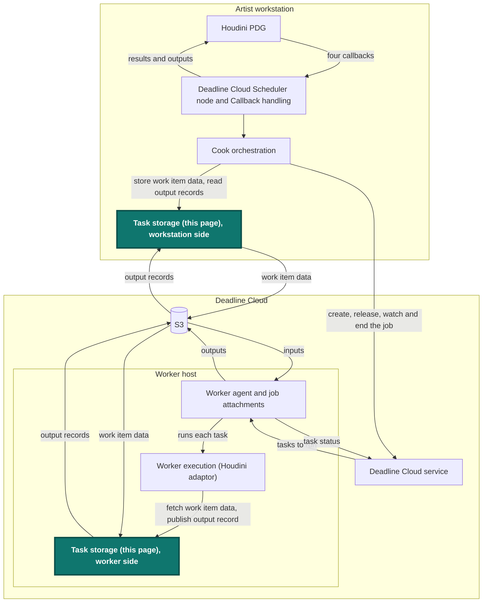
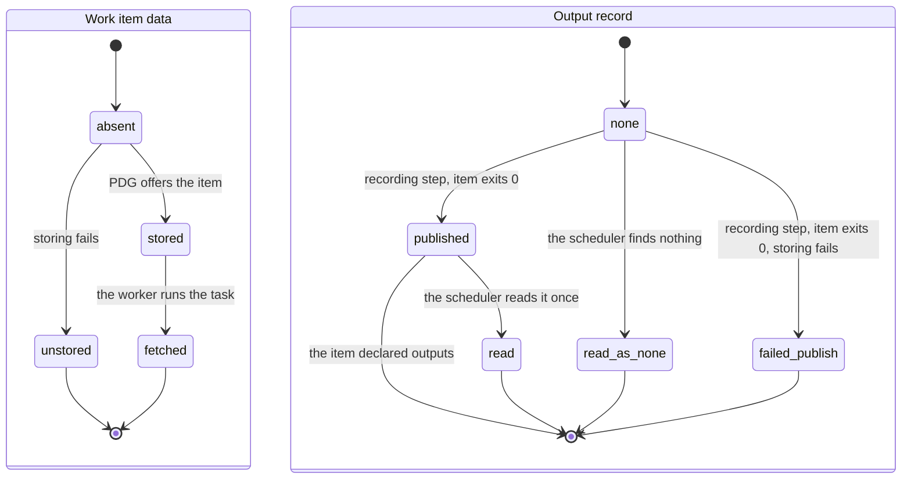
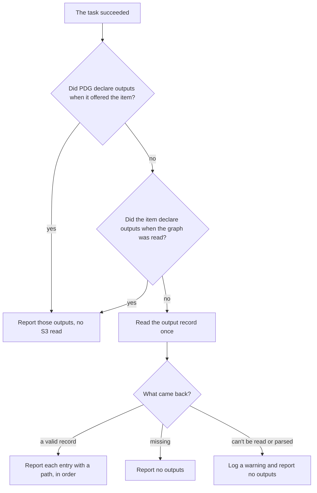
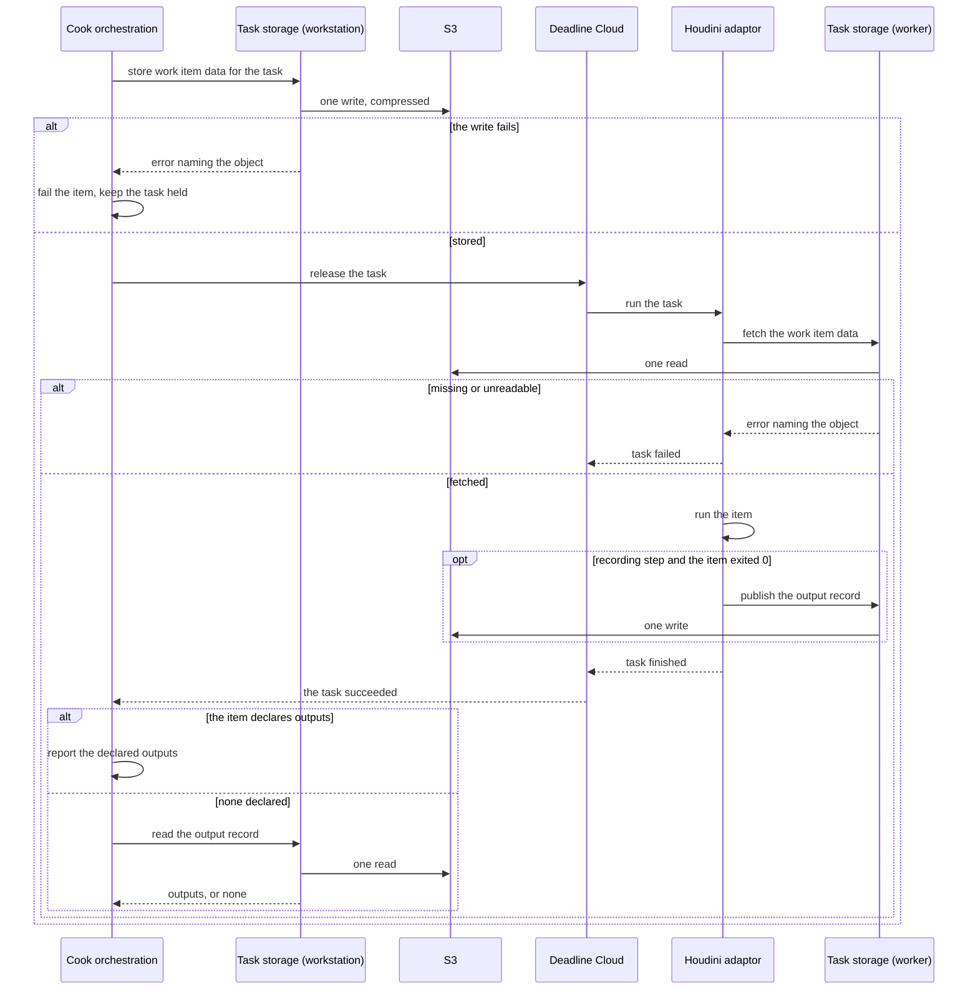

[Back to the overview](../overview.md)

# Task storage

## TL;DR

- Task storage keeps two small objects per task in S3.
  - The work item data is PDG's data for one work item. The workstation writes it, and the worker reads it.
  - The output record is the list of files the task wrote. The worker writes it, and the workstation reads it.
- Both sides build the same S3 key from the task's IDs. So neither side has to tell the other where an object is.
- The objects sit in the task's own folder in the queue's job attachments bucket, next to the task's output manifests. The steps that depend on this task still find those manifests and sync the right files.
- The work item data is stored before its task is released. When a worker can't find it, the task fails with a message that says the task ran before its data was ready.
- The workstation reads an output record only for a work item that declares no outputs. When the record can't be read, the item still succeeds, with no outputs.

## The problem

- PDG hands the scheduler a work item's data only when it offers the item. That happens after the job exists, so the data can't go in the job bundle.
- The worker only knows its task's IDs. It has to find the data without a message from the workstation.
- Some nodes don't say in advance which files they write, so the workstation needs the worker to tell it.
- Job attachments finds a task's output manifests in the same folder, by their key. If one of our files looked like a manifest, job attachments could pick it instead of the real one. The steps that depend on the task would then sync no files.
- The worker and the workstation can run different releases, so the stored format has to be checkable.

## Where it fits

- Task storage owns the two objects in each task's folder. It decides where they live, how they're encoded, and what a bad one means.
- The same component runs on both sides. On the workstation, Cook orchestration calls it. On the worker, Worker execution calls it from the Houdini adaptor's own process.
- Other components make the decisions about the cook. Cook orchestration decides when to store data and what a failure does to the item. Worker execution decides when to publish a record.

## How it works

The workstation and the worker meet in one S3 folder per task, and each side finds it from the task's IDs.

- **Set up.** When a cook starts, the scheduler gets the queue's job attachments bucket and root prefix, and puts them in the job. The worker reads them from the job, so both sides use the same ones.
- **Store the data.** When PDG offers a work item, the scheduler compresses PDG's data for the item and stores it in the task's folder. The task is released only after that.
- **Fetch the data.** When the worker runs the task, the adaptor builds the same key from the task's IDs. It fetches the data and decodes it.
- **Publish the record.** On a recording step, once the item succeeds, the adaptor stores the list of files the item wrote, each with its tag.
- **Read the record.** When the task succeeds, the scheduler uses the outputs PDG declared for the item. If the item declared none, the scheduler reads the task's output record once.

### Terms

| Term | What it means |
| --- | --- |
| Task address | The five IDs that name one task: farm, queue, job, step and task. Every ID must have a value. |
| Root prefix | The top folder the queue's job attachments use in its S3 bucket, such as `DeadlineCloud`. |
| Output manifest | The file job attachments writes when a task finishes, listing the files the task produced. The steps that depend on the task read it to know which files to sync. |
| Supported root prefix | A root prefix that can't make our objects look like output manifests. Job attachments finds a task's output manifests by matching their keys to a pattern. A plain root prefix such as `DeadlineCloud` doesn't match that pattern. A root prefix such as `step-x/a/output` matches it on its own, so every key under it would look like a manifest, whatever the file name is. |
| Task folder | The folder job attachments uses for a task's output manifests. It's the root prefix, then `Manifests`, then the five IDs in order, such as `DeadlineCloud/Manifests/farm-1/queue-1/job-1/step-1/task-1-0/`. Both objects go here. |
| Work item data | PDG's data for one work item, as PDG saved it on the workstation, stored compressed. |
| Declared outputs | The output files PDG says an item will write, known before the task runs. For example, a ROP Geometry Output item that will write `$HIP/geo/a.5.bgeo`. |
| Recording step | A step where at least one work item didn't say which files it writes, when the graph was read. On a recording step, the worker records what each item wrote. |
| Output record | The list of files a task wrote, each with its tag, stored as JSON with a format version. A tag is PDG's label for the kind of file, such as `file/geo`. An empty tag means PDG picks the tag from the file's extension. |
| Missing | S3 answers that the object isn't there. Any other failed read, such as access denied, is an error. |

## Object life and decision flow

Task storage keeps no state of its own. Each of the two objects in a task folder has a short life, shown below. Reading a task's outputs follows one decision flow.

### The two objects

| State | What it means |
| --- | --- |
| absent | The task folder has no work item data. A task that runs now fails, and says it ran before its data was ready. |
| stored | The data is in S3. Only now can the task be released. |
| unstored | The data couldn't be stored. The task stays held, and the item fails. |
| fetched | The worker fetched and decoded the data. |
| none | No record exists. Either the task hasn't finished, its step isn't a recording step, or the item failed. |
| published | The worker stored the record after the item succeeded. |
| failed_publish | The record couldn't be stored, so the task fails. |
| read | The scheduler read the record and reported its outputs to PDG. |
| read_as_none | The record is missing, so the item succeeded with no outputs. |

### Reading a task's outputs

- In every reported path, PDG's working directory token is replaced with the workstation's working directory. For example, `__PDG_DIR__/geo/a.bgeo` becomes `/proj/pdgwork/geo/a.bgeo` when the workstation's working directory is `/proj/pdgwork`.
- The item is reported as succeeded in every branch. A problem reading its outputs leaves the success in place.

## Invariants

These rules always hold, whatever the implementation does.

### Keys

1. The workstation and the worker build a task's keys the same way, from the task address alone.
2. Task storage is the only place that builds these keys.
3. Both objects live in the task folder that job attachments uses for that task's output manifests.
4. Each task address has its own keys. Within one task, the work item data and the output record have different keys.
5. An address with an empty ID, or an ID of only spaces and slashes, is refused.
6. Slashes around an ID are dropped before the key is built. For example, `/step-1/` is used as `step-1`, so the key has no empty folder.
7. Under a supported root prefix, job attachments picks only the real output manifest from a task folder, and leaves both objects alone.
8. On the worker, when the task address lacks any ID, the task is refused with one error that names every missing ID.

### Setup

1. Both sides use the same bucket and root prefix. The workstation gets them from the queue, and the worker gets them from the job.
2. A blank bucket, or a root prefix that is blank or only slashes and spaces, is refused when the cook starts, before any task depends on it.
3. On the worker, only the Houdini adaptor's own process uses task storage, as Worker execution describes.

### Work item data

1. The work item data is PDG's own text for the item, compressed and otherwise unchanged.
2. Storing it is one write. When the write fails, the error names the object.
3. A task is released only after its work item data is stored.
4. Storing the same data again for the same task leaves the same data at the same key.
5. Reading accepts compressed or plain data.
6. Reading returns the data only when it's a JSON object. For anything else, such as a JSON list or text that isn't JSON, reading raises an error that names the object.
7. When a fetch fails, the error names the object. It also says the task may have run before its data was ready.

### Output records

1. A record carries a format version. A record with no version, or with a version other than the current one, is refused as malformed.
2. A record lists entries, each with a path and a tag.
3. A recorded tag is kept as it is. An empty tag lets PDG pick the tag from the file's extension.
4. An entry without a path is skipped.
5. Any other malformed record is refused, and the error names the object.
6. When storing a record fails, the error names the object, and the task fails.
7. The workstation reads a task's record only when the work item declares no outputs. It reads it exactly once.
8. PDG can declare an item's outputs at two times: when the graph is read, and when PDG offers the item. When both are known, the outputs declared at the offer are used.
9. No record means S3 answered that the object is missing. Any other failed read is an error.
10. When a record can't be read, an item that succeeded still succeeds. It's reported with no outputs, and the reason is logged.

## Sequence and errors

| Case | What task storage does | What the caller does | What you see |
| --- | --- | --- | --- |
| The queue has no bucket or no root prefix set | isn't built | the cook doesn't start | node error saying the queue has no job attachments bucket, and to choose a queue that has one |
| The bucket is only spaces, or the root prefix is only slashes and spaces | refuses to be built, naming both values | the cook doesn't start | node error naming both values |
| The work item data can't be stored | raises an error naming the object | the item fails, its task stays held, and the cook ends failed at close | a console line |
| The worker can't fetch the data | raises an error naming the object, saying the task may have run before its data was ready | the task fails | the error in the task log |
| The data is corrupt, isn't JSON, or isn't a JSON object | raises an error naming the object | the task fails | the error in the task log |
| A task address lacks an ID on the worker | raises one error naming every missing ID | the task fails | the error in the task log |
| The output record can't be stored | raises an error naming the object | the task fails | the error in the task log |
| The record is missing | returns no record | the item succeeds with no outputs | a debug line |
| The record can't be read, or is malformed | raises an error naming the object | the item succeeds with no outputs | a warning in the log |

## Where it lives

- Task storage interface (port) and task address: `src/deadline/houdini_pdg/ports.py`
- Task storage implementation: `src/deadline/houdini_pdg/task_storage.py`
- Errors: `src/deadline/houdini_pdg/errors.py`
- Built for a cook: `src/deadline/houdini_pdg/houdini_plugin/pdg/types/deadlinecloud/__init__.py`
- Built for a worker session: `src/deadline/houdini_adaptor/HoudiniAdaptor/adaptor.py`

[Back to the overview](../overview.md)
