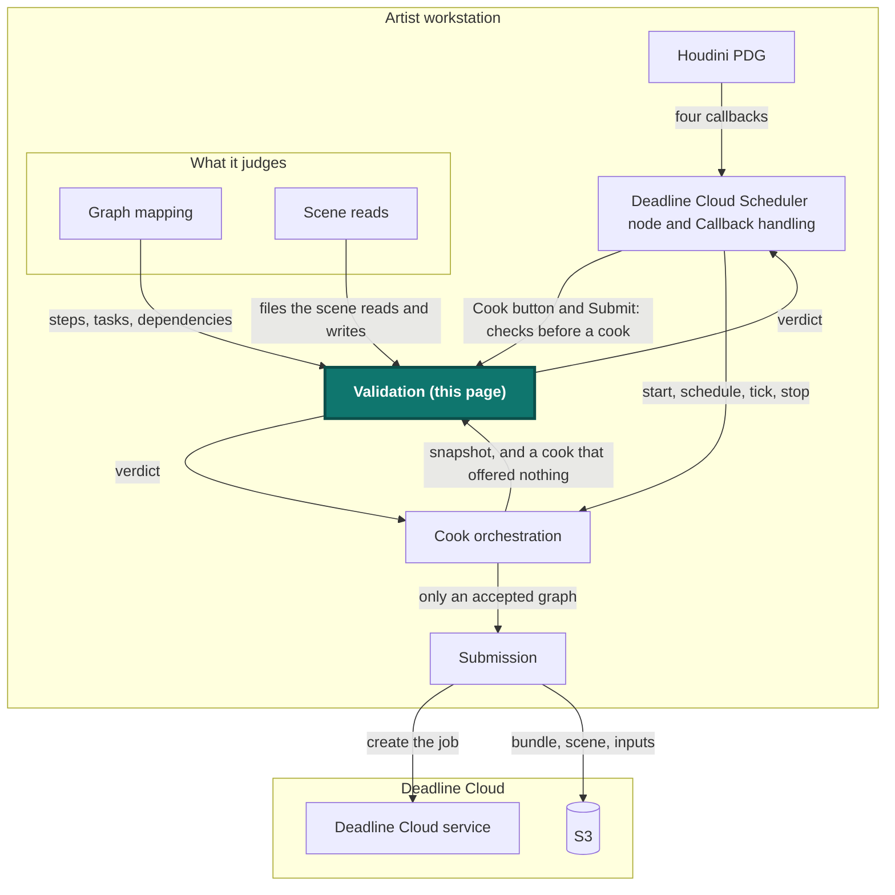
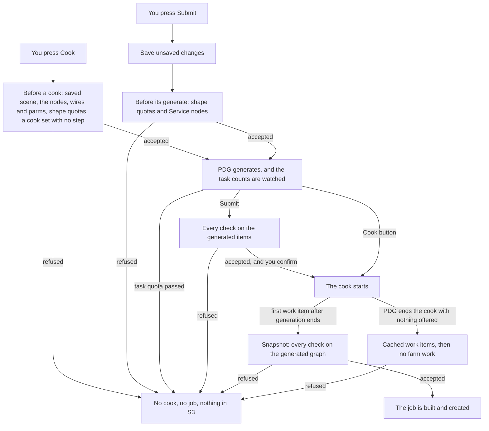
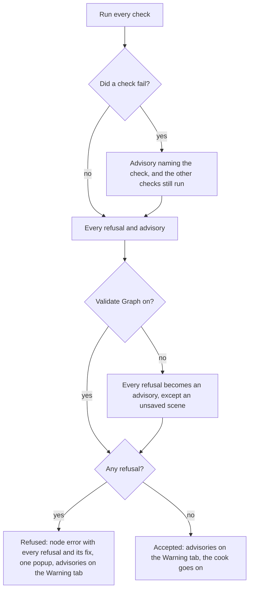
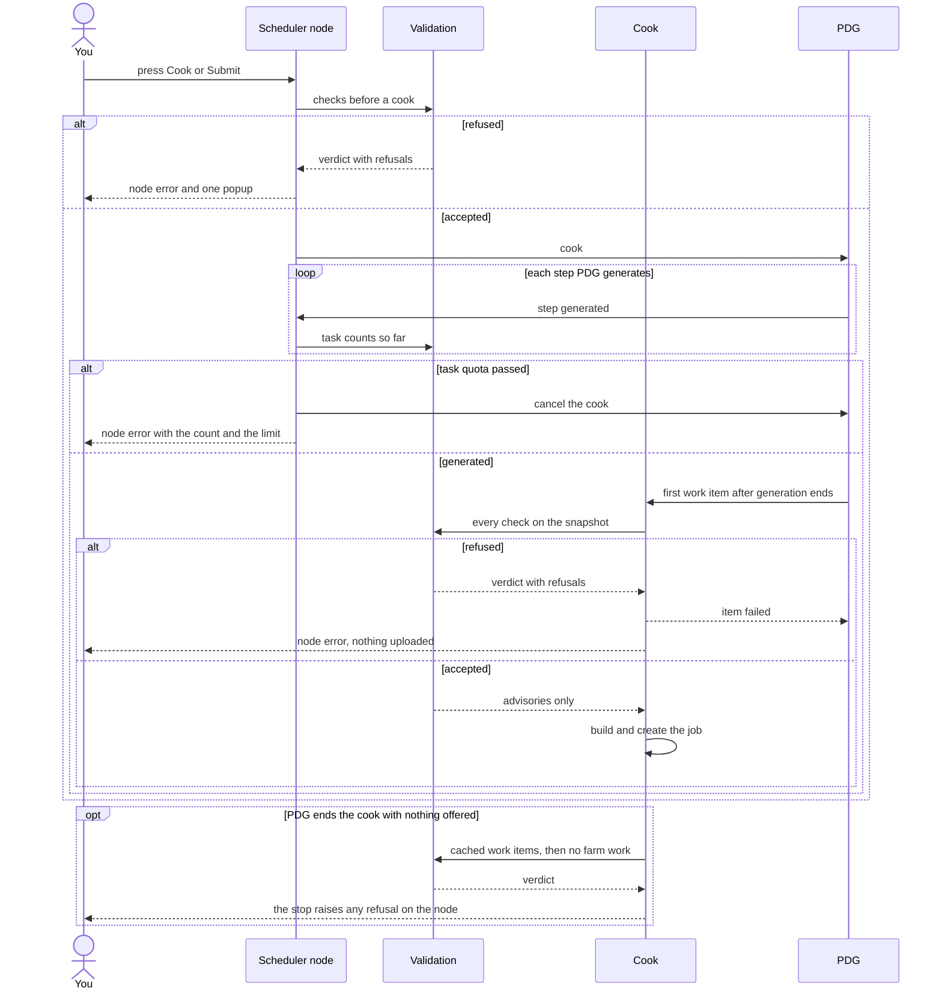

[Back to the overview](../overview.md)

# Validation

## TL;DR

- Validation decides whether a TOP network can be cooked as one Deadline Cloud job. It decides before anything is uploaded.
- It returns one verdict. The verdict lists every refusal it found, each with the node at fault and the fix. It also lists advisories, which are warnings that don't stop the cook.
- When the verdict has a refusal, the cook creates no job and puts nothing in S3.
- The checks run at four moments: when you press Cook or Submit, while PDG generates work items, when the cook reads the whole graph at the first work item PDG offers after generation ends, and when a cook ends without PDG offering any work item.
- Each cause gets one message. When a node is refused for one reason, Validation doesn't refuse it again under another reason for the same cause.
- When you turn off the Validate Graph parm, each refusal Validation finds becomes an advisory and the cook goes on. An unsaved scene is still refused. A quota error from Deadline Cloud when the job is created still stops the cook too.

## The problem

- Some networks can't run as one job. Examples are a node that makes work items while the cook runs, a step set to In-Process, a command server, and a step that writes files where the farm can't see them.
- Deadline Cloud finds some of these problems only after the scene is uploaded, and it names neither the node nor the fix. It never finds others, and the cook stalls or reports success with missing files.
- The artist needs every problem at once, in plain words, with what to change. They need it before the cook spends time on an upload.
- Some problems show in the nodes and their wires alone. Others show only in the generated work items, which exist only after PDG has generated the graph.

## Where it fits

- Validation owns the rules. It decides what is refused, what is only advised, and the words the artist sees.
- It reads what Graph mapping and Scene reads found, and the scheduler node's settings. The only other thing it does is ask whether a file exists on disk.
- The Scheduler node asks it to judge the graph when you press Cook or Submit.
- Cook orchestration asks it at the snapshot, and again when a cook ends without PDG offering any work item.
- It never talks to Deadline Cloud or S3. A refusal stops the cook before Submission runs.

## How it works

The Scheduler node and Cook orchestration ask Validation to judge what Graph mapping and Scene reads found. The cook goes on only when the verdict has no refusal.

- **When you press Cook or Submit.** Before PDG starts anything, the scheduler judges what the nodes, their wires and their parms show. Cook runs every check that doesn't need work items, and it checks that the scene is saved. Submit first saves any unsaved changes, and it asks you unless the node's automatic scene save is on. Then it judges only the shape quotas and the Service nodes. It leaves every other check until after its generate.
- **While PDG generates.** The scheduler counts each step's tasks as PDG makes them. It stops the cook as soon as a count goes over its task quota.
- **At Submit, after its generate.** Submit generates the work items of the display node, which is the node with the display flag, and of every node above it. Then it runs every check on them, including the saved-scene check.
- **At the snapshot.** The snapshot is the cook's read of the whole generated graph. While PDG is still generating a step it asked for, the cook defers each work item PDG offers, and PDG offers it again later. The cook takes the snapshot at the first offer after generation ends. The wait has a limit, and when it runs out, the cook takes the snapshot anyway. The cook runs every check on the snapshot before it builds the job.
- **When a cook ends with nothing offered.** Sometimes PDG ends the cook without offering the scheduler any work item. The scheduler then says why. Either PDG took the work items from cache, or nothing in the cook runs on the farm.

### Terms

| Term | What it means |
| --- | --- |
| Refusal | A reason the graph can't be cooked. It has a reason key, a subject, a detail and a fix. The subject is the node, step, parm or file at fault. For example, the step `render` with the reason key `rop_batch`. |
| Advisory | A warning that doesn't stop the cook. It has a reason key, a subject and a detail. It shows on the scheduler node's Warning tab. |
| Verdict | Every refusal and every advisory for one graph. A verdict with no refusal is accepted. |
| Step | A TOP node that runs a job script on a worker, such as a ROP Geometry Output. Each of its work items becomes one task. |
| Cook set | The nodes PDG asked to cook, for example the node you pressed Cook on and the nodes above it. For each node, Validation knows that it's in the cook set, knows that it's out of it, or doesn't know. |
| In the cook | A node PDG will cook in this cook. A node outside the cook is one PDG won't cook this time, such as a branch you didn't ask to cook. |
| Dropped step | A step with no work items in this cook. The job leaves it out. |
| Leaf step | A step that no other step waits on, such as the last render in a chain. |
| Consumed step | A step that another step waits on. |
| Working directory | The folder the cook writes into, set on the scheduler node. PDG writes it as `__PDG_DIR__` in paths. |
| The job's folders | The working directory, plus the folders listed in the scheduler node's Output Directories parm. For example, `/proj/shot` and `/renders/shot`. A task uploads the files it writes there, so only those files reach the steps below it. |
| Declared output | A file a work item tells PDG it will write. For example, a ROP Geometry Output item declares `/proj/shot/geo/a.0001.bgeo`. |
| Declared input | A file a work item tells PDG it will read, usually an upstream item's declared output. |
| Scene read | A file parm in a node's scene that names a file the node opens, such as a File SOP's `file` parm. |
| Write parm | A file parm that names a file the node creates, such as a ROP Geometry Output's output file. |
| Read parm | Any other file parm, so a parm whose file the node opens. |
| Scene walk | The pass Scene reads makes over the node parms that name files. When the walk can't run, the checks that need it say they were skipped. A walk can run and find no reads, and that's normal. |
| Typed out | A path written as full text in a parm, with no portable prefix, such as `/proj/shot/geo/a.bgeo`. |
| Portable prefix | A path that starts with `$HIP`, `$PDG_DIR`, `$PDG_TEMP` or a PDG path token. Each of these resolves on the worker too. A variable counts only as a whole token, written `$HIP` or `${HIP}`. So `$HIPNAME/a.bgeo` has no portable prefix. |
| PDG path token | Text PDG puts in a path and fills in on the worker, such as `__PDG_DIR__` or `__PDG_TEMP__`. |
| Worker folder | A folder every worker has, such as `$HFS`. It's also matched only as a whole token. Only the check for files the scene reads accepts it. |
| Command server | A TOP node that starts a long-running process and sends work items to it, such as a Houdini Command Server. |
| Waived | A refusal kept as an advisory, because Validate Graph is off. The advisory keeps the fix in its text. |

### Kinds of path

Several refusals depend on how a path is written. The examples below assume the working directory is `/proj/shot`, the scene is saved in `/proj/shot` so `$HIP` is `/proj/shot`, and `$HFS` is `/opt/hfs20.5`.

| Kind of path | Example |
| --- | --- |
| Plain path inside the job's folders | `/proj/shot/geo/a.bgeo` |
| Plain path outside the job's folders | `/mnt/lib/tex/brick.png` |
| Path with a portable prefix | `$HIP/geo/a.bgeo` |
| Path under a worker folder | `$HFS/houdini/pic/default.pic` |
| Path with a variable that doesn't expand, because `SHOT` isn't set in this Houdini | `$SHOT/geo/a.bgeo` |
| Path with a work item attribute | `$HIP/geo/@wedgenum.bgeo` |
| Path with a backtick expression | `` $HIP/geo/`padzero(4, $F)`.bgeo `` |
| Path with a PDG path token | `__PDG_DIR__/geo/a.bgeo` |
| Relative path | `geo/a.bgeo` |

Each path check treats these kinds like this:

| Example | Declared output of a consumed step (`output_outside_cook`) | Write parm (`output_outside_cook`) | Declared input that no task writes (`runtime_file_unproduced`) | Scene read that no step writes (`local_file_unreachable`) |
| --- | --- | --- | --- | --- |
| `/proj/shot/geo/a.bgeo` | Accepted | Refused, because it's typed out | Accepted when the file is on disk, refused when it isn't | Not judged, because it's inside the job's folders |
| `/mnt/lib/tex/brick.png` | Refused, because it's outside the job's folders | Not judged by this check | Accepted when the file is on disk, refused when it isn't | Advisory when the file is on disk, refused when it isn't |
| `$HIP/geo/a.bgeo` | Accepted, because it expands to `/proj/shot/geo/a.bgeo` | Accepted | Accepted when the file is on disk, refused when it isn't | Not judged |
| `$HFS/houdini/pic/default.pic` | Refused, because it expands outside the job's folders | Not judged by this check | Accepted when the file is on disk, refused when it isn't | Not judged |
| `$SHOT/geo/a.bgeo` | Refused, because the variable didn't expand | Not judged by this check | Not judged | Not judged |
| `$HIP/geo/@wedgenum.bgeo` | Judged by the value PDG gives each work item | Not judged | Judged by the value PDG gives each work item | Not judged |
| `` $HIP/geo/`padzero(4, $F)`.bgeo `` | Judged by the value PDG gives each work item | Not judged | Judged by the value PDG gives each work item | Not judged |
| `__PDG_DIR__/geo/a.bgeo` | Accepted | Accepted | The token is replaced with `/proj/shot`, then judged like a plain path. A path with any other token, such as `__PDG_TEMP__/a.bgeo`, isn't judged. | Not judged |

- For a leaf step, each refusal in the declared output column is an advisory instead.
- A read parm that's typed out inside the working directory, such as `/proj/shot/geo/a.bgeo`, gets an advisory instead of a refusal.
- The scene read check skips a relative path, such as `geo/a.bgeo`.
- The `cached_outputs` check reads declared outputs the same way as the declared input column. It skips a path that still holds a PDG token or a variable.

### Refusals

Each refusal's reason key appears in its log line, for example `Refused, write_batched (rop_batch): ...`.

| Reason | Refused when | Exceptions and limits |
| --- | --- | --- |
| `unsaved_scene` | The `.hip` file was never saved. With a Houdini UI, it's also refused when the scene has unsaved changes. Workers load the saved file. | Checked only when you press Cook or Submit. It's never waived. |
| `dynamic_node` | A node makes its work items while the cook runs. | Only the node that causes it is named. That's a node whose own Generate When parm makes it dynamic, or a dynamic node with no dynamic node above it. |
| `in_process_step` | A step's Cook Type is In-Process. PDG cooks In-Process items inside your Houdini and never offers them to the scheduler. | |
| `in_process_node` | A node that isn't a step, with a step above it, touches a step's files. It touches them when its Cook Type is In-Process, or when a file parm or expression reads an upstream item's file, such as `@pdg_input`. It also touches them when the scene walk shows it reads a step's output, or writes a file a step reads. | Allowed: a node with no step above it, a node that only passes work items along, and a node inside a locked asset. |
| `service_node` | A node's Cook Type is Service. Or the node is a command server, whatever its Cook Type. | Allowed: a node known to be outside the cook. |
| `multiple_schedulers` | A node's `topscheduler` parm sends its work items to another scheduler node. | Allowed: an override that names this scheduler. |
| `rop_batch` | A step has batched work items. The refusal gives the number of batched items and batches. It names the two parms to change, All Frames in One Batch and Frames Per Batch. | |
| `quota_exceeded` | The job goes over a quota. The quotas are tasks per job, steps per job, tasks per step, dependencies per step and consumers per step. The refusal gives the count and the limit. | A count equal to the limit is accepted. |
| `no_farm_work` | The cook set names only nodes that run nothing on a worker. Or the generated graph has work items but no step. | Allowed: an unknown cook set, or one that names a node the graph read doesn't have or whose kind isn't known. A step PDG asked for that has no items yet is reported as `step_without_items` instead. |
| `step_without_items` | PDG asked for a dropped step, or might have, which means the graph was read too early. Or a step waits on a dropped step, so nothing makes its inputs. | See [One cause, one message](#one-cause-one-message). Any other dropped step is an advisory. |
| `output_outside_cook` | A consumed step declares an output outside the job's folders, such as `/mnt/out/a.bgeo`. Or it declares an output with a variable that didn't expand, such as `$SHOT/geo/a.bgeo`. Or a write parm is typed out as a path inside the working directory, such as `/proj/shot/geo/a.bgeo`, instead of `$HIP/geo/a.bgeo`. A worker folder isn't accepted here, so `$HFS/out/a.bgeo` is refused. The refusal names one example path and the path it resolves to. A declared-output refusal also lists the job's folders. | A leaf step's output is an advisory. A write parm whose value holds a backtick expression or an `@` isn't judged. |
| `attribute_as_variable` | A write parm spells an attribute of its own step's work items as a variable, such as `$HIP/geo/$wedgeindex.bgeo` or `${WEDGEINDEX}`. Upper and lower case match the same attribute. An exported attribute is always refused this way. An attribute the step carries but doesn't export is refused only when Houdini has no variable of that name, so `$HIP` is never refused even if an item has a `hip` attribute. The refusal quotes the variable as written and the attribute as PDG spells it. Its fix is to write `@wedgeindex` instead. | Allowed: a read parm, and another step's attribute. |
| `runtime_file_unproduced` | A step declares an input that is no task's declared output and isn't on disk, such as `/proj/shot/cache/sim.bgeo`. The refusal names the file once, with every step that reads it. | Not judged: a path that still holds a PDG token or a variable, such as `__PDG_TEMP__/a.bgeo` or `$SHOT/a.bgeo`. |
| `local_file_unreachable` | A scene read that no step writes points outside the job's folders, and the file isn't on disk. For example, `/mnt/lib/tex/brick.png` when that file is missing. | Not judged: a read with a portable prefix such as `$HIP/tex/brick.png`, a read under a worker folder such as `$HFS/houdini/pic/default.pic`, a relative path such as `tex/brick.png`, and a path that still holds a variable. |
| `cached_outputs` | A step in this cook has a work item with a declared output that already exists on this workstation, such as `/proj/shot/geo/a.0001.bgeo`. One existing output is enough. Or PDG cooked one of the step's items from cache. | Allowed: a step whose Cache Mode is Write Files, for the files on disk. A step outside the cook. |

### Advisories

- A leaf step writes outside the job's folders, such as `/mnt/out/final.exr`. The cook succeeds, and that step's files are lost.
- A read parm is typed out as a path inside the working directory, such as `/proj/shot/geo/a.bgeo`. It works only while PDG hands it the file.
- The scene is saved outside the job's folders, so a `$HIP` path writes where the job doesn't upload. For example, the scene is in `/home/me/shot` and the working directory is `/proj/shot`.
- A step's scene reads point at files outside the job's folders that exist on this workstation, such as `/mnt/lib/tex/brick.png`. They're uploaded with every cook.
- A node below a step that isn't a step itself has Python code that names work item files or opens a file.
- A dropped step that PDG didn't ask for.
- A check couldn't run, or the scene walk couldn't run.

### One cause, one message

`step_without_items` stays quiet for these nodes, because another reason already names them:

- a dynamic node
- an In-Process step
- a Service node or a command server in the cook
- a node whose scheduler is overridden
- a step with work items PDG cooked from cache

It also stays quiet for two kinds of node that no other reason names:

- a node that isn't a step and has work items PDG cooked from cache
- a Service node or a command server known to be outside the cook

It stays quiet for a dropped step below one of these nodes, too. It also stays quiet for a step whose only missing inputs come from these nodes.

## Decision flow

Validation has no state of its own. Each call returns a verdict, and the caller acts on it.

### When the checks run

| Moment | What is judged | What waits for a later moment |
| --- | --- | --- |
| When you press Cook or Submit | At Cook: the saved scene, and what the nodes, wires and parms show. That covers dynamic nodes, In-Process steps and nodes, Service nodes and command servers, scheduler overrides, typed-out write parms, steps per job, dependencies and consumers per step, and a cook set with no step. At Submit: unsaved changes are saved, then only steps per job, dependencies and consumers per step, and Service nodes are judged. | At Cook: every check that needs work items. At Submit: every other check, until after its generate. |
| While PDG generates | Tasks per step and tasks per job | Nothing else |
| Submit, after its generate | Every check, on the display node and every node above it | Nothing |
| Snapshot | Every check, on PDG's own cook set | Nothing. The saved scene was already checked when you pressed Cook. |
| A cook that ended with nothing offered | First work items cooked from cache, then no farm work | Nothing else |

### One verdict

## Invariants

These rules always hold, whatever the implementation does.

### The verdict

1. Validation returns every refusal from every check, not only the first.
2. Validation always returns a verdict. When a check fails with an error, it becomes an advisory naming that check, and the other checks still run.
3. Every refusal names its subject and has a detail and a fix.
4. Every advisory names its subject and has a detail.
5. A verdict is accepted exactly when it has no refusal.
6. When two checks give the same advisory, it's shown once.
7. When you press Cook or Submit, a Service node is found two ways: from PDG's cook type and from its Cook Type parm. When both find the same refusal, it's listed once.

### Stopping before upload

1. When the verdict has a refusal, the scheduler creates no job and stores nothing in S3.
2. When a refusal is found as you press Cook or Submit, PDG starts nothing. That includes a Service node's processes.
3. When a task count goes over its quota while PDG generates, the generation stops. The refusal is reported once per cook.
4. Before generation, the steps and dependencies quotas count the steps in the cook and the wires between them. At the snapshot, they count again, on the steps that have work items. A step with no items isn't counted then, and neither are the dependencies on it, so a count can go down. Data edges can make a dependency count go up. A data edge is a dependency Scene reads add when a step's scene reads a file another step writes. A step the cook asked for that has no items is refused as `step_without_items`, unless another reason already names it.

### One cause, one message

1. A graph can be dynamic because of one node, and PDG also flags the nodes below it. Only the node that causes it is refused. When no such node can be found, every dynamic node is named.
2. Some nodes are already named by another reason. These are a node refused as dynamic, as an In-Process step, as a Service node or for a scheduler override, and any node with items cooked from cache. Validation doesn't also refuse them as a step without items.
3. A Service node or command server outside the cook isn't refused as a step without items either.
4. A dropped step below any of the nodes in rules 2 and 3 isn't refused as a step without items.
5. A step refused for its files on disk isn't refused again for items cooked from cache.
6. A step without items that PDG didn't ask for gets at most an advisory. It never gets both a refusal and an advisory.
7. A step PDG asked for that has no items yet is reported as a step without items, not as no farm work.

### Paths and files

1. A path is judged as it reads on this workstation, after Houdini variables are filled in. For example, `$HIP/geo/a.bgeo` is judged as `/proj/shot/geo/a.bgeo`. A declared input also has the working directory token filled in, so `__PDG_DIR__/geo/a.bgeo` is judged as `/proj/shot/geo/a.bgeo`. The `cached_outputs` check fills it in the same way. A declared output that holds a PDG path token, such as `__PDG_DIR__/geo/a.bgeo`, is accepted as it is, without being resolved. The scene read check skips a read that holds one.
2. A path that still holds a PDG path token after that, such as `__PDG_TEMP__/a.bgeo`, is accepted wherever it points. A worker resolves it.
3. A file inside the job's folders reaches the steps below. A file outside them doesn't reach them.
4. When no working directory is set, an output isn't compared with the job's folders. An output with a variable that didn't expand, such as `$SHOT/geo/a.bgeo`, is still refused.
5. A consumed step whose output can't reach the steps below is refused. For a leaf step, the same output is an advisory.
6. A write parm typed out as a workstation path is refused, because the worker evaluates the parm again. A read parm typed out the same way is an advisory, because PDG usually hands it the file.
7. A value that holds a backtick expression or an `@`, such as `$HIP/geo/@wedgenum.bgeo`, isn't judged by the path it evaluates to on this workstation. Only a work item can evaluate it.
8. A file the scheduler can't read, for example because of a permission error, is treated as a file that isn't on disk. So a scene read of that file is unreachable, and it's refused as `local_file_unreachable`. A declared input of that file that no task writes is refused as `runtime_file_unproduced`. The `cached_outputs` check doesn't count that file as an existing output.
9. When the scene walk can't run, the checks that need it report that they were skipped. When the walk runs and finds no reads, there's no advisory.
10. A declared input that no task writes and that exists on this workstation is attached to the job, whichever step declares it. So it's accepted, and not refused as `runtime_file_unproduced`.

### Quotas

1. A quota is refused only when a count is over its limit.
2. Each quota refusal gives the count and the limit, and points to Service Quotas.
3. A dependencies refusal says how many of the step's dependencies carry data, when any do.
4. Before generation, a step outside the cook isn't counted.
5. Before generation, dependencies are counted through the nodes that aren't steps, the same way Graph mapping counts them. For example, a step below a Wait for All below another step depends on that step.

### The Validate Graph toggle

1. With Validate Graph off, every refusal Validation finds becomes an advisory that keeps its fix, and the cook goes on. A quota error from Deadline Cloud when the job is created isn't one of these, so it still stops the cook.
2. An unsaved scene is refused whatever the toggle says.
3. Sometimes the scheduler node's settings can't be read when you press Cook. The checks then judge as if no working directory is set, and they aren't waived.

## Sequence and errors

| Case | What the scheduler does | What PDG is told | What you see |
| --- | --- | --- | --- |
| Refused when you press Cook | starts nothing | onStartCook returns false | node error listing each refusal and its fix, one popup, advisories on the Warning tab |
| Refused at Submit | starts no cook | a cook start that's refused at once, so the text stays on the node | one popup, and the same text on the node's error tab |
| A task quota passed while generating | cancels the generate or the cook, and moves the cook to REFUSED | the stop raises the refusal | node error with the node and the count, or the popup at Submit |
| Refused at the snapshot | ends the cook REFUSED, stores nothing | the item fails | node error listing each refusal and its fix |
| A cook ended with nothing offered, from cache or with no step | ends the cook REFUSED | the stop raises the refusal | from cache: node error naming each step and one of its files. With no step: node error naming the nodes that cook in this Houdini session, with no file |
| A check fails with an error | keeps going without that check | nothing | an advisory naming the check, with the reason in the Houdini console |
| The scene walk can't run | judges what it can | nothing | an advisory that the path checks were skipped |
| Validate Graph is off | cooks anyway | nothing | each refusal on the Warning tab, with its fix |
| The scene is unsaved, with Validate Graph off | refuses anyway | onStartCook returns false | node error asking you to save |

Deadline Cloud can also return a quota error when the job is created. That error isn't a validation refusal, so it stops the cook even with Validate Graph off.

The node error starts with a header line. Then it has one line per refusal, with its subject, detail and fix. The log has one line per refusal, with its reason key.

## Where it lives

- Rules and checks: `src/deadline/houdini_pdg/validation.py`
- Checks before a cook, the unsaved-scene check and the task count watch: `src/deadline/houdini_pdg/houdini/host.py`
- The refusal error and its text: `src/deadline/houdini_pdg/errors.py`
- Public reasons and fixes: `src/deadline/houdini_pdg/README.md`, section "Why a cook is refused"

[Back to the overview](../overview.md)
