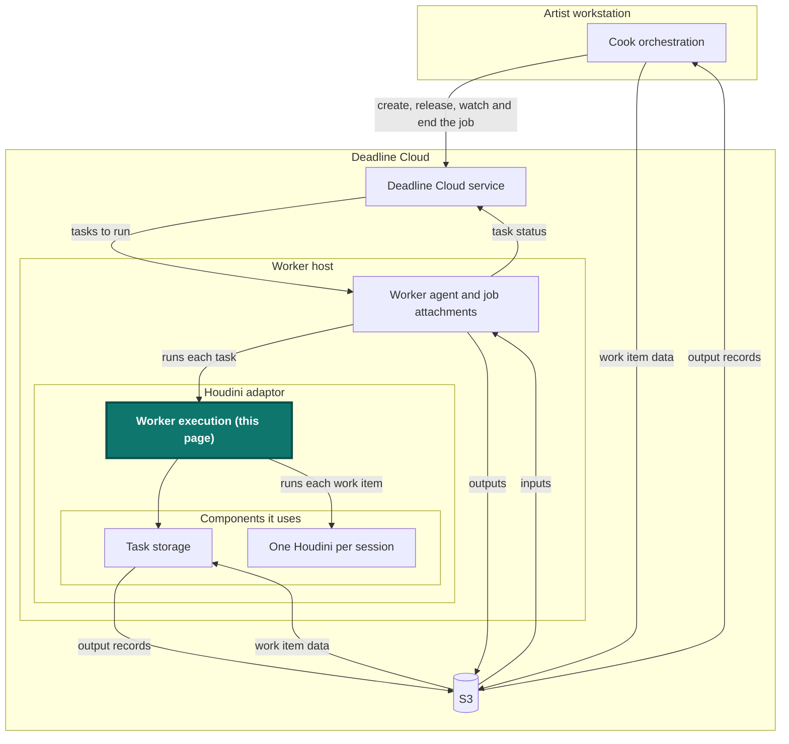
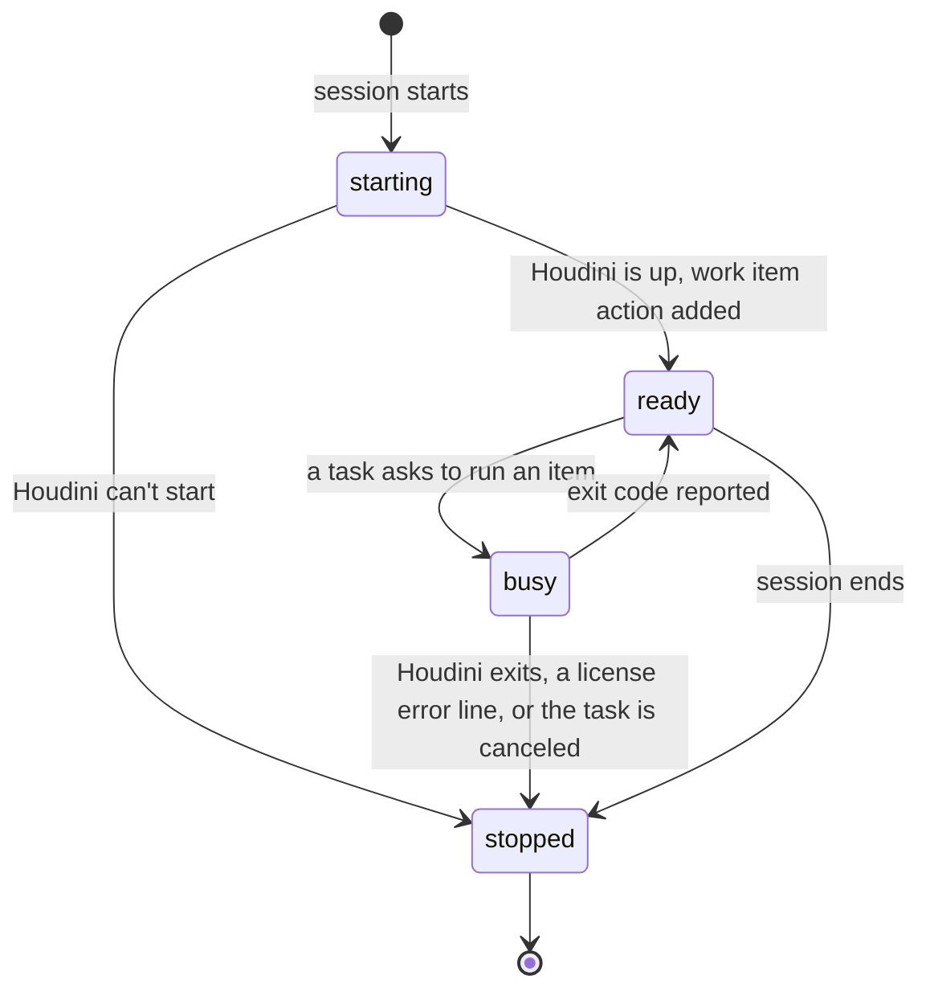
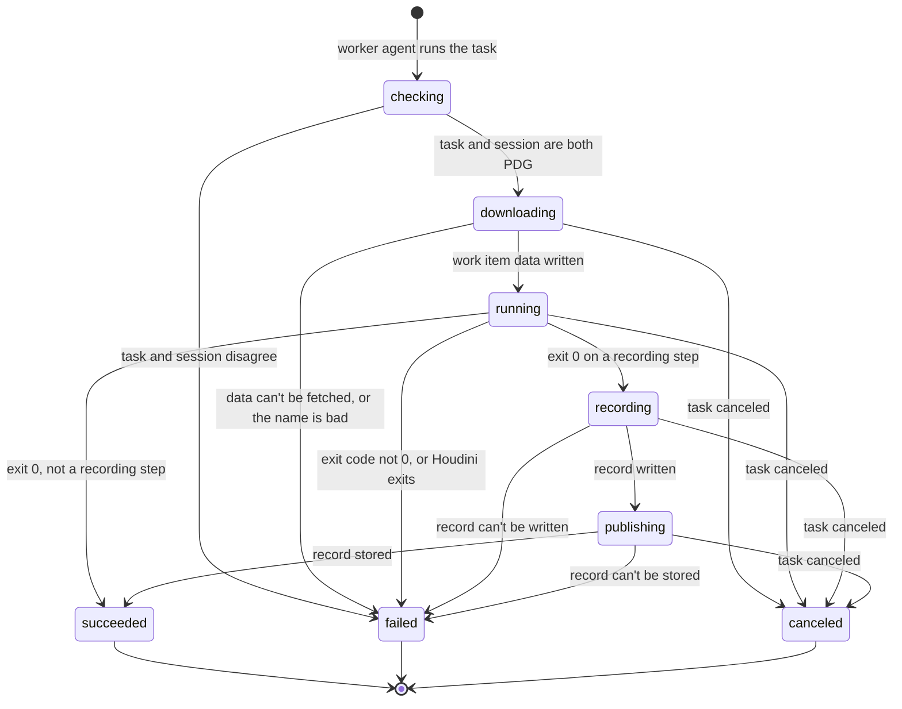
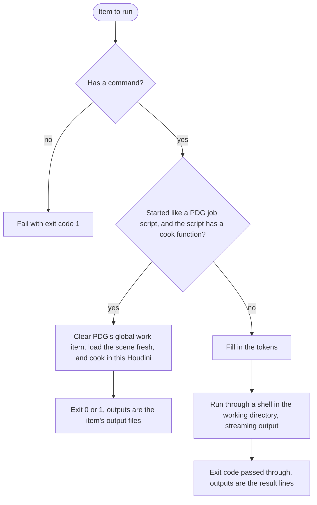
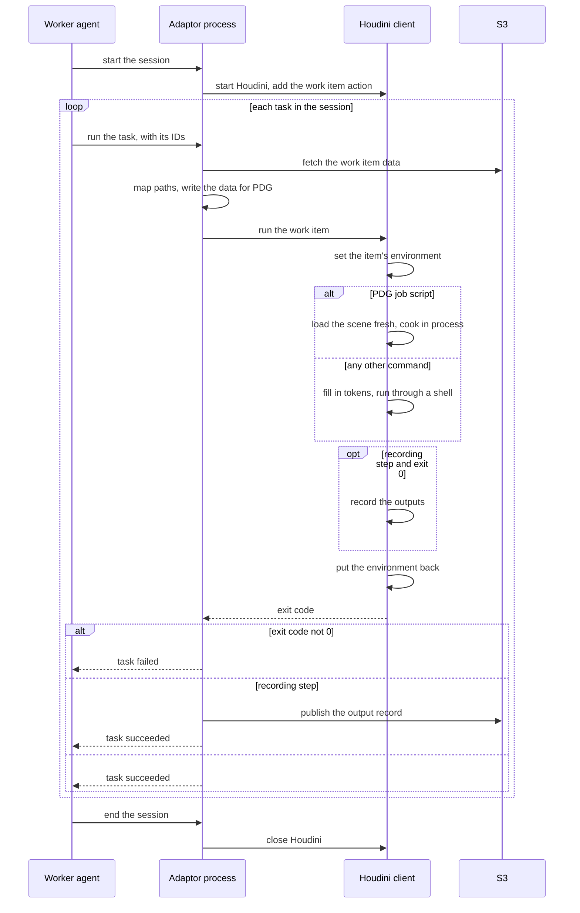

[Back to the overview](../overview.md)

# Worker execution

## TL;DR

- Worker execution runs one PDG work item for each task on the farm, inside the Houdini adaptor.
- One Houdini stays open for the whole worker session and serves every task in it.
- The adaptor fetches the item's work item data from S3, changes its workstation paths to this worker's paths, and hands it to Houdini.
- Houdini runs the item in one of two ways. A command that starts one of PDG's own job scripts is cooked inside the open Houdini, which we call an in-process cook. Any other command runs in a shell.
- The task's outcome is the item's exit code. Each item starts with a clean environment. An in-process cook loads the scene fresh for each item.
- Some steps don't say which files their items write. On those steps, the worker lists what each item wrote and publishes that list, the output record, to S3.

## The problem

- The task Deadline Cloud runs knows only its step and its index. The work item's command, attributes and files are in S3, stored after the job was created.
- Starting Houdini for each task is slow and checks out a license each time. A Houdini kept open between tasks is faster, but it remembers the last item unless something resets it.
- The paths in the work item data are the workstation's. The worker has to use its own.
- PDG's job scripts expect PDG's variables and files to be in place, as if PDG's own scheduler had started them.
- The workstation needs to know what each item wrote, even when the item declared no outputs.

## Where it fits

- Worker execution owns one task on the worker. It starts when the worker agent runs the task and ends when the task's outcome is known.
- In that time it handles the work item data, the item's environment, the command, and the output record.
- Other components do the rest. Task storage reads and writes S3. Job attachments syncs the inputs and outputs. Houdini runs the item.
- Its only link to the workstation is S3 and the task's exit code. It reads the work item data and writes the output record there.

## How it works

Each worker session starts one Houdini, and then every task in the session runs one work item in it.

- **Start the session.** The adaptor starts Houdini once and tells it that this is a PDG session. Houdini saves a copy of its starting environment. It loads no scene yet.
- **Download.** For each task, the adaptor fetches the work item data from S3. It changes the workstation paths in it to this worker's paths. Then it writes the data into the PDG temp folder, where PDG's loader looks for it.
- **Run.** Houdini sets the item's environment. It cooks a PDG job script in process, or runs any other command in a shell. The output streams to the task log.
- **Record.** On a recording step, when the item succeeded, Houdini writes down the files the item wrote. Then it puts the environment back and reports the exit code.
- **Publish.** The adaptor turns the exit code into the task's outcome. On a recording step that succeeded, it also publishes the output record to S3.

Two processes share the work. The adaptor process is the only one that talks to S3. The Houdini client only runs the item, so it never loads the AWS libraries.

### Phases of one task

| Phase | What it means | Where it runs |
| --- | --- | --- |
| Checking | The task data and the session data agree that this is a PDG work item. | Adaptor process |
| Downloading | We're fetching the work item data, mapping its paths and writing it for PDG. | Adaptor process |
| Running | Houdini is running the item, in process or in a shell. | Houdini client |
| Recording | The item exited 0 on a recording step, and we're writing its output record. | Houdini client |
| Publishing | We're storing the output record in S3. | Adaptor process |
| Succeeded | The item exited 0, and any output record is stored. | |
| Failed | The task can't succeed. The error is in the task log. | |
| Canceled | The task was canceled. Houdini is stopped at once, so the session ends. | |

### Terms

| Term | What it means |
| --- | --- |
| Worker session | The worker agent's session on one worker host. It runs every task it's given, from any step in the job, through one Houdini. |
| Session data, task data | The values the job gives the adaptor when the session starts, and again for each task. Each one says whether it's for a PDG work item. |
| Adaptor process | The Houdini adaptor's own process. It talks to S3 and to the worker agent. |
| Houdini client | The Houdini the adaptor keeps open for the session. It runs the work items. |
| Work item data | The work item as PDG saved it on the workstation: its name, command and attributes. |
| Working directory | The cook's working directory, at the path this worker sees, such as `/mnt/work`. Commands run here. |
| PDG temp folder | The folder PDG's loader reads work item data from. When the session sets its own PDG temp folder, that folder is used. Otherwise it's a folder inside the working directory. |
| Path mapping rules | The session's rules for turning a workstation path into this worker's path. Each rule has a source folder and a destination folder, such as `/proj` on the workstation and `/mnt/proj` on the worker. Deadline Cloud gives them to the adaptor. |
| PDG job script | A Python script that ships with Houdini's PDG and has a `cook` function, such as its ROP cooker `rop.py`. PDG starts one with a command of the form `"__PDG_HYTHON__" "__PDG_SCRIPTDIR__/rop.py" json`. |
| In-process cook | Running a PDG job script's `cook` function inside the session's Houdini, instead of starting a new program. |
| PDG's global work item | The work item Houdini reads when it evaluates an attribute in a parm, such as `@wedgenum`. In a Houdini that runs many items, it keeps pointing at the first item loaded until it's cleared. |
| Shell command | Any command that isn't an in-process cook. It runs as a new program through the worker's shell, for example `magick in.png out.jpg`. |
| Token | A placeholder PDG writes into a command, which the machine that runs the command fills in. For example, `__PDG_DIR__/geo/a.bgeo` becomes `/mnt/work/geo/a.bgeo` on the worker. |
| Exported attribute | A work item attribute that PDG marks for export to the environment, and doesn't mark as internal. For example, a `wedgenum` attribute with the value `3` becomes the variable `wedgenum=3`. |
| Result line | A line of a shell command's output that reports one output file. It starts with `PDG_RESULT:`, followed by the output's ID, sub-index, path and tag, separated by `;`. For example, `PDG_RESULT: geo1_5;-1;__PDG_DIR__/geo/a.5.bgeo;file/geo`. Only a line that starts with `PDG_RESULT:` counts. A log line such as `INFO PDG_RESULT: ...` is just log text. |
| Exit code marker | The text Houdini prints, on a line of its own, just before each item's exit code. The adaptor waits for this line to know the item has finished. |
| License error line | A line in Houdini's output saying it couldn't get a license. Houdini stops after it. |
| Recording step | A step where at least one work item didn't say which files it writes, when the graph was read. On a recording step, the worker records what each item wrote. |
| Output record | The list of files a task wrote, each with its tag, stored in S3 for the workstation. |

### The item's environment

Houdini sets these for each item, as PDG's own scheduler would. It adds the exported attributes first, then the variables below. When a name is in both, the value below is used. An exported attribute named like one of the `PDG_*` variables below is dropped, so the `PDG_*` value is always the one set.

| Variable | Value |
| --- | --- |
| `PDG_ITEM_NAME` | The item's name. |
| `PDG_ITEM_ID`, `PDG_INDEX` | PDG's own ID and index for the item, which can differ from the task's index. Set when the work item data has them. |
| `PDG_ITEM_DATA_SOURCE` | `0`, so PDG's loader reads the work item data from the PDG temp folder. |
| `PDG_DIR`, `PDG_OUTPUT_DIR` | The working directory. |
| `PDG_TEMP` | The PDG temp folder. |
| `PDG_SCRIPTDIR` | The folder of PDG's job scripts in this Houdini. When `HFS` isn't known, it's set to an empty value. |
| `HFS` | This Houdini's install folder. Set when Houdini's own environment has it. |
| `HIP` | The folder of the session's scene file. Set when the scene file exists on the worker. |
| `PDG_RESULT_SERVER` | Removed from the environment. PDG's own scheduler uses a result server to hear back from items. Here the workstation learns each outcome from the farm instead. |

## State machine

Worker execution runs two state machines: the worker session, and each task in it. A third diagram shows how a command is run.

### Session states

| State | What it means |
| --- | --- |
| starting | The adaptor is starting Houdini. A PDG session loads no scene here. |
| ready | Houdini waits for the next item. Its environment is the session's starting environment. |
| busy | Houdini is running one item. Items never overlap. |
| stopped | Houdini is gone. A task that was running fails. Every later task in the session also fails. When Houdini can't start, every task in the session fails without running. |

### Per task states

| From | To | When | What happens |
| --- | --- | --- | --- |
| checking | downloading | the task data and the session data are both for PDG | the task's IDs are already in the task data |
| checking | failed | one is for PDG and the other isn't | nothing runs |
| downloading | running | the work item data is fetched, mapped and written | any output record left by an earlier attempt is removed first |
| downloading | failed | the data can't be fetched or read, or it has no usable item name | nothing is written for the item |
| running | recording | the item exits 0 and the step is a recording step | the outputs come from the item, or from a scan |
| running | succeeded | the item exits 0 and the step isn't a recording step | nothing is published |
| running | failed | the item exits with any other code, or any error stops it | the error's traceback is in the task log. Houdini stays up. |
| running | failed | Houdini exits before the item finishes, including after a license error line | the session is stopped |
| downloading, running, recording or publishing | canceled | the task is canceled | Houdini is stopped at once, and the session ends |
| recording | publishing | the record is written, even an empty one | Houdini puts the environment back and reports exit code 0 |
| recording | failed | the outputs can't be scanned or written | the task gets exit code 1 and nothing is published |
| publishing | succeeded | the record is stored in S3 | the workstation reads it when the task succeeds |
| publishing | failed | the record can't be stored | the error is logged |

### How a command runs

- The choice depends only on how the command is written. The node type and the program don't change it.
- A command can look like a PDG job script but name a script PDG doesn't ship, or one with no `cook` function. That command runs through the shell like any other.
- A shell command can start its own Houdini, such as `hython render.py`. That second Houdini needs a second license on the worker. Worker execution itself only ever runs the one session Houdini.

## Invariants

These rules always hold, whatever the implementation does.

### Session

1. One Houdini serves every task of a worker session. Worker execution starts it once, at the start of the session.
2. Work items run only in a session whose session data is for PDG.
3. When the task data and the session data disagree about PDG, the task fails before anything runs.
4. Only the adaptor process reads or writes S3. The Houdini client doesn't load the AWS libraries.
5. Items in a session run one at a time.
6. When Houdini exits, the running task fails. Every later task in that session also fails.
7. A license error line stops Houdini, so it counts as Houdini exiting.
8. When Houdini can't start, every task in the session fails without running.
9. Canceling a task stops Houdini at once, which ends the session.
10. The Houdini client loads the PDG support code by its full `deadline` package name. When only the adaptor's own folders are on its path, it loads the same code by the short top-level name instead.

### Work item data

1. Before the item runs, the work item data is fetched, its paths are mapped, and it's written into the PDG temp folder.
2. Path mapping uses exactly the session's rules, in their order. For each string, the first rule that matches it is used. With no rules, the data stays as it was.
3. A rule first tries to match the whole string as one path.
4. When no rule matches the whole string, each path inside the string is mapped on its own. An example is one argument of a command line. A path inside a string starts after a space, a quote, `=`, `(`, `,` or `;`, and it ends at the next quote or space.
5. A rule maps its source folder and anything under it. A rule for `/proj` maps `/proj/a.bgeo`. It leaves `/project/a.bgeo` as it is, because `/project` is a different folder.
6. Path mapping changes only string values. A string with no rule's source in it stays exactly as it was. The keys of the data stay as they were.
7. The item's name is the work item's name. When that's missing, it's the node name and the item's ID, such as `geo1_5`. When those are missing too, it's the top-level name in the data.
8. The name must be a single file name, such as `geo1_5`. A missing name, or a name like `a/b`, fails the task before anything is written.
9. Before the item runs, any output record left by an earlier attempt of the task is removed. So only this attempt's record can be published.

Here's how path mapping treats each kind of path, with one rule from `/proj` on the workstation to `/mnt/proj` on the worker:

| Kind of path | In the work item data | On the worker |
| --- | --- | --- |
| Plain absolute path | `/proj/geo/a.bgeo` | `/mnt/proj/geo/a.bgeo` |
| Path inside a command line | `magick /proj/in.png --out=/proj/out.jpg` | `magick /mnt/proj/in.png --out=/mnt/proj/out.jpg` |
| Folder that only starts the same way | `/project/geo/a.bgeo` | `/project/geo/a.bgeo`, unchanged |
| Path with a variable or attribute after the source | `/proj/geo/$F4.bgeo` or `/proj/geo/@wedgenum.bgeo` | `/mnt/proj/geo/$F4.bgeo` or `/mnt/proj/geo/@wedgenum.bgeo` |
| Path with a portable prefix | `$HIP/geo/a.bgeo` | `$HIP/geo/a.bgeo`, unchanged |
| Path with a PDG token | `__PDG_DIR__/geo/a.bgeo` | `__PDG_DIR__/geo/a.bgeo`, unchanged. The token is filled in when the command runs. |
| Path with a backtick expression | `` `chs("../outdir")`/a.bgeo `` | unchanged |

### Environment

1. Each item runs with the session's starting environment plus its own values. After the item, the environment is put back, so the next item sees none of these values.
2. PDG's own `PDG_*` variables always keep their values. When an exported attribute has the same name as one of them, the attribute is dropped.
3. The item's own values come from one place. When the work item data has a non-empty environment block, that block is used. Otherwise the exported attributes are used.
4. A file attribute, one whose values are files, is never put in the environment.
5. Values are written as PDG writes them. An integer is written as an integer, such as `1`. A float keeps its decimal point, such as `0.0`. An attribute with several components has them joined by spaces, such as `1 2 3`.
6. A malformed attribute doesn't stop the item. An attribute with a bad flag is left out. A value that doesn't fit its type is exported as written.
7. The session's scene file is linked into the working directory, because the work item's scene attribute points there. When the link can't be made, the item still runs and the log shows a warning.

### Running

1. A command written like a PDG job script, whose script ships with PDG and has a `cook` function, is cooked inside the session's Houdini.
2. Any other command runs through a shell in the working directory.
3. Before each in-process cook, PDG's global work item is cleared and the item's scene is loaded fresh. So each item sees only its own attributes and cooked data.
4. Before a shell command runs, each known token in it is replaced with this worker's value. For example, `__PDG_DIR__` becomes the working directory.
5. The result server token, `__PDG_RESULT_SERVER__`, becomes empty.
6. An unknown token, such as `__PDG_FOO__`, stays as written. So if the command fails because of it, the error names the token.
7. The Python tokens use the Python of the session's Houdini. These are `__PDG_PYTHON__` and the Python version inside `__PDG_SCRIPTDIR__`. The adaptor's own Python isn't used.
8. The command's output reaches the task log line by line, as it's written.
9. A job script must not print the exit code marker at the start of a line.
10. When a shell command prints a line that starts with the exit code marker, the line is prefixed before it reaches the log. So the command's output can't end the task early.
11. The adaptor treats the task as finished when the item has finished in Houdini, or when Houdini exits.

### Outcome

1. A shell command's exit code is the task's outcome, unchanged.
2. An in-process cook gives exit code 0 when it succeeds and 1 when it fails.
3. An error while running or recording an item fails that task with exit code 1. The traceback goes to the task log before the exit code. Houdini stays up for the next task.
4. A task succeeds only with exit code 0. With any other exit code, the task fails and publishes nothing.

### Outputs

1. Outputs are recorded only on a recording step, and only when the item exited 0.
2. A shell command's outputs are the files it names in result lines, in the order it printed them.
3. A result line needs at least three fields and a path. A result line with fewer fields, or with an empty path, adds no file.
4. An output's tag is kept as the item reported it, such as `file/geo`. An empty tag lets PDG pick the tag from the file's extension.
5. An in-process cook's outputs are the output files on the work item after the cook.
6. When an item reports no outputs, the worker scans the working directory for files written since the item started. Inputs that were synced before the task started are older, so they aren't recorded.
7. The scan skips hidden files and folders, such as `.cache`. It also skips the PDG temp folder and the linked scene file.
8. The scan doesn't follow folder links. Its list is sorted, so the same files always give the same list.
9. The scan also covers the folders listed in the node's Output Directories parm, at this worker's path. Files found there are recorded by the workstation's path. For example, the node lists `/proj/renders`, the worker sees it as `/mnt/proj/renders`, and `/mnt/proj/renders/a.exr` is recorded as `/proj/renders/a.exr`.
10. A scanned folder that doesn't exist gives no outputs.
11. A scanned folder that exists but can't be read fails the item. So a record is never a partial list.
12. A path under the working directory is recorded with the `__PDG_DIR__` token in place of the working directory. The cook on the workstation fills the token in with its own path, on any OS. For example, with the working directory `/mnt/work`:
    - `/mnt/work/geo/a.bgeo` is recorded as `__PDG_DIR__/geo/a.bgeo`.
    - `/mnt/work2/a.bgeo` is recorded as it is, because `/mnt/work2` is a different folder.
13. On a recording step, an item that exited 0 always publishes a record, even an empty one.
14. When the record can't be written or stored, the task fails.

## Sequence and errors

| Case | What worker execution does | The task | What you see in the task log |
| --- | --- | --- | --- |
| The task data and the session data disagree about PDG | runs nothing | fails | an error that names the mismatch |
| The work item data can't be fetched or read | writes nothing | fails | the storage error |
| The work item data has no name, or a name that isn't a single file name | writes nothing | fails | an error naming the problem |
| The work item data has no command | puts the environment back, keeps Houdini up | fails with exit code 1 | a traceback, then the exit code |
| A shell command exits with a code other than 0 | publishes nothing | fails with that code | the command's output, then the exit code |
| A job script's cook fails or raises | publishes nothing | fails with exit code 1 | the job script's output and traceback |
| Loading the scene ahead of the job script fails | leaves the load to the job script | goes on | a warning |
| The scene file is missing or can't be read | leaves it to the job script, which reports it | goes on | no warning from the worker |
| The scene can't be linked into the working directory | goes on, because the variables still name the scene | goes on | a warning |
| A scanned folder exists but can't be read, or the record can't be written | publishes nothing | fails with exit code 1 | a traceback, then the exit code |
| The output record can't be stored in S3 | logs it | fails | the storage error |
| Houdini exits before the item finishes, including after a license error line | stops the session | fails, and so does every later task in the session | an error that Houdini exited, or a license error with guidance |
| Houdini can't start, or its start action fails | runs no task | every task in the session fails | the start error |
| The task is canceled | stops Houdini at once, which ends the session | is canceled | the cancel request |

## Where it lives

- Work item runner, download and publish: `src/deadline/houdini_adaptor/pdg_actions.py`
- Adaptor process, the PDG session and each task: `src/deadline/houdini_adaptor/HoudiniAdaptor/adaptor.py`
- Task IDs added to the task's data: `src/deadline/houdini_adaptor/HoudiniAdaptor/__main__.py`
- Houdini client actions: `src/deadline/houdini_adaptor/HoudiniClient/houdini_client.py`
- Session and task data schemas: `src/deadline/houdini_adaptor/HoudiniAdaptor/schemas/init_data.schema.json` and `run_data.schema.json`

The job's session environment starts the adaptor once per worker session, and each step runs every task through it.

[Back to the overview](../overview.md)
