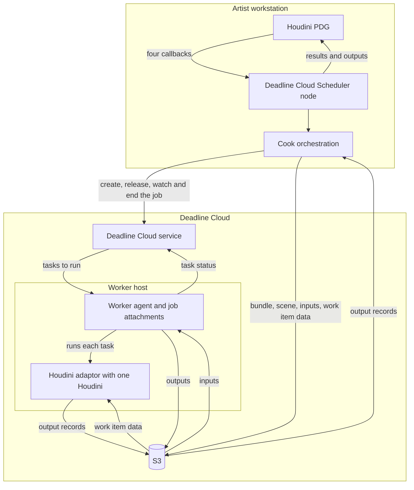
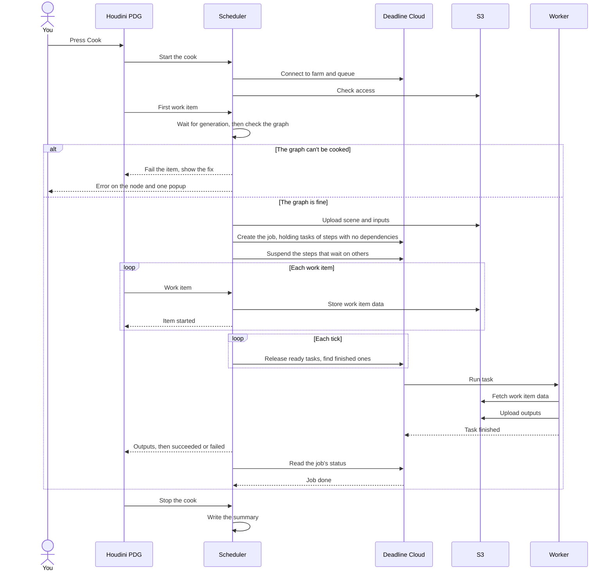

# Houdini PDG on Deadline Cloud

## TL;DR

- You press Cook on a TOP network (a graph of Houdini PDG nodes), and it runs as one Deadline Cloud job on your farm.
- A worker is a farm machine that runs tasks. A job script is the script that cooks one work item, such as PDG's ROP cooker.
- Each TOP node that runs a job script on a worker becomes a step in the job. A step is a group of tasks that run the same job script.
- Each work item becomes a task, one unit of work on the farm.
- Each TOP wire becomes a step dependency. A node that reads a file another node writes also gets a step dependency, even with no wire between them.
- The scheduler is the Deadline Cloud Scheduler TOP node. It checks the network before it uploads anything. When it can't cook a network, it names the node and the fix.
- Every task waits until the scheduler releases it. The scheduler releases a task once its work item data is stored and every step it waits on has succeeded.
- On the worker, the Houdini adaptor is the Deadline Cloud program that runs Houdini. It keeps one Houdini open for each session, one worker's run of tasks from the job, and cooks each work item in it.
- Files move between steps with job attachments, Deadline Cloud's way of moving files through S3.
- Your Houdini checks the farm on a regular interval and reports each result back to PDG. Keep Houdini open until the cook ends.

The cook itself, with its full state machine, is in [Cook orchestration](components/cook-orchestration.md).

## Problem

You build a TOP network, say a wedge of simulations that feeds a render and an encode. You want to press Cook and have the work run on your Deadline Cloud farm instead of your own machine, with the network's dependencies kept.

We add a TOP scheduler node, **Deadline Cloud Scheduler (Experimental)**, that does exactly that. You cook from the Houdini UI as usual. The node cooks TOP networks whose work items are all known before the cook starts, and it moves files between steps with job attachments.

## Background: how Houdini PDG works

PDG (Procedural Dependency Graph) is the Houdini engine that cooks a TOP network. Here's only what you need for this spec.

| Term | What it is |
|---|---|
| TOP network | A graph of TOP nodes. |
| TOP node | One node in the graph. Some run a job script on a worker for each work item (ROP Fetch, ROP Geometry Output). Others only make or regroup work items and run nothing (Wedge, partitioners such as Wait for All). Only nodes that run a job script on a worker become steps. |
| Work item | One unit of work on a node, such as one frame or one wedge. It has attributes, a command, and the input and output files it expects. |
| Scheduler node | A TOP node that decides where work items run. PDG talks to it through four callbacks, functions PDG calls at fixed points in a cook. |

A few more PDG ideas the scheduler depends on:

- **In-process vs out-of-process.** A node's Cook Type says where its items run. Out-of-Process items go to the scheduler. In-Process items cook inside your Houdini and never reach the scheduler, so every step that runs on the farm must be Out-of-Process.
- **Static vs dynamic.** A static node makes all its work items before the cook runs. A dynamic node makes them while it runs. A job's tasks must be known when the job is created, so the scheduler cooks static networks.
- **Generate vs cook.** A generate only makes work items. A cook runs them. The scheduler creates a job for a cook and never for a generate.

The scheduler handles these four PDG callbacks:

| Callback | What PDG means | What the scheduler does |
|---|---|---|
| `onStartCook` | A cook or a generate is starting. | For a generate, it only sets the working directory. For a cook, it checks the nodes and wires, and connects to your farm and queue. It checks that it can reach the queue's job attachments bucket in S3, and sets the working directory. If the network can't be cooked, it tells PDG not to start. |
| `onSchedule` | Here's one ready work item. | On the first item, it waits for PDG to finish generating, checks the whole graph, and creates the job. On every item, it stores the item's data and queues its task for release. Then it tells PDG the item started. |
| `onTick` | Called often while the cook runs. Each call is a tick. | On a regular interval, it checks the farm, releases ready tasks and reports finished items. It ends the cook when the job can't go on. |
| `onStopCook` | The cook ended, or you canceled. | On cancel, it cancels the job. It writes a cook summary and sends one telemetry event. |

## How it works

Your Houdini turns the whole cook into one Deadline Cloud job, then feeds that job work item by work item while workers on the farm run the tasks.

- **You press Cook.** The scheduler connects to your farm and queue, then waits for PDG to offer the first work item.
- **The graph is checked once.** On the first work item, the scheduler reads the whole graph and checks it. If it can't be cooked, the scheduler stops with the fix before anything is uploaded.
- **One job is created.** The scheduler uploads the scene and inputs and creates the job. The job is created with the tasks of steps that have no dependencies on hold, so they wait. Then the scheduler suspends each step that waits on others, so its tasks wait too.
- **Tasks are released when they're ready.** For each work item, the scheduler stores the work item data in S3. It releases the item's task once every step it waits on has succeeded.
- **Workers run them, and results go back to PDG.** A worker runs each task in Houdini. On each tick, the scheduler finds finished tasks and tells PDG each item's outputs and result.

## Approach

- **One cook is one job.** A TOP node that runs a job script on a worker is a step. A work item is a task, and a TOP wire is a step dependency.
- **Scene reads add dependencies.** A step also depends on any step whose outputs its scene reads, even with no wire. For example, a ROP Fetch step renders a scene whose File SOP reads `$HIP/geo/a.bgeo`, and a ROP Geometry Output step writes that file.
- **Create the job at the first work item.** PDG hasn't generated the graph before then. On the first item, the scheduler reads the graph, checks it, builds the job bundle, and creates the job. The job bundle is the job template and the files it needs.
- **Check before you upload.** The scheduler checks the graph before any upload and names every problem at once. A lighter check of the network's shape runs when the cook starts.
- **Hold every task, then release it.** The job is created with the tasks of steps that have no dependencies on hold. The scheduler then suspends each step that waits on others. So every task waits until it's released.
- **Release a task when it's ready.** The scheduler releases a task when its work item data is stored and every step it waits on has succeeded.
- **Work item data goes to S3, not into the bundle.** PDG only has an item's data when it hands the item over, which is after the job exists. So the scheduler stores the data in S3, under a key built from the task's IDs.
- **The worker records outputs a step doesn't declare.** Some work items don't say which files they write. On a step with such an item, the worker also writes an output record to S3, the list of files the task wrote.
- **Files move between steps with job attachments.** The working directory is a job output, and so are the folders listed in the node's Output Directories parm. The outputs stay in S3, and the scheduler downloads none of them to your workstation.
- **The worker runs inside the Houdini adaptor.** One Houdini per worker session serves every task. A stock PDG job script cooks in that Houdini, and any other command runs in a shell.
- **Your Houdini follows the farm.** On each tick, it checks the farm, reports finished tasks to PDG, and ends the cook when the job can't go on.

## Architecture

Your Houdini and the worker never talk to each other directly. They meet only in S3 (work item data and output records) and in task status on Deadline Cloud.

Read the diagram top to bottom. Your workstation creates and drives the job, and the worker only talks to S3 and the worker agent.

## Components

| Component | What it's responsible for | Runs on |
|---|---|---|
| [Scheduler node and UI](components/scheduler-node.md) | The node type, its parameters, help and Tab menu entry. A Submit button, and Farm and Queue menus. Picking a farm or queue saves it as your workstation default. | Workstation |
| [Callback handling](components/scheduler-node.md) | Sets up one cook when PDG starts it and passes PDG's four callbacks on. Shows errors on the node and in one popup. | Workstation |
| [Graph mapping](components/graph-synthesis.md) | Turns TOP nodes and work items into steps, tasks and dependencies. | Workstation |
| [Scene reads](components/graph-synthesis.md) | Finds the files each node's scene reads and which step writes them, so it can add dependencies that have no wire. | Workstation |
| [Validation](components/validation.md) | Checks the graph before upload. Stops the cook with a clear message, or adds warnings. | Workstation |
| [Submission](components/submission.md) | Builds the job template, parameter values and the list of files to upload, then creates the job. | Workstation |
| [Task storage](components/task-storage.md) | Stores the work item data for each item and each task's output record in S3. | Workstation and worker |
| [Cook orchestration](components/cook-orchestration.md) | Runs one cook's phases: creating the job, releasing tasks, and reporting results to PDG. | Workstation |
| [Farm job](components/cook-orchestration.md) | Talks to Deadline Cloud for a running job: suspends and releases tasks, finds finished tasks, reads job status, and ends the job. | Workstation |
| [Diagnostics](components/diagnostics.md) | Keeps a debug folder per cook with a log, the graph it read, and the job bundle as submitted. Sends one telemetry event per cook, and honors opt-out. | Workstation |
| [Worker execution](components/worker-execution.md) | Fetches the work item data, runs it in Houdini or a shell, records outputs, and publishes the output record. | Worker |
| [Installer](components/packaging-and-install.md) | Ships the scheduler with the ROP submitter, turned off. You turn it on in the switch file and restart Houdini. | Workstation |
| [Adaptor package](components/packaging-and-install.md) | Puts the Houdini adaptor and the PDG support onto workers. | Worker |

## Data flow

One cook from start to end. Solid arrows are calls and dashed arrows are replies.

- When the graph check stops the cook, it stops before any upload, so no job is created.
- A task is released only after its data is stored and all the steps it depends on have succeeded.
- If the job fails or is canceled, every open work item fails in PDG.
