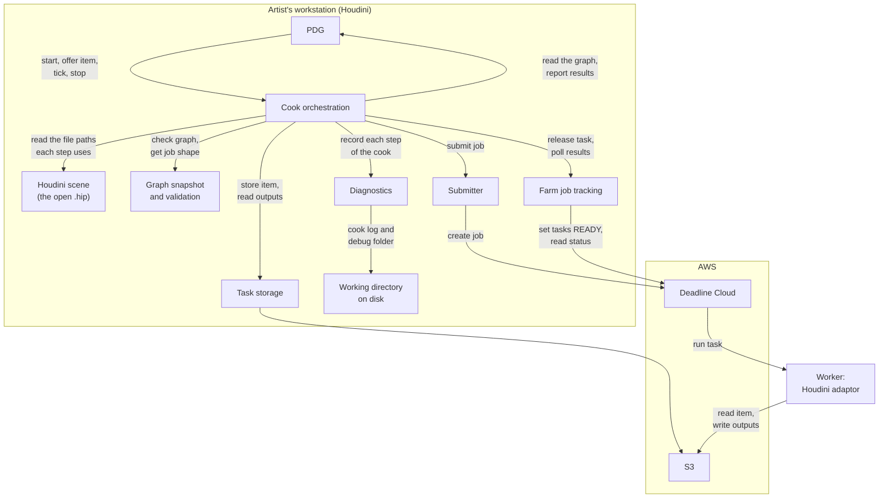
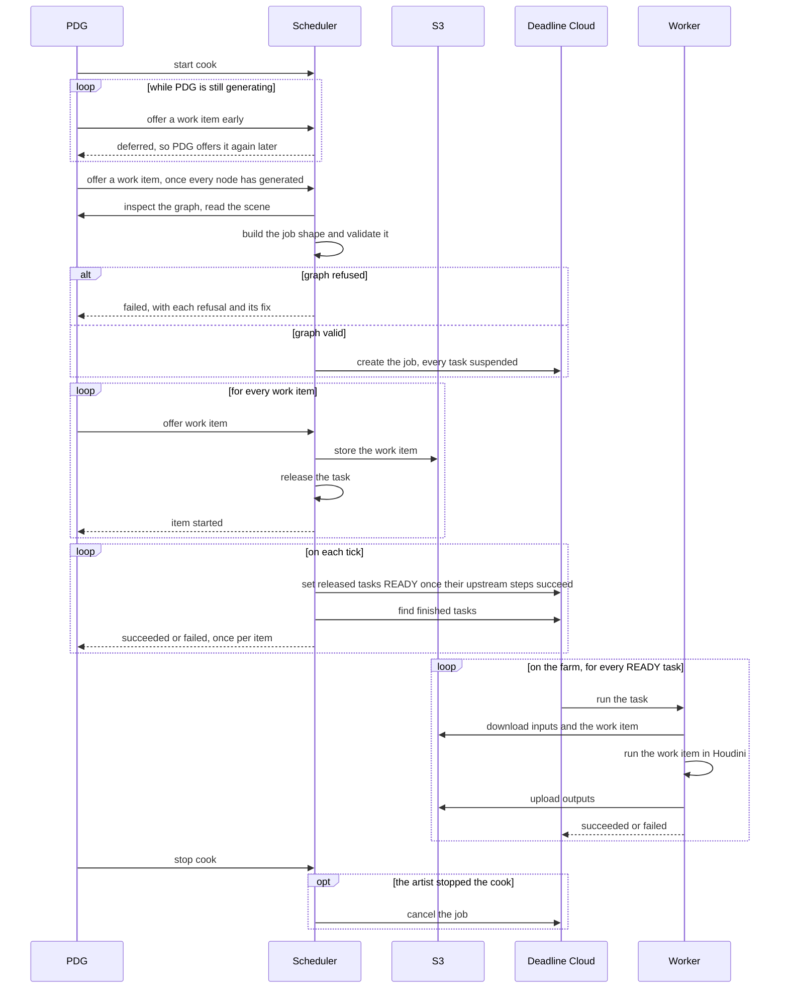

# Overview: cooking Houdini PDG networks on AWS Deadline Cloud

## TLDR

The Deadline Cloud PDG scheduler lets an artist cook a Houdini TOP network on a Deadline Cloud farm. Each cook becomes one Deadline Cloud job: every TOP node that runs a command becomes a step, and every work item becomes a task. PDG creates work items while it cooks, but Deadline Cloud needs every task when the job is submitted. The scheduler therefore waits until PDG has generated the graph, checks that the graph can run on the farm, and submits the whole job with every task suspended. As PDG hands it each work item, the scheduler stores the item in S3 and lets its task run once the steps it depends on have finished. Workers run the items in Houdini, and the scheduler reports each result back to PDG.

## Problem

Houdini artists describe multi-stage work, such as simulating, caching, rendering and encoding a video, as a PDG TOP network. Deadline Cloud cannot run a TOP network today, because PDG generates work items during the cook and hands them out one at a time, while a Deadline Cloud job must describe all of its tasks when it is submitted. Running a TOP network on Deadline Cloud therefore requires a scheduler on the artist's workstation that acts as an adapter between PDG and Deadline Cloud.

## Background

### PDG

- A **TOP network** is a graph of TOP nodes connected by wires. Each node generates **work items**, and PDG then cooks them.
- A work item is one unit of work, such as rendering one frame. Some nodes, such as Wedge, run nothing themselves and only create or group work items.
- A **scheduler** decides where work items run. PDG offers each work item to the scheduler once it is ready to run, and the scheduler reports back whether it succeeded.

### Deadline Cloud

- A **job** is represented by an OpenJD template, which defines the job's **steps**, the **tasks** in each step, and the dependencies between steps.
- A task can be **suspended**, in which case it does not run until it is set READY.
- **Job attachments** move files through S3. A task receives the job's input files and the outputs of the steps it depends on.

### How a TOP network maps to a job

| TOP network | Deadline Cloud job |
|---|---|
| A node that runs a command | A step |
| A node that runs nothing | Nothing. Dependencies pass through it. |
| A work item | A task |
| A wire | A step dependency |
| A node that reads a file another step writes | A step dependency, so the task receives the file |

## Block diagram

## Sequence diagram

A successful cook, from the artist starting the cook to the cook ending.

